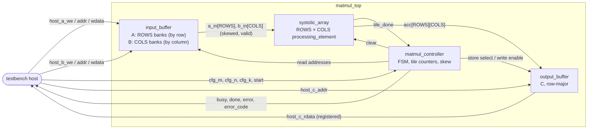

# INT8 matmul accelerator: architecture contract (matmul-os-r1)

This document fixes the decisions every Project 3 RTL, verification and report ticket builds to: the numerics, the parameters and names, the output-stationary dataflow and its timing, tiling, the buffers and the host port, and the start/busy/done handshake. A ticket that needs to change one of them says so in its pull request and updates this document in the same change.

The design is `matmul-os-r1` (matmul, output-stationary, revision 1), recorded in [hardware/accelerators/matmul/REVISION](../../../hardware/accelerators/matmul/REVISION). The bit-exact reference every RTL test is compared against is [@vcpu/accelerator-reference](../../../packages/accelerator-reference/src/model/matmul.ts).

## What it computes

C = A × B, with A an M × K matrix, B a K × N matrix and C an M × N matrix:

C[i, j] = Σk = 0 … K−1 A[i, k] · B[k, j]

M, N and K are each 1 … `MAX_DIM` (64), independently: non-square and non-multiple-of-the-array sizes (for example 13 × 19 · 19 × 11) are the normal case, not a special one.

## Numerics

| Quantity    | Type                                       | Range                                 |
| ----------- | ------------------------------------------ | ------------------------------------- |
| A, B        | signed INT8, `logic signed [DATA_W-1:0]`   | −128 … 127                            |
| A · B       | signed INT16 (`PROD_W` = 16), always exact | −16 256 … 16 384                      |
| accumulator | signed INT32, `logic signed [ACC_W-1:0]`   | −2³¹ … 2³¹ − 1, two's-complement wrap |

- **Signed everywhere.** Operands are declared `signed`, products are sign-extended to the accumulator width before the add, and no expression mixes signed and unsigned operands (which would make SystemVerilog evaluate it unsigned).
- **Overflow wraps.** An accumulator that passes 2³¹ − 1 or −2³¹ wraps around (two's complement), the natural behaviour of a 32-bit adder. The reference computes each MAC exactly in a JS double and wraps with `| 0` after every one, which is bit-identical. Because wrap-around is modular, the wrapped result equals the exact sum reduced modulo 2³², whatever the order of the additions.
- **Overflow is never accidental.** With `MAX_DIM` = 64 an r1 result is at most 64 · 16 384 = 2²⁰ in magnitude, so no r1 workload can overflow. The semantics still matter: the processing element has no K limit, so its unit test drives enough MACs to wrap, and the reference's own tests do the same with a larger `maxDim`. Every test vector's sidecar records `fitsInt32` (did the exact result fit?) and `maxAbsExact`, so a test that overflows says so.
- **One MAC** is one multiply plus one accumulate. Every report counts MACs (M · N · K per matmul) and says so; where a report quotes operations it states that one MAC is two operations.

## Parameters and names

| Parameter | Default | Meaning                                                                  |
| --------- | ------- | ------------------------------------------------------------------------ |
| `ROWS`    | 4       | Processing-element rows of the array (the M dimension of an output tile) |
| `COLS`    | `ROWS`  | Processing-element columns (the N dimension of an output tile)           |
| `DATA_W`  | 8       | Operand width                                                            |
| `ACC_W`   | 32      | Accumulator width                                                        |
| `MAX_DIM` | 64      | The largest M, N or K; buffer depths derive from it                      |

`DATA_W`, `PROD_W`, `ACC_W`, `MAX_DIM` and `CFG_W` (16, the width of the `cfg_*` ports) are also `localparam`s of [rtl/matmul_pkg.sv](../../../hardware/accelerators/matmul/rtl/matmul_pkg.sv), which holds the `error_code_t` and `ctrl_state_t` enums too.

The three required configurations, 4 × 4, 8 × 8 and 16 × 16, are one RTL with `ROWS` = `COLS` = 4, 8 or 16: Verilator builds them with `-GROWS=… -GCOLS=…` and Yosys with `chparam`. The make variable `ROWS` (and `COLS`, defaulting to `ROWS`) selects the size, and every per-size build directory carries it as a suffix (`build/sim-8x8/`, `build/synth-16x16/`). r1 requires `ROWS` and `COLS` to be powers of two no larger than `MAX_DIM`, so the buffer banks are selected by address bits.

Module names equal file names, one module per file in `hardware/accelerators/matmul/rtl/`:

| Module               | Role                                                                                                       |
| -------------------- | ---------------------------------------------------------------------------------------------------------- |
| `processing_element` | One MAC cell: registers and forwards its operands, accumulates into INT32                                  |
| `systolic_array`     | `ROWS` × `COLS` processing elements, wired as the dataflow below, and `tile_done`                          |
| `input_buffer`       | A and B storage, written by the host port, banked for one A element per row and one B per column per clock |
| `output_buffer`      | C storage, written one element per clock during STORE, read by the host port                               |
| `matmul_controller`  | The FSM: configuration, dimension checks, tile scheduling, skew, accumulator clears, stores, handshake     |
| `matmul_top`         | The accelerator: the controller, the buffers and the array, with the host port                             |

## Clock and reset

One clock, `clk`, and one synchronous active-high reset, `rst`. All state is in `always_ff`; every `always_comb` assigns defaults first, so nothing infers a latch. `rtl/` holds synthesizable code only: no `initial`, `#` delays, `$display` or `$finish`. Reset clears control state (FSM, valid bits, counters, flags); the buffer contents are not reset (RAM inference needs that), and neither are operand registers whose valid bit is clear.

## Block diagram

## Interfaces

### `matmul_top`

| Port           | Dir | Width              | Meaning                                                                                             |
| -------------- | --- | ------------------ | --------------------------------------------------------------------------------------------------- |
| `clk`          | in  | 1                  | The clock                                                                                           |
| `rst`          | in  | 1                  | Synchronous active-high reset                                                                       |
| `cfg_m`        | in  | `CFG_W` (16)       | M, sampled on `start`                                                                               |
| `cfg_n`        | in  | 16                 | N, sampled on `start`                                                                               |
| `cfg_k`        | in  | 16                 | K, sampled on `start`                                                                               |
| `start`        | in  | 1                  | One-clock pulse: run one matmul. Ignored while `busy`                                               |
| `busy`         | out | 1                  | High from the clock after an accepted `start` until `done`                                          |
| `done`         | out | 1                  | One-clock pulse when C is complete in `output_buffer`                                               |
| `error`        | out | 1                  | Level: the last `start` had an invalid configuration. Cleared by the next `start`                   |
| `error_code`   | out | `error_code_t` (2) | `ERR_NONE`, `ERR_DIM_ZERO` (a dimension is 0), `ERR_DIM_TOO_LARGE` (a dimension is above `MAX_DIM`) |
| `host_a_we`    | in  | 1                  | Write `host_a_wdata` to A at `host_a_addr`                                                          |
| `host_a_addr`  | in  | `ADDR_W` (12)      | A[i, k] is at i · `MAX_DIM` + k                                                                     |
| `host_a_wdata` | in  | 8, signed          | The A element                                                                                       |
| `host_b_we`    | in  | 1                  | Write `host_b_wdata` to B at `host_b_addr`                                                          |
| `host_b_addr`  | in  | 12                 | B[k, j] is at k · `MAX_DIM` + j                                                                     |
| `host_b_wdata` | in  | 8, signed          | The B element                                                                                       |
| `host_c_addr`  | in  | 12                 | C[i, j] is at i · `MAX_DIM` + j                                                                     |
| `host_c_rdata` | out | 32, signed         | C at the `host_c_addr` of the previous clock (registered read, one clock of latency)                |

`ADDR_W` = log₂(`MAX_DIM`²) = 12. Every matrix is row-major with a fixed row stride of `MAX_DIM`, whatever the configured K or N, so an address splits into a row and a column by bit-slicing and the banks need no division. The host writes A and B and reads C only while `busy` is low; a host write while `busy` is high is ignored.

### `systolic_array`

| Port         | Dir | Width                | Meaning                                                                                  |
| ------------ | --- | -------------------- | ---------------------------------------------------------------------------------------- |
| `clk`, `rst` | in  | 1                    |                                                                                          |
| `clear`      | in  | 1                    | Zero every accumulator (tile start)                                                      |
| `a_in`       | in  | `ROWS` × 8, signed   | Row i's operand, entering PE(i, 0)                                                       |
| `a_valid`    | in  | `ROWS`               | Row i's operand is valid                                                                 |
| `b_in`       | in  | `COLS` × 8, signed   | Column j's operand, entering PE(0, j)                                                    |
| `b_valid`    | in  | `COLS`               | Column j's operand is valid                                                              |
| `acc`        | out | `ROWS` × `COLS` × 32 | Every accumulator, PE(i, j) at index i · `COLS` + j                                      |
| `tile_done`  | out | 1                    | One-clock pulse in the first clock in which every accumulator holds the tile's final sum |

### `processing_element`

| Port                   | Dir | Width | Meaning                                                           |
| ---------------------- | --- | ----- | ----------------------------------------------------------------- |
| `clk`, `rst`           | in  | 1     | `rst` clears the accumulator and both valid bits                  |
| `clear`                | in  | 1     | Zero the accumulator; takes priority over a MAC in the same clock |
| `a_in`, `a_valid_in`   | in  | 8 + 1 | Operand from the left                                             |
| `b_in`, `b_valid_in`   | in  | 8 + 1 | Operand from above                                                |
| `a_out`, `a_valid_out` | out | 8 + 1 | `a_in` and `a_valid_in` registered: one clock later, to the right |
| `b_out`, `b_valid_out` | out | 8 + 1 | `b_in` and `b_valid_in` registered: one clock later, downwards    |
| `acc`                  | out | 32    | The accumulator register                                          |

A processing element accumulates, `acc <= acc + a_in · b_in`, in a clock where both `a_valid_in` and `b_valid_in` are high, and holds `acc` otherwise. Its operand registers forward every clock, valid or not, so the array has no stalls: it is a **no-stall architecture**, with no back-pressure inside the array. The controller never starts a tile before the previous one has drained.

## Output-stationary dataflow

Each processing element PE(i, j) holds C[i, j] of the current output tile in its accumulator for the whole tile; only the operands move.

- **A moves right.** Row i of the tile's A enters PE(i, 0) and moves one PE to the right per clock.
- **B moves down.** Column j of B enters PE(0, j) and moves one PE down per clock.
- **Skew.** The controller delays row i by i clocks and column j by j clocks: in tile clock t it presents A[i, t − i] on row i and B[t − j, j] on column j (valid only for 0 ≤ t − i < K and 0 ≤ t − j < K). A value presented at the edge in clock t reaches PE(i, j) in clock t + j (A) or t + i (B), so PE(i, j) multiplies **A[i, k] by B[k, j] in clock k + i + j** of the tile: the matching pair always arrives together.
- **Completion.** PE(i, j) performs its last MAC (k = K − 1) in clock K − 1 + i + j, and its accumulator holds C[i, j] from the next clock. The far corner PE(`ROWS`−1, `COLS`−1) is last: its final MAC is in clock K + `ROWS` + `COLS` − 3, and **`tile_done` pulses in clock K + `ROWS` + `COLS` − 2**, the first clock in which every accumulator is final. A tile's array phase therefore lasts K + `ROWS` + `COLS` − 2 clocks: K clocks of streaming, `ROWS` + `COLS` − 2 clocks of pipeline fill and drain.
- **Not all at once.** PEs on the same anti-diagonal (equal i + j) start, compute and finish together; a PE `d` anti-diagonals from the corner starts `d` clocks later. Nothing assumes every PE has valid operands in the same clock.

### A 4 × 4 tile with K = 3, clock by clock

Clock 0 is the first tile clock, in which A[0, 0] and B[0, 0] are at PE(0, 0). "–" is an invalid (bubble) input; the controller holds `a_valid` / `b_valid` low there. The number in brackets is how many PEs of that anti-diagonal do a MAC.

| Clock | Row inputs A (row 0…3) | Column inputs B (col 0…3) | MACs this clock: PE(i, j) uses k = t − i − j   | Active PEs | Accumulators final at end of clock |
| ----: | ---------------------- | ------------------------- | ---------------------------------------------- | ---------: | ---------------------------------- |
|     0 | A[0,0] – – –           | B[0,0] – – –              | i+j=0: k=0 (1)                                 |          1 | –                                  |
|     1 | A[0,1] A[1,0] – –      | B[1,0] B[0,1] – –         | i+j=0: k=1 (1); i+j=1: k=0 (2)                 |          3 | –                                  |
|     2 | A[0,2] A[1,1] A[2,0] – | B[2,0] B[1,1] B[0,2] –    | i+j=0: k=2 (1); i+j=1: k=1 (2); i+j=2: k=0 (3) |          6 | i+j=0                              |
|     3 | – A[1,2] A[2,1] A[3,0] | – B[2,1] B[1,2] B[0,3]    | i+j=1: k=2 (2); i+j=2: k=1 (3); i+j=3: k=0 (4) |          9 | i+j=1                              |
|     4 | – – A[2,2] A[3,1]      | – – B[2,2] B[1,3]         | i+j=2: k=2 (3); i+j=3: k=1 (4); i+j=4: k=0 (3) |         10 | i+j=2                              |
|     5 | – – – A[3,2]           | – – – B[2,3]              | i+j=3: k=2 (4); i+j=4: k=1 (3); i+j=5: k=0 (2) |          9 | i+j=3                              |
|     6 | – – – –                | – – – –                   | i+j=4: k=2 (3); i+j=5: k=1 (2); i+j=6: k=0 (1) |          6 | i+j=4                              |
|     7 | – – – –                | – – – –                   | i+j=5: k=2 (2); i+j=6: k=1 (1)                 |          3 | i+j=5                              |
|     8 | – – – –                | – – – –                   | i+j=6: k=2 (1)                                 |          1 | i+j=6 (PE(3, 3), the corner)       |
|     9 | – – – –                | – – – –                   | none                                           |          0 | all: `tile_done` pulses            |

The edge inputs stop after clock K + `ROWS` − 2 = 5 (A) and K + `COLS` − 2 = 5 (B); clocks 6 to 8 only drain operands already inside the array. The 48 MACs (4 · 4 · 3) take 10 clocks (0 to 9) of 16 PEs, a utilisation of 48 / 160 = 30 %: with K this small, fill and drain dominate. Utilisation rises with K, towards K / (K + `ROWS` + `COLS` − 2) for one tile.

## Tiling

- **Output tiles.** C is split into output tiles of `ROWS` × `COLS`. There are ⌈M / `ROWS`⌉ · ⌈N / `COLS`⌉ of them, processed in row-major tile order: tile (tm, tn) covers rows tm · `ROWS` … and columns tn · `COLS` …, and tn varies fastest.
- **K is never split in r1.** For one output tile, the whole reduction length K streams through the array. The accumulators are cleared once, at the tile's start, and never during K, so no partial sum is ever discarded or reset early, and no partial sum is written back to a buffer. K-chunking with read-modify-write partial sums is not in r1; it is a design-space experiment for a later revision.
- **Edge tiles.** When M or N is not a multiple of the array size, the last tile row or column is partial. Rows i ≥ M of an edge tile are fed **valid zeros** for A and columns j ≥ N valid zeros for B, so every PE sees exactly K valid pairs and the tile's timing (and `tile_done`) does not depend on M or N. Those PEs compute 0, and STORE masks them out: only the R′ × C′ results with R′ = min(`ROWS`, M − tm · `ROWS`) and C′ = min(`COLS`, N − tn · `COLS`) are written to the output buffer.

An 8 × 8 array on A = 13 × 19, B = 19 × 11 has ⌈13/8⌉ · ⌈11/8⌉ = 2 · 2 = 4 tiles: (0, 0) is a full 8 × 8 tile, (0, 1) is 8 × 3, (1, 0) is 5 × 8 and (1, 1) is 5 × 3. Each streams all K = 19.

## Memory: buffers and the host port

| Buffer             | Contents              | Entries    | Bits per entry | Bits    | Organisation                                                                          |
| ------------------ | --------------------- | ---------- | -------------- | ------- | ------------------------------------------------------------------------------------- |
| `input_buffer` (A) | A[i, k] at i · 64 + k | 64² = 4096 | 8              | 32 768  | `ROWS` banks; bank r holds the rows i ≡ r (mod `ROWS`), 4096 / `ROWS` entries each    |
| `input_buffer` (B) | B[k, j] at k · 64 + j | 4096       | 8              | 32 768  | `COLS` banks; bank c holds the columns j ≡ c (mod `COLS`), 4096 / `COLS` entries each |
| `output_buffer`    | C[i, j] at i · 64 + j | 4096       | 32             | 131 072 | One bank                                                                              |

- **RAM-friendly.** Every bank is a synthesizable RAM inference pattern: one `always_ff` write port, a registered read port, and no reset of the contents. Nothing is a giant combinational array of registers.
- **Bandwidth.** In every streaming clock the array consumes one A element per row and one B element per column: `ROWS` + `COLS` bytes per clock (8 for 4 × 4, 32 for 16 × 16), which is why A is banked by row and B by column. A tile at row offset i₀ reads row i₀ + r from bank r, and column j₀ + c from bank c, so every bank serves one read per clock. Reads have one clock of latency; the controller issues each address one clock before the operand is needed.
- **Writes of C.** The output buffer takes one element per clock during STORE: a tile stores R′ · C′ elements in R′ · C′ clocks.
- **The host port is a testbench convenience**, not a production memory system: one A write, one B write and one C read per clock, synchronous, with no burst, DMA, AXI or flow control. A production accelerator would stream A and B from an external memory with its own bandwidth limit. Transfers are therefore measured and reported separately from compute: loading A and B takes at least max(M · K, K · N) clocks if the host writes both ports in parallel (M · K + K · N if it writes them one after the other), and reading C takes M · N + 1 clocks (the read is registered). The runner records which it does.
- **Capacity.** One matmul of up to 64 × 64 · 64 × 64 fits; a dimension above `MAX_DIM` is rejected with `ERR_DIM_TOO_LARGE`, never truncated.

## Control: the handshake and the FSM

1. The host writes A and B through the host port while `busy` is low (or leaves them from a previous run).
2. It drives `cfg_m`, `cfg_n`, `cfg_k` and pulses `start` for one clock. The controller samples the configuration in that clock; `start` while `busy` is ignored.
3. If any dimension is 0 (`ERR_DIM_ZERO`) or above `MAX_DIM` (`ERR_DIM_TOO_LARGE`), the controller enters ERROR: `error` goes high with `error_code`, `busy` stays low, no tile runs, and `done` does not pulse. `ERR_DIM_ZERO` wins if both apply.
4. Otherwise `busy` goes high and the controller runs every tile. When the last tile is stored, `done` pulses for one clock and `busy` falls.
5. The host reads C. `error` and `error_code` stay until the next `start`, which clears them; a second `start` after `done` runs again without a reset, with new or unchanged buffers.

`ctrl_state_t` names the controller's states:

| State          | What happens                                                                                                         |
| -------------- | -------------------------------------------------------------------------------------------------------------------- |
| `IDLE`         | Waiting for `start`                                                                                                  |
| `LOAD`         | The sampled configuration is checked; tile counters reset                                                            |
| `PREPARE_TILE` | `clear` the accumulators; compute the tile's row and column offsets and its R′ × C′ mask                             |
| `COMPUTE`      | Issue buffer reads and present the skewed operands (valid zeros past M or N), clocks 0 … K + max(`ROWS`, `COLS`) − 2 |
| `DRAIN`        | Edge inputs invalid; wait for `tile_done`                                                                            |
| `STORE`        | Write the R′ · C′ unmasked accumulators to `output_buffer`, one per clock                                            |
| `NEXT_TILE`    | Advance in row-major tile order, or finish                                                                           |
| `DONE`         | `done` pulses; back to `IDLE`                                                                                        |
| `ERROR`        | `error` and `error_code` set; back to `IDLE` waiting for the next `start`                                            |

The exact number of clocks each state takes is the controller's own design (its documentation records it); the array-level timing above is the contract. Clock counts in reports are always measured on the RTL, never computed from this table.

## Verification and vectors

Every RTL test compares against `@vcpu/accelerator-reference`. Matrices come from its seeded PRNG (`Prng`, the same algorithm as `@vcpu/rtl-tools`), so a test is a function of its seed. The vectors the C++ and SystemVerilog side read are plain text, one decimal integer per line with LF endings:

- `<case>.in`: `M N K` on line 1, then the M · K values of A, then the K · N values of B, each row-major;
- `<case>.expected`: the M · N INT32 values of C (wrapped), row-major;
- `<case>.out`: what the RTL runner writes, in the `.expected` format, beside `<case>.cycles.json`;
- `<case>.json`: the sidecar for the TypeScript side (schema `CaseMetaSchema`: seed, generator, dimensions, MACs, `fitsInt32`, `maxAbsExact`).

`pnpm --filter @vcpu/accelerator-reference cli gen-vectors --seed S --m M --n N --k K --out <dir>` writes one case (`--generator random|zero|identity|max|min|mixed`). A failing case is saved under `build/failures/<name>/` with its inputs and both outputs.

## What is and is not measured

| Measured (simulation or synthesis, with provenance)                                         | Not measured                                                                    |
| ------------------------------------------------------------------------------------------- | ------------------------------------------------------------------------------- |
| Compute clocks, transfer-in clocks and transfer-out clocks, separately, from the RTL runner | Power: no compatible estimation flow, so every report says "not measured"       |
| MACs, PE utilisation (MACs / (`ROWS` · `COLS` · compute clocks)) and MACs per clock         | Elapsed time from simulator wall-clock: a faster simulator is not a faster chip |
| Logic cells, flip-flops, multipliers and memory from Yosys (generic, iCE40, ECP5)           | Fmax or time for anything but a named FPGA's nextpnr estimate                   |
| Fmax estimates from nextpnr for a named FPGA, labelled as estimates                         | Silicon (ASIC) area or timing                                                   |

Every report is JSON (zod schema, `schemaVersion` 1) plus Markdown (and CSV for benchmarks), and records `revision`, the git commit and dirty flag, the array size and the `build/tool-versions.json` provenance. [research/accelerators/matmul/README.md](../../../research/accelerators/matmul/README.md) lists what is committed.
