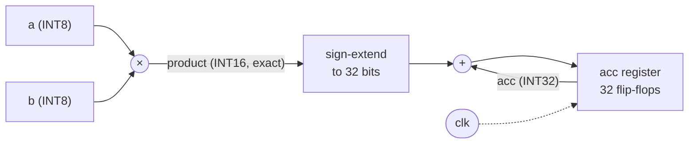

# Concepts: from a matrix product to a systolic array

This guide is a short course on AI matrix hardware for a reader who can program but has not designed hardware. It goes from the arithmetic of one matrix product to the reasons an accelerator is shaped the way it is, and ties every step to this design: signed INT8 × INT8 → INT32, an output-stationary systolic array of 4 × 4, 8 × 8 or 16 × 16 processing elements, and tiling for any M × K · K × N up to 64.

Read it in order; each section builds on the one before and has a worked example in numbers. The precise rules live in the module documents, and this guide links to them instead of repeating them:

| Document                                         | Use it for                                                                 |
| ------------------------------------------------ | -------------------------------------------------------------------------- |
| [architecture.md](architecture.md)               | The contract: numerics, dataflow timing, tiling, memory, handshake         |
| [processing-element.md](processing-element.md)   | The MAC cell, its overflow rule and its synthesis preview                  |
| [systolic-array.md](systolic-array.md)           | The PE grid, the skew registers, a traced 4 × 4 tile, per-tile timing      |
| [controller.md](controller.md)                   | The FSM, tile order, edge masks and the measured cycle counts              |
| [memory.md](memory.md)                           | Buffer sizes, banking, bandwidth and the host port                         |
| [from-rtl-to-silicon.md](from-rtl-to-silicon.md) | Topics 11–15: RTL to logic, synthesis reports, fair comparison, FPGA, ASIC |

**Where the numbers come from.** Every measured number below names the committed file that records it. The cycle counts were measured on the RTL by `make -C hardware/accelerators/matmul test-top` and are recorded in [controller.md](controller.md#cycle-formulas); utilisation figures are computed from those measured counts with the formula in [section 9](#9-why-utilisation-matters). The benchmark ticket's reports (`research/accelerators/matmul/reports/`) and the synthesis ticket's reports (`research/accelerators/matmul/synth/`) were not yet committed when this guide was written; once they are, they are the authoritative figures, and [research/accelerators/matmul/README.md](../../../research/accelerators/matmul/README.md) lists them. Nothing here is a power figure or a clock frequency: neither has been measured for the accelerator.

## 1. Matrix multiplication fundamentals

A matrix is a grid of numbers with a number of rows and a number of columns. An M × K matrix A times a K × N matrix B gives an M × N matrix C, where each element of C is the dot product of a row of A and a column of B:

C[i, j] = Σ<sub>k = 0 … K−1</sub> A[i, k] · B[k, j]

The inner dimension K must match: it is the length of each dot product, the **reduction length**. M and N only set how many dot products there are.

### Worked example: a 2 × 3 by 3 × 2 product

```text
        A (2 × 3)              B (3 × 2)             C (2 × 2)
     ┌            ┐         ┌         ┐         ┌           ┐
     │  1   2   3 │    ·    │  7   8  │    =    │  58   64  │
     │  4   5   6 │         │  9  10  │         │ 139  154  │
     └            ┘         │ 11  12  │         └           ┘
                            └         ┘
```

| Element | Row of A  | Column of B | Products     | Sum |
| ------- | --------- | ----------- | ------------ | --: |
| C[0, 0] | (1, 2, 3) | (7, 9, 11)  | 7 + 18 + 33  |  58 |
| C[0, 1] | (1, 2, 3) | (8, 10, 12) | 8 + 20 + 36  |  64 |
| C[1, 0] | (4, 5, 6) | (7, 9, 11)  | 28 + 45 + 66 | 139 |
| C[1, 1] | (4, 5, 6) | (8, 10, 12) | 32 + 50 + 72 | 154 |

Each product-and-add is one **multiply-accumulate (MAC)**. A whole M × K · K × N product is exactly M · N · K MACs: here 2 · 2 · 3 = 12. Every report in this project counts MACs, and where one quotes "operations" it says that one MAC is two (a multiply and an add).

The same loop in code, the way the reference model writes it ([matmul.ts](../../../packages/accelerator-reference/src/model/matmul.ts) adds the INT32 wrap of [section 3](#3-what-a-multiply-accumulate-unit-is)):

```ts
for (let i = 0; i < M; i++)
  for (let j = 0; j < N; j++) {
    let acc = 0;
    for (let k = 0; k < K; k++) acc += A[i][k] * B[k][j];
    C[i][j] = acc;
  }
```

Three things about this loop decide the shape of the hardware:

- **The work is huge and regular.** The largest r1 product, 64 × 64 · 64 × 64, is 262 144 MACs with no branches and no data-dependent control.
- **Every C[i, j] is independent** of every other, so they can all be computed at the same time.
- **Every input is used many times.** A[i, k] appears in N dot products and B[k, j] in M. Hardware that fetches each input once and reuses it is far cheaper than hardware that fetches two inputs per MAC ([section 8](#8-why-memory-bandwidth-matters)).

## 2. Why AI models use matrix operations

Most of the arithmetic in a neural network, when it runs (inference), is matrix multiplication. Three common layers, each as an M × K · K × N product that fits this accelerator:

| Layer                                | Matrix form                                       | Example that fits `MAX_DIM` = 64                                           |
| ------------------------------------ | ------------------------------------------------- | -------------------------------------------------------------------------- |
| Dense (fully connected)              | inputs (batch × in) · weights (in × out)          | 13 inputs of 19 features to 11 outputs: 13 × 19 · 19 × 11, 2 717 MACs      |
| Convolution, lowered with **im2col** | patches (positions × kernel · channels) · filters | 3 × 3 kernels, 3 channels, 16 filters, 8 × 8 outputs: 64 × 27 · 27 × 16    |
| Attention scores                     | queries (tokens × d) · keysᵀ (d × tokens)         | 64 tokens of dimension 16: 64 × 16 · 16 × 64, then the scores times values |

**im2col** ("image to columns") copies every 3 × 3 × 3 input patch the convolution looks at into one row of 27 numbers, so the convolution becomes one matrix product with the filter matrix. It costs memory (each input pixel is copied into up to nine patches) and buys a single regular kernel. Attention multiplies a matrix of queries by the transpose of a matrix of keys to score every token against every other.

**Why INT8.** A trained network's weights and activations can usually be **quantised** to 8-bit integers with a scale factor per tensor or per channel, with little loss of accuracy. The products are then accumulated in 32 bits so the sum does not overflow ([section 3](#3-what-a-multiply-accumulate-unit-is)), and the INT32 result is scaled back down for the next layer. This accelerator does the INT8 × INT8 → INT32 matrix product only; the quantisation scales, the requantisation to INT8, the activation function and im2col itself are the host's job, and nothing here implements them.

A network is a long chain of such products, so an accelerator that does matrix products fast and cheaply speeds up nearly all of a model's work, which is why AI chips are built around one.

## 3. What a multiply-accumulate unit is

A **multiply-accumulate unit (MAC unit)** is a multiplier, an adder and a register, wired so that each clock it multiplies two inputs and adds the product into the register:



This design's MAC unit is the [processing element](processing-element.md): `acc <= acc + a × b` in every clock where both operands are valid. One clock does one MAC; the register holds the running sum between clocks.

### Why the accumulator is 32 bits

| Quantity    | Bits | Range                          | Why that width                                     |
| ----------- | ---: | ------------------------------ | -------------------------------------------------- |
| a, b (INT8) |    8 | −128 … 127                     | the quantised operands                             |
| a · b       |   16 | −16 256 … +16 384              | 8 + 8 bits: −128 · −128 = +16 384 needs all 16     |
| acc (INT32) |   32 | −2 147 483 648 … 2 147 483 647 | room for many products before the sum can overflow |

The largest product magnitude is 16 384 = 2¹⁴, and INT32 holds up to 2³¹ − 1, so **any 131 071 products can be added without overflow** (131 071 · 16 384 = 2 147 467 264 ≤ 2³¹ − 1); the 131 072nd copy of +16 384 reaches 2³¹, one past the largest INT32. The processing element's unit test drives exactly this: in its `overflow up` segment, MAC 131 072 of −128 × −128 is the first to leave INT32 ([processing-element.md](processing-element.md#verification)). r1 caps K at 64, so a result is at most 64 · 16 384 = 1 048 576 = 2²⁰ in magnitude, which the array's `min` test tile (all −128) produces ([systolic-array.md](systolic-array.md#verification)). A 16-bit accumulator, by contrast, would overflow on the second +16 384.

### The wrap rule

When a sum does pass the INT32 range, this design **wraps around in two's complement**, the natural behaviour of a 32-bit adder: 2 147 483 647 + 1 = −2 147 483 648. It raises no flag and rejects nothing. The reference model does the same with JavaScript's `| 0` after every MAC, so the RTL and the reference agree bit for bit even on overflow, and every test vector records `fitsInt32` so that an overflowing test is deliberate ([architecture.md](architecture.md#numerics)). A wrapped result is wrong as an integer; real INT8 inference keeps K small enough (or the values small enough) that it never happens.

## 4. How a systolic array works

A **systolic array** is a grid of identical MAC units (processing elements, PEs) in which each PE talks only to its neighbours. Data enters at the edges and is pumped through the grid one PE per clock, like blood through the body with each heartbeat (systole), hence the name. No PE reaches out to a shared memory or a shared bus for its operands; the operand wires run only between neighbours and stay short however large the grid grows. (Not everything is local: the tile-start clear and the reset reach every PE, and reading the results out goes through one wide multiplexer, which [from-rtl-to-silicon.md](from-rtl-to-silicon.md#reading-the-accelerators-report-when-it-lands) names as a likely long path.)

```text
                 B[k,0]  B[k,1]  B[k,2]  B[k,3]       B enters at the top
                    │       │       │       │         and moves down
                    ▼       ▼       ▼       ▼
     A[0,k] ──▶ PE(0,0)─▶PE(0,1)─▶PE(0,2)─▶PE(0,3)
                    │       │       │       │
     A[1,k] ──▶ PE(1,0)─▶PE(1,1)─▶PE(1,2)─▶PE(1,3)     A enters at the left
                    │       │       │       │          and moves right
     A[2,k] ──▶ PE(2,0)─▶PE(2,1)─▶PE(2,2)─▶PE(2,3)
                    │       │       │       │
     A[3,k] ──▶ PE(3,0)─▶PE(3,1)─▶PE(3,2)─▶PE(3,3)     PE(i, j) accumulates C[i, j]
```

In this design's 4 × 4 array, row i of A flows right along PE row i, column j of B flows down PE column j, and PE(i, j) sits at the crossing of row i of A and column j of B, which is exactly where the dot product for C[i, j] needs them. Every clock, every PE whose two operands are valid does one MAC, so a 4 × 4 array can do up to 16 MACs per clock, an 8 × 8 64 and a 16 × 16 256.

The reuse is built into the wiring. A[i, k] enters once and is used by all `COLS` PEs of row i as it passes; B[k, j] enters once and is used by all `ROWS` PEs of column j. That is why the array needs only `ROWS` + `COLS` operands per clock to feed `ROWS` · `COLS` MACs ([section 8](#8-why-memory-bandwidth-matters)).

The [dataflow diagram](images/systolic-4x4-dataflow.svg) draws this array with its skew registers and four clocks of a K = 2 tile, and the [animated page](images/systolic-4x4.html) (open it from disk) steps through a K = 3 tile clock by clock.

## 5. How operands move between processing elements

Each PE has a register on its A output and one on its B output. On every rising clock edge it copies `a_in` to `a_out` (to the PE on its right) and `b_in` to `b_out` (to the PE below), so an operand moves exactly one PE per clock. Each operand travels with a **valid bit**, and a PE does a MAC only when both arriving valid bits are high; otherwise it holds its accumulator ([processing-element.md](processing-element.md#behaviour)). Operands keep moving whether they are valid or not: there is no stall anywhere inside the array (a **no-stall** pipeline).

Moving one step per clock creates a timing problem. A[i, k] reaches PE(i, j) after j steps; B[k, j] reaches it after i steps. If row i and column j started at the same time, A[i, k] would arrive at PE(i, j) in clock k + j and B[k, j] in clock k + i, and they would only meet on the diagonal. The fix is **skew**: row i of A is delayed by i clocks and column j of B by j clocks before it enters the grid. Then both arrive at PE(i, j) in clock **k + i + j**, together. In this design the skew is a triangle of delay registers inside `systolic_array`, so the controller presents plain unskewed rows and columns ([systolic-array.md](systolic-array.md#dataflow)).

### Worked example: where A[2, 1] meets B[1, 3]

On the 4 × 4 array, the pair for k = 1 of C[2, 3]:

| Operand | Enters the edge at operand clock | Skew delay | Steps through PEs | Arrives at PE(2, 3) |
| ------- | -------------------------------: | ---------: | ----------------: | ------------------: |
| A[2, 1] |                1 (row 2's k = 1) |  2 (row 2) |   3 (columns 0→3) |       1 + 2 + 3 = 6 |
| B[1, 3] |             1 (column 3's k = 1) |  3 (col 3) |      2 (rows 0→2) |       1 + 3 + 2 = 6 |

The [traced K = 3 tile](systolic-array.md#a-4--4-tile-with-k--3-clock-by-clock), measured on the RTL, shows the same: at operand clock 6, PE(2, 3) multiplies its k = 1 pair. PEs on one anti-diagonal (equal i + j) work in the same clocks, and each anti-diagonal runs one clock behind the previous one, so the computation sweeps across the grid as a diagonal wavefront.

## 6. Output-stationary dataflow

A **dataflow** says which of the three matrices stays put in the PEs and which move. This design is **output-stationary**: PE(i, j) keeps C[i, j] in its accumulator for the whole tile, while A and B stream past it. The alternatives keep something else in place:

| Dataflow                     | What stays in each PE   | What moves             | Typical use                                                 |
| ---------------------------- | ----------------------- | ---------------------- | ----------------------------------------------------------- |
| **Output-stationary** (this) | one C[i, j] accumulator | A right, B down        | simple, no partial sums leave the PE until the tile is done |
| Weight-stationary            | one B (weight) element  | A in, partial sums out | weights loaded once and reused across many inputs           |
| Input-stationary             | one A element           | B in, partial sums out | the mirror image of weight-stationary                       |

Output-stationary suits a first design: the 32-bit partial sums never move between PEs (only the 8-bit operands do), and a tile's result is simply read out of the accumulators at the end. Its cost is that the accumulators must be read out after every tile, which this design does one element per clock in its STORE state ([controller.md](controller.md#the-fsm)).

### Fill, steady state and drain: the K = 3 tile

Because of the skew, the array does not start or stop all at once. The [architecture contract's 4 × 4, K = 3 table](architecture.md#a-4--4-tile-with-k--3-clock-by-clock) shows it clock by clock; the number of PEs doing a MAC in each operand clock is:

| Operand clock |    0 |    1 |    2 |    3 |    4 |     5 |     6 |     7 |     8 |           9 |
| ------------- | ---: | ---: | ---: | ---: | ---: | ----: | ----: | ----: | ----: | ----------: |
| Active PEs    |    1 |    3 |    6 |    9 |   10 |     9 |     6 |     3 |     1 |           0 |
| Phase         | fill | fill | fill | fill | peak | drain | drain | drain | drain | `tile_done` |

The 48 MACs (4 · 4 · 3) take 9 clocks, K + `ROWS` + `COLS` − 2: K clocks of streaming plus `ROWS` + `COLS` − 2 of **fill** (the wavefront spreading from PE(0, 0)) and **drain** (it reaching PE(3, 3)). `tile_done` pulses in the next clock, operand clock 9, when the corner accumulator holds its final sum. With K this small, all 16 PEs are never busy at once; the longer K is, the longer the steady state between fill and drain lasts ([section 9](#9-why-utilisation-matters)).

## 7. Tiling

The array computes one `ROWS` × `COLS` block of C at a time, an **output tile**. A larger C is cut into ⌈M / `ROWS`⌉ · ⌈N / `COLS`⌉ tiles, processed one after another in row-major order. For each tile the whole reduction length K streams through the array, the accumulators are cleared once at the tile's start and never in the middle of K, so no partial sum is ever lost or written back ([controller.md](controller.md#tile-order-and-how-k-is-handled)).

### Worked example: a 13 × 11 output on the 4 × 4 array

A = 13 × 19, B = 19 × 11, so C is 13 × 11 and K = 19. On the 4 × 4 array that is ⌈13 / 4⌉ · ⌈11 / 4⌉ = 4 · 3 = **12 tiles**:

```text
            columns 0-3   columns 4-7   columns 8-10
          ┌─────────────┬─────────────┬─────────────┐
rows 0-3  │ (0,0) 4 × 4 │ (0,1) 4 × 4 │ (0,2) 4 × 3 │
          ├─────────────┼─────────────┼─────────────┤
rows 4-7  │ (1,0) 4 × 4 │ (1,1) 4 × 4 │ (1,2) 4 × 3 │
          ├─────────────┼─────────────┼─────────────┤
rows 8-11 │ (2,0) 4 × 4 │ (2,1) 4 × 4 │ (2,2) 4 × 3 │
          ├─────────────┼─────────────┼─────────────┤
row 12    │ (3,0) 1 × 4 │ (3,1) 1 × 4 │ (3,2) 1 × 3 │   ◀ edge tiles: 3 of 4 PE rows masked
          └─────────────┴─────────────┴─────────────┘
                                          ▲ edge tiles: 1 of 4 PE columns masked
```

The last tile row and tile column are **edge tiles**. The array still runs as a full 4 × 4 grid: rows past M = 13 are fed valid zeros for A and columns past N = 11 valid zeros for B, so every PE sees exactly K valid pairs and every tile has the same timing. Those PEs compute 0, and the store **masks** them out: only the R′ × C′ elements inside C are written ([architecture.md](architecture.md#tiling)). The 12 tiles give the array 12 · 16 = 192 output positions, of which 143 (13 · 11) are real, so 74.5 % of the PE-tile slots compute something that is kept.

Each tile costs 1 (PREPARE_TILE) + 19 (COMPUTE) + 7 (DRAIN, `ROWS` + `COLS` − 1) = 27 compute clocks, and 12 · 27 = **324 compute clocks**, the value `make test-top` measures for this product on the 4 × 4 array ([controller.md](controller.md#cycle-formulas)). On the 8 × 8 array the same product is 2 · 2 = 4 tiles (140 compute clocks) and on 16 × 16 a single tile (51).

## 8. Why memory bandwidth matters

An array can only do MACs as fast as it is fed. **Memory bandwidth** is how many bytes per clock the memory can deliver, and it is very often the real limit of an accelerator, not the arithmetic.

### Bytes per MAC: what reuse buys

A lone MAC unit needs two new INT8 operands, 2 bytes, for every MAC. This array reads one A byte per row and one B byte per column each streaming clock, `ROWS` + `COLS` bytes, and does up to `ROWS` · `COLS` MACs with them ([memory.md](memory.md#bandwidth)):

| Array   | Bytes read per clock | MACs per clock (peak) | Bytes per MAC | Each A byte used by | Each B byte used by |
| ------- | -------------------: | --------------------: | ------------: | ------------------: | ------------------: |
| one MAC |                    2 |                     1 |         2.000 |                1 PE |                1 PE |
| 4 × 4   |                    8 |                    16 |         0.500 |               4 PEs |               4 PEs |
| 8 × 8   |                   16 |                    64 |         0.250 |               8 PEs |               8 PEs |
| 16 × 16 |                   32 |                   256 |         0.125 |              16 PEs |              16 PEs |

A bigger array reuses each byte more, so it needs less bandwidth per MAC; but it still needs more bytes per clock in total, which is why `input_buffer` is split into `ROWS` banks for A and `COLS` banks for B: one RAM can deliver one element per clock, and the array wants `ROWS` + `COLS` of them ([memory.md](memory.md#data-layout-and-banking)).

The whole product has even more reuse than one clock does. 64 × 64 · 64 × 64 is 262 144 MACs on only 8 192 input bytes (4 096 of A and 4 096 of B): each input byte takes part in 64 MACs. The ratio of arithmetic to bytes moved is the **arithmetic intensity**; when it is high, a design can be compute-bound, and when it is low (small matrices), the memory sets the pace.

### The host port: transfers measured separately

The bandwidth outside the chip matters just as much. This design's host port, a testbench convenience, moves one element per port per clock, and every report counts the transfer clocks apart from the compute ([memory.md](memory.md#the-host-port-is-a-testbench-convenience)). Measured by `make test-top` and recorded in [controller.md](controller.md#cycle-formulas), for 64 × 64 · 64 × 64 on the 16 × 16 array:

| Phase                                               | Clocks |
| --------------------------------------------------- | -----: |
| transfer in (A and B written in parallel)           |  4 096 |
| compute (PREPARE_TILE, COMPUTE, DRAIN of 16 tiles)  |  1 536 |
| store (C into the output buffer, one element/clock) |  4 096 |
| transfer out (registered C reads)                   |  4 097 |

Moving the data in and out takes over five times as many clocks as the arithmetic: on this design, at this size, the memory interfaces and the one-element-per-clock store, not the 256 PEs, set the speed. A production accelerator would stream operands over a wide bus and overlap loads with compute (double buffering); r1 deliberately does not, and its reports say so.

## 9. Why utilisation matters

**PE utilisation** is the fraction of the PE-clocks the hardware spends that actually do a MAC:

utilisation = MACs / (`ROWS` · `COLS` · clocks)

An idle PE still costs its silicon area (and, in real hardware, leakage power and clock power), so utilisation says how much of the array you are paying for is working. A 16 × 16 array has 16 times the PEs of a 4 × 4 one, but it only finishes 16 times sooner if it keeps them as busy.

### One tile in isolation

A tile does `ROWS` · `COLS` · K MACs and occupies the array for K + `ROWS` + `COLS` − 1 clocks, so its utilisation is K / (K + `ROWS` + `COLS` − 1): fill and drain are a fixed cost, and only a long K amortises them. [systolic-array.md](systolic-array.md#utilisation-of-one-tile) tabulates it: at K = 3 a 16 × 16 tile is 8.8 % busy, at K = 64 it is 67.4 %.

### Whole matmuls: small versus large

The table below divides the MACs by the measured clocks of `make test-top` ([controller.md](controller.md#cycle-formulas)): once over the compute clocks (`cycles_compute`: tile starts, streaming, fill and drain) and once over every busy clock (compute plus the one-element-per-clock store and the tile changes). Which denominator is "the" PE utilisation is the benchmark report's to fix; both are shown here so the store's cost is visible.

| Product           |    MACs | Array   | compute clocks | busy clocks | utilisation over compute | utilisation over busy | MACs per busy clock |
| ----------------- | ------: | ------- | -------------: | ----------: | -----------------------: | --------------------: | ------------------: |
| 13 × 19 · 19 × 11 |   2 717 | 4 × 4   |            324 |         480 |                   52.4 % |                35.4 % |                 5.7 |
| 13 × 19 · 19 × 11 |   2 717 | 8 × 8   |            140 |         288 |                   30.3 % |                14.7 % |                 9.4 |
| 13 × 19 · 19 × 11 |   2 717 | 16 × 16 |             51 |         196 |                   20.8 % |                 5.4 % |                13.9 |
| 64 × 64 · 64 × 64 | 262 144 | 4 × 4   |         18 432 |      22 785 |                   88.9 % |                71.9 % |                11.5 |
| 64 × 64 · 64 × 64 | 262 144 | 8 × 8   |          5 120 |       9 281 |                   80.0 % |                44.1 % |                28.2 |
| 64 × 64 · 64 × 64 | 262 144 | 16 × 16 |          1 536 |       5 649 |                   66.7 % |                18.1 % |                46.4 |

What it shows:

- **Small, ragged products waste big arrays.** 13 × 19 · 19 × 11 on 16 × 16 is one tile in which only 143 of the 256 PEs (13 · 11) hold a real output and the other 113 are masked, with K = 19 against a fill and drain of 31 clocks: a fifth of the PE-clocks of compute do useful work.
- **Large products amortise fill and drain.** At 64³ the 4 × 4 array is 88.9 % busy over its compute clocks.
- **A bigger array is still faster in clocks**, 196 busy clocks against 480 for the small product, but far from 16 times faster, and over busy clocks the gap is worse: the store writes one element per clock whatever the array size, so on 16 × 16 at 64³ the 4 096 store clocks outweigh the 1 536 compute clocks ([controller.md](controller.md#cycle-formulas) names it as the r1 bottleneck).

These are computed from measured cycle counts, not from the reference model; the benchmark ticket's report in `research/accelerators/matmul/reports/` will record the official utilisation and MACs per clock with full provenance. Clocks are not time: turning them into seconds needs a clock frequency, and none has been measured for the accelerator ([from-rtl-to-silicon.md](from-rtl-to-silicon.md#13-how-to-compare-accelerator-designs-fairly)).

## 10. How arithmetic precision affects hardware

The number format is the largest single lever on the size of a MAC unit. A multiplier built from gates makes one partial-product bit for every pair of input bits and then adds them up, so its size grows roughly with the **square** of the operand width; an adder grows roughly linearly with its width.

| Format          | Multiplier input bits | Partial-product bits (rule of thumb) | Relative to INT8 | Also needs                                                                |
| --------------- | --------------------: | -----------------------------------: | ---------------: | ------------------------------------------------------------------------- |
| INT4            |                 4 × 4 |                                   16 |            0.25× | an INT16-or-wider accumulator                                             |
| **INT8** (this) |             **8 × 8** |                               **64** |           **1×** | an INT32 accumulator ([section 3](#3-what-a-multiply-accumulate-unit-is)) |
| INT16           |               16 × 16 |                                  256 |               4× | a wider (48- or 64-bit) accumulator                                       |
| FP32            |   24 × 24 (mantissas) |                                  576 |               9× | exponent add, alignment shifter, normalisation and rounding               |

This is a scaling rule of thumb, not a measurement: only the INT8 PE has been synthesized. The measured anchor is the processing element's synthesis preview ([processing-element.md](processing-element.md#synthesis-preview)): **1 008 generic Yosys cells**, of which **50 are flip-flops** (32 for the accumulator, 16 for the two forwarded operands, 2 for the valid bits) and **958 are the 8 × 8 signed multiplier and the 32-bit adder in gates**. The arithmetic, not the storage, is most of a PE, which is why the operand width matters so much; measuring `DATA_W` = 16 is a design-space experiment for a later ticket.

Precision also sets the size of everything around the arithmetic:

- **Registers move with the width.** Each PE forwards 2 · `DATA_W` operand bits per clock; INT16 operands would double the 16 operand flip-flops per PE and nearly double the skew registers (each stage is `DATA_W` + 1 bits: 9 now, 17 then).
- **Storage and bandwidth move with the width.** The A and B buffers hold INT8, 32 768 bits each; the C buffer holds INT32, 131 072 bits, two thirds of the accelerator's 196 608 bits of RAM ([memory.md](memory.md#sizes)). Doubling the operand width doubles the input bytes per clock in [section 8](#8-why-memory-bandwidth-matters).
- **The accumulator width is a trade-off.** A narrower accumulator saves flip-flops, adder bits and output-buffer bits, but overflows sooner: INT16 would overflow on the second extreme product. INT32 keeps any r1 result exact with a wide margin (2²⁰ against 2³¹). Wrap-around is the cheapest overflow rule (no extra logic); saturation, which clamps at the INT32 limits, would need a comparator and a multiplexer in every PE.

Lower precision is why AI accelerators favour INT8 and smaller formats: for the area of one FP32 MAC unit, a chip can hold several INT8 ones, each needing a quarter of the operand bandwidth.
