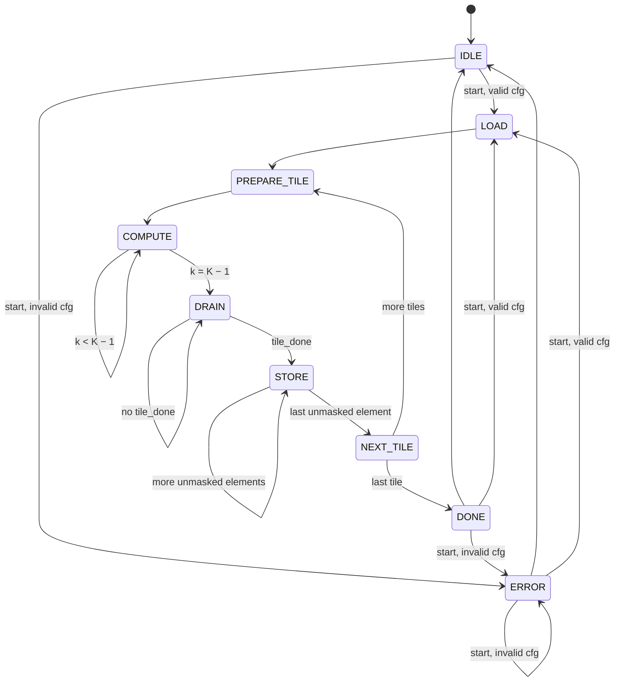

# Controller (`matmul_controller`) and the accelerator top (`matmul_top`)

`matmul_controller` turns one `start` into a whole tiled matmul: it checks the configuration, walks the output tiles of C in row-major order, issues the buffer reads that feed the [systolic array](systolic-array.md), masks the edge tiles, stores each tile's results into the output buffer and raises `done`, or `error` for an invalid configuration. `matmul_top` wires it to the two [input buffers, the output buffer](memory.md) and the array, and is the accelerator: C (M × N) = A (M × K) · B (K × N) for any M, N and K in 1 … `MAX_DIM` (64), on any array size, from one RTL.

- RTL: [rtl/matmul_controller.sv](../../../hardware/accelerators/matmul/rtl/matmul_controller.sv), [rtl/matmul_top.sv](../../../hardware/accelerators/matmul/rtl/matmul_top.sv)
- Unit test: [tb/unit/tb_matmul_top.sv](../../../hardware/accelerators/matmul/tb/unit/tb_matmul_top.sv), run by `make -C hardware/accelerators/matmul test-top` at 4 × 4, 8 × 8, 16 × 16 and 4 × 8
- Contract: [architecture.md](architecture.md), whose `matmul_top` port table, tiling rules and handshake this implements

## Parameters and ports

`matmul_top` and `matmul_controller` take the same parameters, and `matmul_top` passes every one of them down:

| Parameter | Default                    | Meaning                                                                      |
| --------- | -------------------------- | ---------------------------------------------------------------------------- |
| `ROWS`    | 4                          | Array rows (output-tile height); a power of two, at most `MAX_DIM`           |
| `COLS`    | 4                          | Array columns (output-tile width); a power of two, at most `MAX_DIM`         |
| `DATA_W`  | `matmul_pkg::DATA_W` (8)   | Operand width, signed                                                        |
| `ACC_W`   | `matmul_pkg::ACC_W` (32)   | Accumulator and C width, signed, wraps on overflow                           |
| `MAX_DIM` | `matmul_pkg::MAX_DIM` (64) | Largest M, N or K; a power of two; the buffers hold `MAX_DIM`² elements each |

`matmul_top`'s ports are the ones in [architecture.md](architecture.md#matmul_top), plus these outputs for the runner and for waveforms:

| Port             | Width              | Meaning                                                                                        |
| ---------------- | ------------------ | ---------------------------------------------------------------------------------------------- |
| `cycles_compute` | 32                 | PREPARE_TILE, COMPUTE and DRAIN clocks of the last accepted `start` (cleared by every `start`) |
| `cycles_store`   | 32                 | STORE clocks of the last accepted `start`                                                      |
| `dbg_state`      | `ctrl_state_t` (4) | The FSM state                                                                                  |
| `dbg_tile_i`     | log₂ `MAX_DIM` (6) | Current output tile's row index (its first row is `dbg_tile_i` · `ROWS`)                       |
| `dbg_tile_j`     | 6                  | Current output tile's column index (its first column is `dbg_tile_j` · `COLS`)                 |
| `dbg_k`          | 6                  | In COMPUTE, the k whose operands go into the array this clock                                  |

Internally the controller drives the array's `tile_start`, `tile_k`, `a_valid`/`a_data` and `b_valid`/`b_data`, reads its `c` and `tile_done`, gives each input buffer one read address, and writes the output buffer through `c_we`, `c_addr`, `c_wdata`. The array's `busy` is unused, because the controller never starts a tile before the previous `tile_done`.

## The FSM



`busy` is high in every state except IDLE, DONE and ERROR. A `start` is accepted in exactly those three states, so "ignored while `busy`" is exact: a `start` in the DONE clock (when `busy` is already low) or in the ERROR clock starts the next run straight away, and a `start` in any other state is ignored, its `cfg_*` never sampled.

| State          | Clocks per visit    | What it does                                                                                                                                                                                        |
| -------------- | ------------------- | --------------------------------------------------------------------------------------------------------------------------------------------------------------------------------------------------- |
| `IDLE`         | until `start`       | Waits. On `start`: checks `cfg_m`, `cfg_n`, `cfg_k`; sets `error`/`error_code` from the check (clearing a previous error); clears both cycle counters; samples the configuration if it is valid     |
| `LOAD`         | 1                   | The configuration is held; the tile position is reset to tile (0, 0). `busy` is high from here                                                                                                      |
| `PREPARE_TILE` | 1                   | Pulses `tile_start` (the array clears every accumulator) and issues the buffers' read address of k = 0                                                                                              |
| `COMPUTE`      | K                   | Clock k presents the buffers' registered data of k to the array, unskewed, with every valid bit high and zeros on the rows past M and the columns past N, while it issues the read address of k + 1 |
| `DRAIN`        | `ROWS` + `COLS` − 1 | Edge inputs invalid; waits for `tile_done`, which pulses K + `ROWS` + `COLS` − 1 clocks after `tile_start`, i.e. in the last DRAIN clock                                                            |
| `STORE`        | R′ · C′             | Writes C[row0 + r, col0 + c] = PE(r, c) for r < R′ = min(`ROWS`, M − row0), c < C′ = min(`COLS`, N − col0), row by row, one element per clock. The masked PEs are skipped, not written              |
| `NEXT_TILE`    | 1                   | Moves to the next tile in row-major order (tile column first), or to DONE after the last                                                                                                            |
| `DONE`         | 1                   | `done` pulses; `busy` is low. Back to IDLE (or straight to LOAD/ERROR on a `start`)                                                                                                                 |
| `ERROR`        | 1                   | Entered on an invalid `start`; `error` and `error_code` are already high and stay so until the next `start`. Back to IDLE (or LOAD/ERROR on a `start`). `busy` never rises and `done` never pulses  |

The dimension check: any of `cfg_m`, `cfg_n`, `cfg_k` equal to 0 gives `ERR_DIM_ZERO`; otherwise any above `MAX_DIM` gives `ERR_DIM_TOO_LARGE` (the whole 16-bit value is compared, so 0xFFFF is too large, never truncated). `ERR_DIM_ZERO` wins when both apply.

## Tile order and how K is handled

C is cut into ⌈M / `ROWS`⌉ · ⌈N / `COLS`⌉ output tiles, visited in row-major tile order: tile (ti, tj) covers rows ti · `ROWS` … and columns tj · `COLS` …, and tj varies fastest. For each tile:

- **The whole of K streams through the array.** COMPUTE presents k = 0 … K − 1 in K consecutive clocks with no gaps, and the accumulators are cleared once, by the tile's `tile_start`, never during K. No partial sum is written back to a buffer or reset early, so there is nothing to lose when K is long: K = 64 is 64 COMPUTE clocks of one tile. (K-chunking with read-modify-write of partial sums is not in r1.)
- **The same A rows serve every tile of a tile row**, and the same B columns every tile of a tile column; they are simply read again from the buffers (no operand reuse across tiles in r1).
- **Edge tiles** (the last tile row when `ROWS` does not divide M, the last tile column when `COLS` does not divide N): rows ≥ M get valid zeros for A and columns ≥ N valid zeros for B, so every PE sees exactly K valid pairs and the tile's timing does not depend on M or N. The masked PEs accumulate 0 and are never stored: STORE writes only the R′ × C′ elements inside C. Without the zeros the stored results would still be right (a masked row or column only reaches its own, unstored, C elements), so C alone cannot show the mask; the testbench checks the zeros on the array inputs directly.

On an 8 × 8 array, A = 13 × 19, B = 19 × 11 is 2 · 2 = 4 tiles: (0, 0) 8 × 8, (0, 1) 8 × 3, (1, 0) 5 × 8 and (1, 1) 5 × 3, each 19 COMPUTE clocks.

## Read latency

The buffers' read is registered (one clock of latency), so each read address goes out one clock before its data is used: the address of k = 0 in PREPARE_TILE, the address of k + 1 in COMPUTE clock k. The address issued in the last COMPUTE clock (k = K, wrapping to 0 when K = 64) is read but never used. This is the alignment that K = 1 and 1 × 1 × 1 exercise: PREPARE_TILE primes k = 0, and the single COMPUTE clock presents it.

## Handshake timing: 1 × 1 × 1 on a 4 × 4 array

Clock 0 is the `start` clock. Every row is one clock; the signals are their values in that clock.

| Clock | State          | `start` | `busy` | `done` | `tile_start` | Array inputs           | `tile_done` | Output buffer write |
| ----: | -------------- | :-----: | :----: | :----: | :----------: | ---------------------- | :---------: | ------------------- |
|     0 | `IDLE`         |    1    |   0    |   0    |      0       | –                      |      0      | –                   |
|     1 | `LOAD`         |    0    |   1    |   0    |      0       | –                      |      0      | –                   |
|     2 | `PREPARE_TILE` |    0    |   1    |   0    |      1       | – (read k = 0 issued)  |      0      | –                   |
|     3 | `COMPUTE`      |    0    |   1    |   0    |      0       | A[·, 0], B[0, ·] valid |      0      | –                   |
|  4–10 | `DRAIN`        |    0    |   1    |   0    |      0       | invalid                |   1 in 10   | –                   |
|    11 | `STORE`        |    0    |   1    |   0    |      0       | –                      |      0      | C[0, 0]             |
|    12 | `NEXT_TILE`    |    0    |   1    |   0    |      0       | –                      |      0      | –                   |
|    13 | `DONE`         |    0    |   0    |   1    |      0       | –                      |      0      | –                   |

`busy` is high for 12 clocks (1 to 12); `cycles_compute` is 9 (clocks 2 to 10) and `cycles_store` 1, which is what the testbench measures for `random-m1-n1-k1-s1` on the 4 × 4 array. The host may read C from clock 14 (or start again in clock 13).

## Cycle formulas

With T = ⌈M / `ROWS`⌉ · ⌈N / `COLS`⌉ tiles, every tile spends 1 (PREPARE_TILE) + K (COMPUTE) + `ROWS` + `COLS` − 1 (DRAIN) compute clocks, and the stores of all tiles together write each element of C once:

- **compute** = `cycles_compute` = T · (K + `ROWS` + `COLS`)
- **store** = `cycles_store` = M · N
- **busy** = 1 (LOAD) + T · (K + `ROWS` + `COLS` + 1) (the extra 1 is NEXT_TILE) + M · N, and `done` pulses in the clock after the last busy clock
- **transfer in** (testbench host port, A and B written in parallel, one element per port per clock) = max(M · K, K · N); **transfer out** (registered C reads) = M · N + 1

The testbench checks the first three exactly on every run. For a single 4 × 4 × 4 tile on the 4 × 4 array, compute = 1 · (4 + 4 + 4) = 12, store = 16, busy = 1 + 13 + 16 = 30, the measured values. Measured by `make test-top` (seed 1):

| Product (M × K · K × N) | Array   | Tiles | compute | store |  busy | in   | out  |
| ----------------------- | ------- | ----: | ------: | ----: | ----: | ---- | ---- |
| 4 × 4 · 4 × 4           | 4 × 4   |     1 |      12 |    16 |    30 | 16   | 17   |
| 4 × 4 · 4 × 4           | 16 × 16 |     1 |      36 |    16 |    54 | 16   | 17   |
| 13 × 19 · 19 × 11       | 4 × 4   |    12 |     324 |   143 |   480 | 247  | 144  |
| 13 × 19 · 19 × 11       | 8 × 8   |     4 |     140 |   143 |   288 | 247  | 144  |
| 13 × 19 · 19 × 11       | 16 × 16 |     1 |      51 |   143 |   196 | 247  | 144  |
| 32 × 32 · 32 × 32       | 8 × 8   |    16 |     768 |  1024 |  1809 | 1024 | 1025 |
| 64 × 64 · 64 × 64       | 4 × 4   |   256 |   18432 |  4096 | 22785 | 4096 | 4097 |
| 64 × 64 · 64 × 64       | 8 × 8   |    64 |    5120 |  4096 |  9281 | 4096 | 4097 |
| 64 × 64 · 64 × 64       | 16 × 16 |    16 |    1536 |  4096 |  5649 | 4096 | 4097 |

These are simulation clock counts, not time. The benchmark ticket reports utilisation and MACs per clock from the runner; the table already shows the r1 bottleneck on large arrays: STORE writes one element per clock, so on 16 × 16 a full tile's 256 stores take longer than its K + 32 compute clocks. Overlapping the stores with the next tile's compute, or a wider output-buffer port, is a later design-space experiment.

## Verification

`make -C hardware/accelerators/matmul test-top` builds [tb_matmul_top.sv](../../../hardware/accelerators/matmul/tb/unit/tb_matmul_top.sv) with Verilator `-Wall` at 4 × 4, 8 × 8, 16 × 16 and 4 × 8 (non-square, so a row/column mix-up cannot pass), from suites that `pnpm --filter @vcpu/accelerator-reference gen-top-suite` writes into `build/vectors/top-<R>x<C>/`: 17 directed products and `TOP_RANDOM_CASES` (24) random ones with M, N and K uniform in 1 … 64, from `TOP_SEED` (1). The directed products are 64³ random, two runs that reuse its buffers without rewriting them (40 × 33 · 33 × 27, then 64³ again), 4³, 8³, 16³, 32³, 13 × 19 · 19 × 11, M = 1, N = 1, K = 1, 1 × 1 × 1, an all-zero B, the identity, all −128 and all 127 at 64³, and mixed-sign extremes. Every element of C is compared to the reference model. Per run the testbench also checks:

- `error`/`error_code` clear from the clock after `start`, `busy` high until `done`, `done` a one-clock pulse with `busy` low;
- the tile order (`dbg_tile_i`/`dbg_tile_j` in every PREPARE_TILE clock), `dbg_k` = 0 … K − 1 in COMPUTE, every edge input valid in COMPUTE and zero past M and N;
- `cycles_compute`, `cycles_store` and the number of busy clocks against the formulas above;
- in every other run, a `start` with `cfg_m` = 0 in the third busy clock and host writes of wrong values to A and B during the first busy clocks, all ignored (the next run on the same buffers would see a write that got through);
- after the suite: three back-to-back runs of the last product with no reset, the second started in the first's DONE clock and the third in the clock after the second's DONE; then `cfg_k` = 0, `cfg_m` = 65, `cfg_m` = 65 with `cfg_n` = 0, `cfg_k` = 0xFFFF and 0 · 0 · 0, each raising `error` with the right code from the next clock, through ERROR to IDLE, never `busy` or `done`, and a valid `start` in the last one's ERROR clock clearing `error` and producing the right C again.

There is no reset after the first, so every run is a repeated invocation. `test-top-corrupt` proves the harness can fail: it reruns the 4 × 4 testbench with C[0][0] of the first random case's expected file changed by one and requires a non-zero exit naming that element.

```text
$ make -C hardware/accelerators/matmul test-top
case random-m4-n4-k4-s1: PASS compute=12 store=16 in=16 out=17 busy=30 tiles=1, start and host writes while busy ignored
…
tb_matmul_top 4x4: PASS (41 cases: 17 directed, 24 random, 2 on reused buffers; no reset after the first; back-to-back runs; 5 invalid starts)
tb_matmul_top 8x8: PASS (41 cases: …)
tb_matmul_top 16x16: PASS (41 cases: …)
tb_matmul_top 4x8: PASS (41 cases: …)
test-top-corrupt: corrupting C[0][0] of rand000-random-m34-n59-k57-s854092845 fails the test as it should
test-top: 4x4, 8x8, 16x16 and 4x8 passed (24 random products each, seed 1)
```

`make lint ROWS=4|8|16` lints the whole accelerator from `matmul_top` with Verilator `--lint-only -Wall`, clean at every size; a hand-run Yosys 0.70+145 `proc; check -assert` on `matmul_top` (at 4, 8 and 16) finds no latch, no multiple drivers and no combinational loop ([memory.md](memory.md#ram-inference) has the command).
