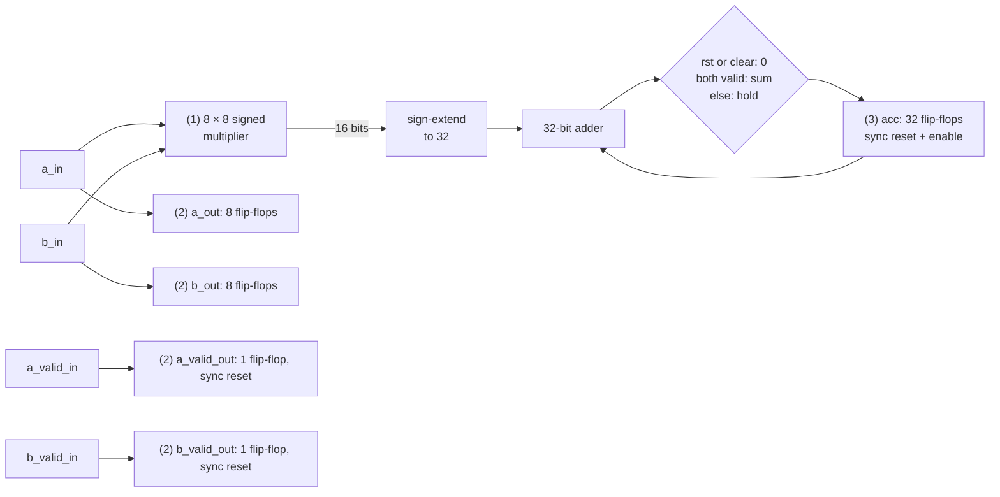
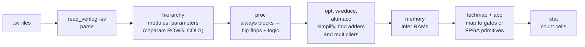
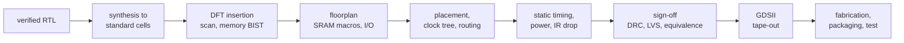

# From RTL to silicon: logic, reports, comparisons, FPGA and ASIC

This guide continues [concepts.md](concepts.md) (topics 1–10) with what happens to the accelerator's SystemVerilog after it passes its tests: how RTL becomes digital logic, how to read the synthesis reports, how to compare two accelerator designs without fooling yourself, and what it would take to run the design on an FPGA or to fabricate it as a chip. It is written for a reader who knows programming but not hardware.

**What has and has not been done.** The RTL simulates and passes its unit tests at 4 × 4, 8 × 8 and 16 × 16 ([controller.md](controller.md#verification)). The only committed synthesis numbers for the accelerator so far are hand-run Yosys previews in the module documents ([processing-element.md](processing-element.md#synthesis-preview), [memory.md](memory.md#ram-inference)). The synthesis ticket's official reports (`research/accelerators/matmul/synth/`: generic, iCE40 and ECP5 resource and timing summaries per array size) were not yet committed when this guide was written, so the accelerator's FPGA fit and Fmax are **not measured** here; where this guide shows a complete report, it uses the committed Project 2 CPU baseline, [research/cpu/synth/baseline.md](../../../research/cpu/synth/baseline.md), and says so. Nothing has been run on an FPGA board, and nothing in [section 15](#15-what-asic-fabrication-requires) has been started: it lists what would be required.

## 11. How RTL becomes digital logic

RTL (register-transfer level) code describes registers and the logic between them, one clock edge at a time. A **synthesis** tool, Yosys in this project, reads it and produces a **netlist**: a list of logic elements (gates, flip-flops, adders, memories) and the wires between them. Every construct has a hardware meaning:

| RTL construct                                 | Becomes                                                               |
| --------------------------------------------- | --------------------------------------------------------------------- |
| `always_ff @(posedge clk)` assignment         | one D flip-flop per bit, loaded on the rising edge                    |
| `if (rst) x <= 0;` inside `always_ff`         | a synchronous reset: the flip-flop's next value is forced to 0        |
| `else if (en) x <= …;`                        | a clock enable: otherwise the flip-flop keeps its value               |
| `assign y = a * b;`                           | a multiplier: a grid of AND gates and adders (or a DSP block on FPGA) |
| `a + b`                                       | an adder: a carry chain                                               |
| `cond ? a : b`, `case`                        | multiplexers                                                          |
| an array with one write and a registered read | a memory: block RAM where the target has it, else flip-flops          |

### Worked example: the processing element

The whole datapath of [processing_element.sv](../../../hardware/accelerators/matmul/rtl/processing_element.sv), stripped of comments:

```systemverilog
localparam int PROD_W = 2 * DATA_W;
logic signed [PROD_W-1:0] product;
assign product = PROD_W'(a_in) * PROD_W'(b_in);    // (1)

always_ff @(posedge clk) begin                     // (2)
  a_out <= a_in;
  b_out <= b_in;
  if (rst) begin
    a_valid_out <= 1'b0;
    b_valid_out <= 1'b0;
  end else begin
    a_valid_out <= a_valid_in;
    b_valid_out <= b_valid_in;
  end
end

always_ff @(posedge clk) begin                     // (3)
  if (rst || clear) begin
    acc <= '0;
  end else if (a_valid_in && b_valid_in) begin
    acc <= acc + ACC_W'(product);
  end
end
```



1. The `assign` is a signed multiplier. Both 8-bit operands are sign-extended to 16 bits, so the product is exact.
2. The first `always_ff` is pure registers: 16 flip-flops with no reset for the forwarded operands, and 2 with a synchronous reset for the valid bits.
3. The second `always_ff` is 32 flip-flops whose next value is chosen by `rst || clear` (reset to 0), `a_valid_in && b_valid_in` (enable: load the sum) or neither (hold), feeding a 32-bit adder.

The [synthesis preview](processing-element.md#synthesis-preview) confirms exactly this: **50 flip-flops**, 32 of type `$_SDFFE_PP0P_` (synchronous reset, with enable) for `acc`, 2 `$_SDFF_PP0_` (synchronous reset) for the valid bits and 16 `$_DFF_P_` (plain) for the operands, plus 958 gates for the multiplier and the adder, **1 008 cells** in all. Nothing in the RTL is a latch, and `check -assert` finds no combinational loop.

### What Yosys does, step by step



- **`hierarchy`** builds the module tree and fixes the parameters: `chparam -set ROWS 16 -set COLS 16` turns the one RTL into the 16 × 16 design, and the `generate` loops in `systolic_array` unroll into 256 PE instances.
- **`proc`** turns each `always_ff` into flip-flops and each `always_comb` into plain logic; a combinational block that forgets to assign a signal would need a latch here, which this design's checks forbid ([memory.md](memory.md#ram-inference)).
- **`opt`, `wreduce`, `alumacc`** remove dead logic, shrink signals to the bits that matter and turn the coarse arithmetic cells the front end made from `+`, `-` and `*` (`$add`, `$sub`, `$mul`) into `$alu` and `$macc` cells; a multiply feeding an add may become one `$macc`.
- **`memory`** recognises the buffer arrays as memories (`$mem_v2`): the preview finds 9 at 4 × 4, 17 at 8 × 8 and 33 at 16 × 16, one per bank ([memory.md](memory.md#ram-inference)).
- **`techmap` and `abc`** map everything to the target's cells: Yosys's internal gates for the generic flow, or an FPGA's lookup tables (LUTs), carry cells, DSP multipliers and block RAM. ABC minimises the combinational logic.
- After synthesis, an FPGA flow continues with **place and route** (nextpnr), which puts each primitive on a site of a real device, wires them through its routing and estimates every path's delay, and with **bitstream generation**, which turns the result into the file that configures the chip.

The Project 2 [synthesis guide](../synthesis-guide.md#what-synthesis-does) walks the same stages for the CPU in more detail.

## 12. How to interpret synthesis reports

The accelerator's synthesis baseline will be committed by the synthesis ticket under `research/accelerators/matmul/synth/`, one summary per flow and array size. It was not yet in the repository when this was written, so the field-by-field reading below uses the committed Project 2 report, [research/cpu/synth/baseline.md](../../../research/cpu/synth/baseline.md), which comes from the same tools (Yosys 0.70+145, nextpnr 0.11.1) and the same two FPGA families (Project 2 used the iCE40UP5K and the LFE5U-25F). The accelerator's report has the same kinds of figures.

| Field                           | What it means                                                                                                                                                                                     | What it does not mean                                                 |
| ------------------------------- | ------------------------------------------------------------------------------------------------------------------------------------------------------------------------------------------------- | --------------------------------------------------------------------- |
| **Cells** (generic)             | Yosys internal logic elements after `synth`: gates, multiplexers, flip-flops. VCPU-8's `vcpu8_core` is 1 981 cells                                                                                | transistors, area or gates of a real library                          |
| **Flip-flops**                  | Bits of state. VCPU-8's core has 182                                                                                                                                                              | anything about speed                                                  |
| **Cell types**                  | e.g. `$_SDFFE_PP0P_`: a D flip-flop (`DFF`) with synchronous reset (`S`) and enable (`E`); `PP0P` is positive clock, active-high reset, reset value 0, active-high enable                         |                                                                       |
| `$mul`, `$alu`, `$macc`         | Multipliers, adders, multiply-accumulates: coarse cells, visible only in a `stat` taken before mapping (the final `synth` stat lists `$_…_` gates only). Expect one `$mul` or `$macc` per PE      |                                                                       |
| **Memory inference**            | Which arrays became RAMs and what each target built them from. VCPU-8's 256 × 8 RAM is flip-flops in the generic flow, one block RAM on each FPGA                                                 | that a memory fits: check the block count against the device          |
| **Logic depth**                 | The most gates on any path between two flip-flops (`ltp -noff`). VCPU-8: 82 gates                                                                                                                 | a delay: no cell library gives these gates a time                     |
| **LUTs, carry, DSP, block RAM** | FPGA primitives after mapping: 4-input lookup tables, carry-chain cells, hard multipliers, RAM blocks. VCPU-8 on iCE40UP5K: 727 LUTs, 143 carry, 150 flip-flops, 1 block RAM, 0 DSP               | portable numbers: they change with the FPGA family                    |
| **Utilisation**                 | Used over available on the named device: VCPU-8 uses ICESTORM_LC 906 / 5 280 and ICESTORM_RAM 1 / 30 on the UP5K                                                                                  |                                                                       |
| **Fmax**                        | nextpnr's **estimate** of the fastest clock for that placed-and-routed design on that device and speed grade. VCPU-8: 10.48 MHz on iCE40UP5K (target 12 MHz, **not met**), 28.21 MHz on LFE5U-25F | a measured frequency, or anything about another device or an ASIC     |
| **Critical path**               | The slowest path nextpnr found, split into logic and routing delay, with the RTL lines on it                                                                                                      |                                                                       |
| **Warnings and the gate**       | Every tool warning, matched against a reviewed allowlist; a new warning fails the build                                                                                                           | that an allowed warning is harmless without reading why it is allowed |

### Reading the accelerator's report when it lands

Use what is already known to sanity-check it. Each item below is arithmetic on committed facts, so a report that disagrees points at something worth understanding:

- **Multipliers.** One per PE (as a `$mul` or folded into a `$macc`): 16 at 4 × 4, 64 at 8 × 8, 256 at 16 × 16. Fewer would mean synthesis removed PEs whose results are unused, which in the FPGA flows means the wrapper does not observe them.
- **Flip-flops.** 50 per PE in the preview ([processing-element.md](processing-element.md#synthesis-preview)), but the operands forwarded out of the right column and the bottom row drive nothing ([systolic-array.md](systolic-array.md#dataflow)), so synthesis may remove those 9 bits per edge PE: about 50 · `ROWS` · `COLS` − 9 · (`ROWS` + `COLS`) PE flip-flops, 728 at 4 × 4, 3 056 at 8 × 8 and 12 512 at 16 × 16 (derived, not measured), plus the skew registers (`ROWS` · (`ROWS` − 1) / 2 + `COLS` · (`COLS` − 1) / 2 stages of 9 bits: 108 bits at 4 × 4, 2 160 at 16 × 16, from [systolic-array.md](systolic-array.md#dataflow)) and the controller.
- **Memories.** 9, 17 and 33 inferred memories holding 196 608 bits at every size ([memory.md](memory.md#sizes)). In the generic flow, which has no RAM cell, they become flip-flops and dominate the count, as VCPU-8's RAM does in its generic report; on an FPGA each should become block RAM, and the report's block count says whether the device had enough.
- **Fmax and its critical path.** Expect the long paths in the PE (an 8 × 8 multiply then a 32-bit add in one clock) or in the controller's store, which selects one of the `ROWS` · `COLS` 32-bit accumulators each clock ([matmul_controller.sv](../../../hardware/accelerators/matmul/rtl/matmul_controller.sv), `c_wdata`), a 256-way multiplexer at 16 × 16. The report names the path; until then, this is a hypothesis.

The Project 2 guide's [Reading the reports](../synthesis-guide.md#reading-the-reports) and [What depends on what](../synthesis-guide.md#what-depends-on-what) sections explain which figures are technology-independent and which belong to one FPGA.

## 13. How to compare accelerator designs fairly

A comparison of two hardware designs is only as good as the rules it follows. These are the rules this project's reports follow, and the ones to check before believing any comparison:

1. **Correctness first.** Only a design that passed differential verification against the reference on the same workloads may be compared at all. A fast wrong answer is not a result.
2. **The same workloads and data.** Same M, N, K, the same seeded inputs, and both small and large products: the [utilisation table](concepts.md#9-why-utilisation-matters) shows the ranking of array sizes changes with the workload.
3. **Count the same things, and say what they are.** MACs (M · N · K) for work; if a report quotes operations, one MAC is two. Count transfer-in, compute and transfer-out clocks separately ([memory.md](memory.md#the-host-port-is-a-testbench-convenience)), and say whether a figure includes the transfers.
4. **Cycles are not time.** Time = cycles × clock period, and a bigger array or a deeper pipeline may need a slower clock. Converting needs an Fmax for each design, from the same timing analysis on the same device and speed grade, labelled as an estimate. The accelerator has no committed Fmax yet, so every comparison here is in clocks.
5. **The same tools, settings and target.** Identical tool versions, synthesis scripts, constraints, device and nextpnr seed for every design; every report records its tool versions and git commit so this can be checked.
6. **Report the cost beside the speed.** Resources (LUTs, flip-flops, DSPs, block RAM, or generic cells) and utilisation go next to the clock counts. A design with 16 times the PEs that needs 2.4 times fewer clocks is not simply "better".
7. **No power or energy without a measurement.** No flow in this repository estimates power, so every report says "not measured". Never derive energy efficiency from cell counts.
8. **A faster simulator is not a faster chip.** Simulator wall-clock time depends on the host computer and the simulator, not on the hardware design.
9. **Compare on a front, not a score.** When designs trade speed against size, the honest output is the set of Pareto-optimal designs (none beaten on every axis by another), not one weighted number.
10. **State the differences that are not in the numbers.** Numeric format, instruction set, what the host does, what is included in "the design".

### Worked example: 4 × 4 against 16 × 16 on the same product

From the measured clocks in [controller.md](controller.md#cycle-formulas), 13 × 19 · 19 × 11 (2 717 MACs):

| Array   | PEs | busy clocks | clocks relative to 4 × 4 | PEs relative to 4 × 4 | MACs per PE per busy clock |
| ------- | --: | ----------: | -----------------------: | --------------------: | -------------------------: |
| 4 × 4   |  16 |         480 |                    1.00× |                    1× |                      0.354 |
| 16 × 16 | 256 |         196 |       0.41× (2.4× fewer) |                   16× |                      0.054 |

The 16 × 16 array finishes in 2.4 times fewer clocks with 16 times the PEs, so each of its PEs does about 15 % of the work of a 4 × 4 PE per clock. Whether it is faster in time depends on the two Fmax estimates (not measured), and whether it is worth its area depends on the resource counts (in the synthesis ticket's reports). Neither the clocks nor the PE counts alone answer "which is better".

The same rules govern the CPU-versus-accelerator comparison, whose results the CPU comparison ticket commits under `research/accelerators/matmul/cpu-comparison/`: the CPU and the accelerator differ in instruction set, numeric support (VCPU-8 is an 8-bit CPU, so INT32 accumulation takes multi-byte arithmetic), memory interface and clock, so that comparison states every one of those differences and compares architectural clocks and memory accesses, not time or energy.

## 14. What FPGA implementation requires

An FPGA (field-programmable gate array) is a chip of programmable lookup tables, flip-flops, block RAMs and hard multipliers that a bitstream configures into any digital design. It is the natural next step for this RTL: no fabrication, real clock speeds, and a design that can be reloaded. The synthesis ticket targets the iCE40 and ECP5 families. Project 2 placed and routed the CPU on one device of each, and the capacities below come from the denominators in its committed report ([research/cpu/synth/baseline.md](../../../research/cpu/synth/baseline.md)), except the UP5K's DSP count, which is from Lattice's datasheet:

| Device                      | Logic                           | Block RAM         | Hard multipliers                                                                             | I/O pins |
| --------------------------- | ------------------------------- | ----------------- | -------------------------------------------------------------------------------------------- | -------: |
| Lattice iCE40UP5K, SG48     | 5 280 logic cells (ICESTORM_LC) | 30 (ICESTORM_RAM) | 8 DSP blocks (SB_MAC16), unused by Project 2's flow, which runs `synth_ice40` without `-dsp` |       39 |
| Lattice LFE5U-25F, CABGA256 | 24 288 LUTs (TRELLIS_COMB)      | 56 (DP16KD)       | 28 (MULT18X18D)                                                                              |      197 |

### Resource fit

The real fit results, LUTs, flip-flops, block RAM and DSPs per array size on each device, are the synthesis ticket's to commit under `research/accelerators/matmul/synth/`; they are **not measured** in this guide. What can already be said from committed numbers is what the fit depends on:

- **Memory blocks.** The accelerator infers 9, 17 or 33 separate memories (4 × 4, 8 × 8, 16 × 16; [memory.md](memory.md#ram-inference)). Each needs at least one block RAM of its own, so the 16 × 16 design's 33 memories exceed the UP5K's 30 block RAMs before their sizes are even considered; the ECP5-25F has 56.
- **Memory bits.** The buffers hold 196 608 bits at every size ([memory.md](memory.md#sizes)); the C buffer alone is 131 072. An iCE40 `ICESTORM_RAM` block holds 4 kbit ([synthesis-guide.md](../synthesis-guide.md#reading-the-reports)), so the UP5K's 30 blocks are 122 880 bits: **at no array size do the r1 buffers fit the UP5K's block RAM** (derived from those two committed figures). The ECP5-25F's 56 blocks are larger; whether the banks pack into them is the report's to say.
- **Multipliers.** One per PE: 16, 64 or 256. The UP5K has 8 DSP blocks and the ECP5-25F 28 hard multipliers, so every size needs more multipliers than the UP5K has DSPs (and Project 2's iCE40 flow, without `-dsp`, builds every multiplier from LUTs anyway), and the 8 × 8 and 16 × 16 arrays need most of theirs from LUTs and carry cells on the ECP5-25F too; and in the [PE preview](processing-element.md#synthesis-preview) the multiplier and adder are 958 of the PE's 1 008 generic cells.
- **Pins.** `matmul_top` has 142 functional port bits (clock, reset, configuration, handshake and the host port; counted from the [port table](architecture.md#matmul_top)) plus 86 bits of runner and debug outputs. The 142 functional bits exceed the SG48's 39 pins but would fit the CABGA256's 197; all 228 fit neither. Either way a board build needs a wrapper that keeps a few pins and drives everything else through a real host interface, as Project 2's [IO wrapper](../fpga-readiness.md#io-wrapper) does for the CPU.

Where a size does not fit (on the UP5K, none does as r1 stands), the parameters are the levers: a smaller array, a smaller `MAX_DIM` (the buffers scale with `MAX_DIM`²), or a larger device.

### What a board build would need

| Requirement               | What it means for this design                                                                                                                                                                                                                           |
| ------------------------- | ------------------------------------------------------------------------------------------------------------------------------------------------------------------------------------------------------------------------------------------------------- |
| **A host interface**      | The testbench host port is not a real interface. A board needs a way to load A and B and read C: a UART or SPI link to a PC on a small board, or an AXI bus (memory-mapped registers plus DMA) next to a CPU on a larger SoC FPGA                       |
| **Clocking**              | One clock from the board's oscillator, possibly through a PLL; a timing constraint (the target frequency) so nextpnr checks every path against it                                                                                                       |
| **Reset**                 | The design's reset is synchronous; an external reset button must pass through a synchroniser first, as in Project 2's [clocking and reset](../fpga-readiness.md#clocking-and-reset-on-a-board)                                                          |
| **Block RAM mapping**     | Already prepared: every buffer bank is one write port, a registered read and no reset of its contents, the pattern FPGA block RAM implements ([memory.md](memory.md#ram-inference))                                                                     |
| **Timing closure**        | The design must meet the target clock on the placed-and-routed device. If the Fmax estimate is below target, the fixes are pipelining (a register between the multiplier and the adder, or in the store multiplexer), a slower clock or a faster device |
| **Pin constraints**       | A constraints file (`.pcf` for iCE40, `.lpf` for ECP5) assigning the wrapper's ports to the board's pins                                                                                                                                                |
| **On-board verification** | The same differential tests, run against the hardware through the host interface, before any result from the board counts                                                                                                                               |

### The gaps today

No FPGA wrapper, host interface, pin constraints, timing constraint or bitstream exists for the accelerator, and it has never run on a board. The synthesis reports will give the first fit and Fmax estimates; the final Project 3 report's FPGA readiness assessment turns them into a plan.

## 15. What ASIC fabrication requires

An ASIC (application-specific integrated circuit) is a chip manufactured for one design. It is faster, smaller and more power-efficient than the same design on an FPGA, but every step below must be done and checked before fabrication, and a mistake found afterwards costs a new set of masks. **None of this has been done for this accelerator.** This section lists what would be required; it claims nothing.



| Step                              | What it requires                                                                                                                                                                                                   | This design's status                                                                                                             |
| --------------------------------- | ------------------------------------------------------------------------------------------------------------------------------------------------------------------------------------------------------------------ | -------------------------------------------------------------------------------------------------------------------------------- |
| **Process design kit (PDK)**      | The foundry's description of its manufacturing process: device models, design rules, layer stack. Open PDKs exist (for example SkyWater SKY130 and GlobalFoundries GF180MCU); commercial ones are licensed         | none chosen                                                                                                                      |
| **Standard-cell library**         | Pre-designed, characterised gates and flip-flops for that PDK, with timing and power models (Liberty `.lib` files). Synthesis maps the RTL to these cells instead of Yosys's generic ones                          | not used: every synthesis here is generic or FPGA                                                                                |
| **Memory macros**                 | The buffers would be SRAM macros from a memory compiler (a foundry's or OpenRAM), not flip-flops. 33 small banks at 16 × 16 is many macros; banking and `MAX_DIM` would be revisited for the macro sizes available | the RTL infers RAMs cleanly, which makes the swap simple                                                                         |
| **Design for test (DFT)**         | Scan chains through the flip-flops, built-in self-test (BIST) for the SRAMs, and ATPG test patterns, so every manufactured chip can be tested for defects                                                          | none                                                                                                                             |
| **Floorplan and physical design** | Placing the macros, the PE grid and the I/O pads; placement, clock-tree synthesis and routing (open flows such as OpenROAD/OpenLane, or commercial tools)                                                          | none                                                                                                                             |
| **Static timing analysis (STA)**  | Every path checked against the clock period at every process, voltage and temperature corner, with the extracted wire parasitics; hold as well as setup                                                            | no ASIC timing exists; the only timing in the repository is the CPU's nextpnr estimates, and none exists yet for the accelerator |
| **Power analysis**                | Switching activity (for example from simulation waveforms) applied to the cell library's power models; IR drop and electromigration checks of the power grid                                                       | not measured                                                                                                                     |
| **Sign-off**                      | Design-rule check (DRC) and layout-versus-schematic (LVS) on the final layout, antenna checks, and formal equivalence between the RTL and the final netlist                                                        | none                                                                                                                             |
| **Tape-out and after**            | The GDSII layout goes to the foundry (alone or on a shared multi-project wafer); then packaging, bring-up on a test board, and running the same differential tests on real silicon                                 | none                                                                                                                             |

What the RTL already does that would carry over: one clock and one synchronous reset, no latches, no combinational loops, every memory a clean RAM pattern, and a bit-exact reference with automated differential verification, which would also check the post-synthesis netlist. Everything else in the table is work that has not started, and no area, timing or power figure for an ASIC exists for this design.
