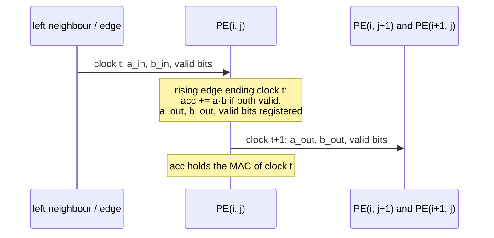

# Processing element (`processing_element`)

The processing element (PE) is the one multiply-accumulate cell of the systolic array: `systolic_array` instantiates it `ROWS` × `COLS` times. It multiplies a signed INT8 operand from the left by a signed INT8 operand from above, adds the exact product into a signed INT32 accumulator that wraps on overflow, and forwards both operands, with their valid bits, to its right and lower neighbours one clock later.

- RTL: [hardware/accelerators/matmul/rtl/processing_element.sv](../../../hardware/accelerators/matmul/rtl/processing_element.sv)
- Reference: the clock-level model [`stepPe`](../../../packages/accelerator-reference/src/model/pe.ts) in `@vcpu/accelerator-reference`
- Unit test: [tb/unit/tb_processing_element.sv](../../../hardware/accelerators/matmul/tb/unit/tb_processing_element.sv), run by `make -C hardware/accelerators/matmul test-pe`
- Contract: [architecture.md](architecture.md), whose `processing_element` port table this module implements

## Parameters and ports

| Parameter | Default                  | Meaning                                          |
| --------- | ------------------------ | ------------------------------------------------ |
| `DATA_W`  | `matmul_pkg::DATA_W` (8) | Operand width, signed                            |
| `ACC_W`   | `matmul_pkg::ACC_W` (32) | Accumulator width, signed; at least 2 · `DATA_W` |

| Port          | Dir | Width            | Meaning                                                                     |
| ------------- | --- | ---------------- | --------------------------------------------------------------------------- |
| `clk`         | in  | 1                | The one clock; everything changes on its rising edge                        |
| `rst`         | in  | 1                | Synchronous, active high: clears `acc`, `a_valid_out` and `b_valid_out`     |
| `clear`       | in  | 1                | Zero the accumulator (tile start); wins over a MAC in the same clock        |
| `a_in`        | in  | `DATA_W`, signed | Operand from the left (A, moving right)                                     |
| `a_valid_in`  | in  | 1                | `a_in` is valid                                                             |
| `b_in`        | in  | `DATA_W`, signed | Operand from above (B, moving down)                                         |
| `b_valid_in`  | in  | 1                | `b_in` is valid                                                             |
| `a_out`       | out | `DATA_W`, signed | `a_in` registered: to the PE on the right                                   |
| `a_valid_out` | out | 1                | `a_valid_in` registered (0 after a clock with `rst`)                        |
| `b_out`       | out | `DATA_W`, signed | `b_in` registered: to the PE below                                          |
| `b_valid_out` | out | 1                | `b_valid_in` registered (0 after a clock with `rst`)                        |
| `acc`         | out | `ACC_W`, signed  | The accumulator register: C[i, j] of the current tile once the tile is done |

## Behaviour

At every rising edge of `clk`:

```text
a_out       <= a_in                          b_out       <= b_in
a_valid_out <= rst ? 0 : a_valid_in          b_valid_out <= rst ? 0 : b_valid_in

acc <= 0                                     if rst or clear
       acc + sext(a_in × b_in)               else if a_valid_in and b_valid_in
       acc                                   otherwise
```

- **Signed arithmetic.** Both operands are sign-extended to `PROD_W` = 2 · `DATA_W` = 16 bits with a size cast of a signed value (`PROD_W'(a_in)`), so the multiply is signed and the 16-bit product is exact: −128 × −128 = +16 384 and 127 × −128 = −16 256 both fit. The product is then sign-extended to `ACC_W` (`ACC_W'(product)`) before the add. No expression mixes signed and unsigned operands, and Verilator `-Wall` reports no width or sign warning.
- **A MAC needs both valid bits.** A clock with only one operand valid, or neither, holds `acc`. Each operand still moves on, so a bubble in one direction never stalls the other.
- **Priority.** `rst` and `clear` both zero `acc`, and either wins over a MAC in the same clock. `rst` also clears the two forwarded valid bits; `clear` does not touch the forwarding.
- **What reset leaves alone.** The forwarded operand data registers (`a_out`, `b_out`) are not reset: nothing reads them while their valid bit is clear (the architecture contract's rule for operand registers). They still forward during reset.

## Timing

Each output is a register, so every effect is one clock after the inputs that cause it: the forwarded operands and valid bits appear one clock later, and a MAC presented in clock t is in `acc` from clock t + 1. A neighbour therefore sees this PE's operands exactly one clock after it did, which is the one-PE-per-clock movement the [dataflow](architecture.md#output-stationary-dataflow) relies on.

An example (values are what the outputs hold just after the rising edge that ends the clock):

| Clock | `rst` | `clear` | `a_in` / valid | `b_in` / valid | `acc` after | `a_out` / valid after | `b_out` / valid after | What happened          |
| ----: | :---: | :-----: | -------------: | -------------: | ----------: | --------------------: | --------------------: | ---------------------- |
|     0 |   1   |    0    |          5 / 1 |          7 / 1 |           0 |                 5 / 0 |                 7 / 0 | reset: no MAC, valid 0 |
|     1 |   0   |    0    |          3 / 1 |          5 / 1 |          15 |                 3 / 1 |                 5 / 1 | MAC 3 × 5              |
|     2 |   0   |    0    |       −128 / 1 |       −128 / 0 |          15 |              −128 / 1 |              −128 / 0 | B invalid: hold        |
|     3 |   0   |    1    |          9 / 1 |          9 / 1 |           0 |                 9 / 1 |                 9 / 1 | clear wins over a MAC  |
|     4 |   0   |    0    |        127 / 1 |       −128 / 1 |     −16 256 |               127 / 1 |              −128 / 1 | MAC 127 × −128         |



## Overflow rule

The accumulator is a plain `ACC_W`-bit adder and **wraps around in two's complement**: an accumulator that passes 2³¹ − 1 continues from −2³¹, and one that passes −2³¹ continues from 2³¹ − 1. The reference computes each MAC exactly in a JS double and wraps with `| 0`, which is bit-identical. No overflow flag is raised and no input is rejected, since in r1 no workload can overflow (a result is at most 64 · 16 384 = 2²⁰ in magnitude; see [Numerics](architecture.md#numerics)). The PE itself has no K limit, which is why its unit test drives enough MACs to wrap in both directions.

## No stall port

The PE has no stall or enable input. The array is a **no-stall architecture**: operands move one PE per clock whatever happens, and the only flow control is the valid bits, which the controller gates at the array edges (it presents bubbles and never starts a tile before the previous one has drained). A stall port would add a mux to every one of the `ROWS` · `COLS` · 50 flip-flops for a case r1 never needs.

## Synthesis preview

A hand-run Yosys 0.70+145 check of the PE alone at its defaults (not the official synthesis, which the synthesis ticket's `make synth` produces for the whole array):

```sh
cd hardware/accelerators/matmul
yosys -q -p 'read_verilog -sv rtl/matmul_pkg.sv rtl/processing_element.sv; hierarchy -check -top processing_element;
             proc; check -assert; select -assert-none t:$dlatch t:$adlatch t:$dlatchsr;
             synth -top processing_element; check -assert; stat'
```

`check -assert` passes after `proc` and after `synth` (no combinational loop, undriven net or multiple driver) and there is no latch. `synth` gives **1,008 generic cells**, of which **50 are flip-flops**: 32 for `acc` (`$_SDFFE_PP0P_`, synchronous reset with enable), 2 for the valid bits (`$_SDFF_PP0_`) and 16 for the forwarded operands (`$_DFF_P_`, no reset). The other 958 cells are the 8 × 8 signed multiplier and the 32-bit adder in gates.

## Verification

`make -C hardware/accelerators/matmul test-pe` (registered in `UNIT_TESTS`, so `make test` runs it too):

1. **Vectors from the reference.** The make recipe runs `pnpm --filter @vcpu/accelerator-reference gen-pe-vectors --seed 1 --count 20000 --out <absolute path>/build/vectors/pe.vec` (a relative `--out` resolves against the directory pnpm was started in), which runs `stepPe` one clock at a time and writes the inputs and the expected outputs of every clock. It is regenerated whenever the model, the generator, `mk/unit-pe.mk`, `PE_SEED` or `PE_RANDOM_CLOCKS` changes, so `make test-pe PE_SEED=5 PE_RANDOM_CLOCKS=50000` runs another random sequence.
2. **Bit-for-bit check, twice per clock.** `tb_processing_element` applies each line's inputs on the falling edge and compares `acc`, `a_out`, `a_valid_out`, `b_out` and `b_valid_out` twice: 1 ns later, while the new inputs are already applied, against the _previous_ clock's expected values (they must not have moved yet, so a combinational path from an input to an output, or an asynchronous reset, fails), and 1 ns after the rising edge against this line's expected values. That first comparison is what verifies the one-clock latency. A malformed line, or a clock count that disagrees with the file's header, is a failure as well.
3. **The harness can fail.** `test-pe-corrupt` (run by `test-pe`) changes the expected accumulator of the first wrapped clock by one and requires the testbench to exit non-zero with a `MISMATCH line <n>` for exactly that line.

The vectors are 13 directed segments, then the random segment, in one run (the state carries across segments, as in the RTL):

| Segment            |  Clocks | What it shows                                                                                             |
| ------------------ | ------: | --------------------------------------------------------------------------------------------------------- |
| reset              |       2 | `rst` with valid operands: `acc` 0, valid bits 0, data still forwarded                                    |
| positive           |       6 | small positive products, then 127 × 127 = 16 129                                                          |
| negative           |       8 | negative × positive, positive × negative, negative × negative                                             |
| zero               |       5 | a zero operand (with 127 or −128 on the other side) leaves `acc` unchanged                                |
| max INT8           |       5 | 127 × 127 three times, then 127 × −1                                                                      |
| min INT8           |       7 | −128 × −128 = +16 384 (the full signed 16-bit product) three times, then −128 × ±1                        |
| mixed sign         |       8 | 127 × −128 = −16 256 and −128 × 127, then back across zero                                                |
| valid low          |     101 | `a_valid` only, `b_valid` only and neither, 99 clocks with non-zero operands: `acc` holds exactly         |
| clear              |       7 | `clear` alone, with both operands valid (clear wins), with `rst`, then accumulating again                 |
| many accumulations |   1,001 | 1,000 MACs without a clear                                                                                |
| reset mid-run      |      15 | `rst` with valid operands between accumulations, once and three clocks in a row                           |
| overflow up        | 131,079 | −128 × −128, 131,076 MACs: MAC 131,072 reaches 2³¹ and wraps to −2³¹; ends at −2,147,418,112, then held   |
| overflow down      | 132,111 | 127 × −128, 132,108 MACs: MAC 132,105 passes −2³¹; exact −2,147,547,648 wraps to 2,147,419,648, then held |
| random (seed 1)    |  20,000 | each operand valid 3 clocks in 4, an extreme value 1 in 8, a `clear` 1 clock in 300, a `rst` 1 in 5,000   |

Result on the pinned toolchain (Verilator 5.053):

```text
segment 'overflow up: -128 x -128 = 16384, 131076 MACs after a clear (MAC 131072 is the first to leave INT32): exact 2147549184 wraps to -2147418112 (| 0), then held': 131079 clocks, 0 mismatches, acc after the last clock -2147418112
segment 'overflow down: 127 x -128 = -16256, 132108 MACs after a clear (MAC 132105 is the first to leave INT32): exact -2147547648 wraps to 2147419648 (| 0), then held': 132111 clocks, 0 mismatches, acc after the last clock 2147419648
segment 'random: seed 1, 20000 clocks': 20000 clocks, 0 mismatches, acc after the last clock -114790
tb_processing_element: PASS (284355 checks, 20000 random clocks, seed 1)
test-pe-corrupt: corrupting the expected wrapped accumulator on line 132251 fails the test as it should
```

One check is one clock: both comparisons of all five outputs. As a further check of the testbench, deliberately broken PEs fail it: an unsigned multiply (`$unsigned` on both operands) at the first negative product of the `negative` segment, forwarding through wires instead of registers at the first clock whose inputs differ from the previous one, and an asynchronous `rst` at the first reset with a non-zero accumulator.

### Vector format

`build/vectors/pe.vec` is plain text (the format is defined in [pe-vectors.ts](../../../packages/accelerator-reference/src/harness/pe-vectors.ts)): a header `pe-vectors 1 <clocks> <random clocks> <seed>`, a `# <description>` line at the start of each segment, and one line per clock of 11 decimal integers,

```text
rst clear a a_valid b b_valid acc a_out a_valid_out b_out b_valid_out
```

the six inputs applied before the rising edge, then the five outputs expected just after it. The array's unit test may reuse the same style.
