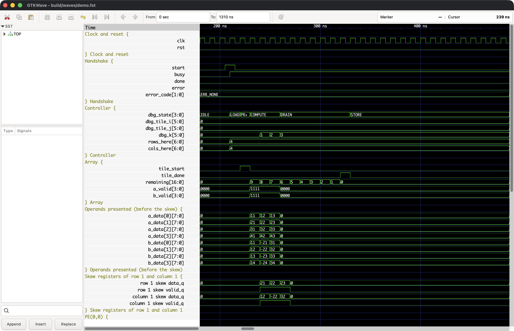

# Simulation guide

How to run a matmul case on the accelerator RTL, record a waveform of it, open that waveform in GTKWave, and follow the demo product clock by clock: which PE sees which operand when, how the accumulators step, when each tile drains and is stored, and where `done` pulses. Every value in the walkthrough comes from the demo's waveform (`make wave-check` and `wave-table` print them), not from a hand calculation.

## Setup

Everything here uses the pinned OSS CAD Suite (`hardware/toolchain.env`), installed once with `pnpm install` and `pnpm hardware:setup` (see [README.md § Building](README.md#building)). The bundle provides Verilator, which builds the runner, and GTKWave with its `vcd2fst` and `fst2vcd` converters. Commands run from the repository root; `make -C hardware/accelerators/matmul help` lists every target.

## Running a case

```sh
make -C hardware/accelerators/matmul simulate CASE=hardware/accelerators/matmul/tb/wave/demo.in
make -C hardware/accelerators/matmul simulate ROWS=8 CASE=build/failures/<name>/case.in
pnpm accel:gen-vectors --seed 7 --m 13 --n 11 --k 19 --out hardware/accelerators/matmul/build/vectors
```

`CASE` is a file in the vector format of [architecture.md](architecture.md): `M N K` on line 1, then the M·K values of A and the K·N values of B, row-major, one decimal integer per line. `pnpm accel:gen-vectors` writes them (with the reference's `.expected`); `make verify` saves every failing one under `build/failures/`. A relative path is looked up from the repository root first, then from `hardware/accelerators/matmul/`. `ROWS=4|8|16` picks the array (COLS follows ROWS).

The runner (`build/sim-<R>x<C>/matmul_sim`, from `tb/sim/matmul_sim.cpp`; [verification-strategy.md](verification-strategy.md) documents it) resets the accelerator, writes A and B through the host port, pulses `start`, waits for `done`, reads C back and prints the clock breakdown. For the demo:

```text
array         4x4 (MAX_DIM 64)
dims          M 6, N 5, K 3 (90 MACs, 4 tiles)
runs          1; 0 differ from the first
stop          done
transferIn    18
compute       44
store         30
busy          79 (compute + store + 5 control)
transferOut   31
total         129
C matches …/tb/wave/demo.expected (30 elements)
```

It writes `build/simulate-<R>x<C>/<name>.out` (C) and `<name>.cycles.json` and, when `<name>.expected` sits next to the case, compares C with it (exit 1 when they differ). [controller.md](controller.md) derives every count above from the FSM.

## Making a waveform

```sh
make -C hardware/accelerators/matmul wave                          # tb/wave/demo.in on 4x4 -> build/waves/demo.fst
make -C hardware/accelerators/matmul wave CASE=<file.in> ROWS=8    # any case, any size
make -C hardware/accelerators/matmul wave WAVE_FORMAT=vcd          # VCD instead of FST
make -C hardware/accelerators/matmul wave-check                    # the demo's dump is complete and correct
pnpm accel:wave                                                    # the same as the first line
```

`wave` builds a second, tracing runner in `build/sim-trace-<R>x<C>/` (Verilator `--trace --trace-structs --trace-max-array 32`), runs the case on it with `--wave` and prints the case's dimensions, its clock counts, the file's size and the command to view it:

```text
  m 6
  n 5
  k 3
  tiles 4
  transferIn 18
  busy 79
  transferOut 31
  total 129
  stop done
wrote …/build/waves/demo.fst (8912 bytes, 4x4 array)
view it (from …/hardware/accelerators/matmul):
  gtkwave build/waves/demo.fst tb/wave/matmul.gtkw
```

- **Separate builds.** The tracing runner never replaces `build/sim-<R>x<C>/matmul_sim`, so `make test`, `simulate` and `verify` stay untraced and fast; the untraced runner rejects `--wave`.
- **FST or VCD.** Verilator writes VCD; for FST (the default, about a tenth of the size) GTKWave's `vcd2fst` converts it. The pinned Verilator's own FST writer (`--trace-fst`) needs liblz4, which OSS CAD Suite does not ship. Waveforms are never committed: everything goes to `build/waves/`, next to `<name>.out` and `<name>.cycles.json`.
- **What is not dumped.** Every signal of the datapath is recorded (the skew registers and the PE grid's operand and accumulator buses are packed vectors), but not the buffer memories: they are the only unpacked arrays in `rtl/`, each holds at least MAX_DIM² / 64 = 64 elements, and `--trace-max-array 32` leaves out any array longer than 32, at every array size. Dumping them would make the file several times larger. What enters and leaves the buffers is still visible on the host port, the controller's read data (`a_data`, `b_data`) and its C writes (`c_we`, `c_addr`, `c_wdata`).
- **Size.** The demo's dump is 73 KB as VCD and 9 KB as FST; a 13 × 19 · 19 × 11 product on 8 × 8 is 0.7 MB of VCD. The dump grows with the number of PEs times the clocks: the largest product, 64 × 64 · 64 × 64 on 16 × 16 (5,649 busy clocks), is 36 MB of VCD. Use the smallest case that shows what you are looking for.

## Opening it in GTKWave

```sh
cd hardware/accelerators/matmul
gtkwave build/waves/demo.fst tb/wave/matmul.gtkw
```

`tb/wave/matmul.gtkw` opens on the first tile (from 180 ns) with these groups:

| Group                                | Signals                                                                                          |
| ------------------------------------ | ------------------------------------------------------------------------------------------------ |
| Clock and reset                      | `clk`, `rst`                                                                                     |
| Handshake                            | `start`, `busy`, `done`, `error`, `error_code` (named)                                           |
| Controller                           | `dbg_state` (named), `dbg_tile_i`, `dbg_tile_j`, `dbg_k`, `rows_here`, `cols_here`               |
| Array                                | `tile_start`, `tile_done`, `remaining` (the drain counter), `a_valid`, `b_valid`                 |
| Operands presented (before the skew) | the controller's `a_data[0..3]` and `b_data[0..3]`: A[row0 + i, k] and B[k, col0 + j], unskewed  |
| Skew registers of row 1 and column 1 | `data_q` / `valid_q` of `g_a_skew[1]` and `g_b_skew[1]`, aliased `row 1 skew …` and `column 1 …` |
| PE(0,0), PE(1,0), PE(1,1), PE(3,3)   | `a_in`, `a_valid_in`, `b_in`, `b_valid_in`, `acc`                                                |
| Store and host read                  | `c_we`, `c_addr`, `c_wdata`, `host_c_addr`, `host_c_rdata`                                       |

Operands, accumulators and C are shown as signed decimal. `dbg_state` and `error_code` show names (`IDLE`, `COMPUTE`, `ERR_NONE`, …) through the translate filters `tb/wave/ctrl_state.txt` and `tb/wave/error_code.txt`, which the save file names relative to `hardware/accelerators/matmul/`, so start GTKWave from that directory as above. They are generated from the enums of `rtl/matmul_pkg.sv`:

```sh
pnpm --filter @vcpu/accelerator-reference cli gen-wave-filters
```

A Vitest test fails when a committed filter no longer matches the package, so a renamed or renumbered state cannot silently show the wrong name. The save file is laid out for the 4 × 4 demo. It also opens an 8 × 8 or 16 × 16 dump, where PE(3,3) is an inner PE rather than the far corner, but GTKWave then leaves out `a_valid[3:0]` and `b_valid[3:0]`, which are ROWS and COLS bits wide (`[7:0]`, `[15:0]`); add them from the hierarchy. To find another signal, expand `TOP` in the hierarchy on the left: the PEs are `u_top.u_array.g_row[i].g_col[j].u_pe`, the controller `u_top.u_controller`.



## Reading time and clocks

- The clock period is 10 ns; **rising edges are at every multiple of 10 ns**. The runner changes its inputs (the host port, `start`, `cfg_*`) at the falling edge, 5 ns before the rising edge that samples them, so an input is visibly stable before the edge it acts at: `start` rises at 205 ns and is sampled at 210 ns.
- Every register changes just after a rising edge. In this guide **clock c** is the period that begins at the c-th rising edge after the one that samples `start`; **clock 0** is the first clock with `busy` high. In the demo, clock c begins at 210 + 10·c ns. A register's value "in clock c" is the value it took at that edge.
- Before clock 0 come two reset clocks (edges at 10 and 20 ns) and the transfer in: 18 clocks of host writes, `max(M·K, K·N)` = max(18, 15), both write ports in parallel (edges at 30 … 200 ns).
- [architecture.md](architecture.md) and [systolic-array.md](systolic-array.md) number **operand clocks** from the first clock of a tile's operands. For the first tile, operand clock 0 is clock 2 (the first COMPUTE clock).

## The demo product

`tb/wave/demo.in` is C (6 × 5) = A (6 × 3) · B (3 × 5): on the 4 × 4 array that is ⌈6/4⌉ · ⌈5/4⌉ = 4 output tiles, three of them edge tiles. Its operands are tagged so each value in the waveform names its own indices (1-based tens and units):

- A[i, k] = 10·(i + 1) + (k + 1): A[0, 0] = 11, A[1, 2] = 23, A[5, 2] = 63.
- B[k, j] = ±(10·(k + 1) + (j + 1)), negative for odd k: B[0, 0] = 11, B[1, 0] = −21, B[2, 4] = 35.

So every accumulator steps up (k = 0), down (k = 1) and up again (k = 2): C[0, 0] = 11·11 − 12·21 + 13·31 = 121 − 252 + 403 = 272. `demo.expected` holds the reference model's C; both files come from `pnpm --filter @vcpu/accelerator-reference cli gen-wave-demo`, and the same Vitest test checks that the committed files still match it.

### The first tile, clock by clock

`wave-table` prints this table from the demo's waveform (`A into PE(0..3, 0)` is the `a_in` of PE(0, 0), PE(1, 0), PE(2, 0), PE(3, 0), after the skew registers; `B into PE(0, 0..3)` the `b_in` of PE(0, 0) … PE(0, 3); `·` while the operand's valid bit is low; "PEs multiplying" counts the PEs with both valid bits high, which add their product into `acc` at the next edge):

```sh
make -C hardware/accelerators/matmul wave-check     # also leaves build/waves/demo.check.vcd
pnpm --silent --filter @vcpu/accelerator-reference cli wave-table \
  --vcd hardware/accelerators/matmul/build/waves/demo.check.vcd --from 0 --to 14
```

| clock | state        |   k | A into PE(0..3, 0) | B into PE(0, 0..3) | PEs multiplying | acc PE(0,0) | acc PE(1,1) | acc PE(3,3) | tile_done |
| ----: | ------------ | --: | ------------------ | ------------------ | --------------: | ----------: | ----------: | ----------: | :-------: |
|     0 | LOAD         |     | · · · ·            | · · · ·            |               0 |           0 |           0 |           0 |           |
|     1 | PREPARE_TILE |     | · · · ·            | · · · ·            |               0 |           0 |           0 |           0 |           |
|     2 | COMPUTE      |   0 | 11 · · ·           | 11 · · ·           |               1 |           0 |           0 |           0 |           |
|     3 | COMPUTE      |   1 | 12 21 · ·          | -21 12 · ·         |               3 |         121 |           0 |           0 |           |
|     4 | COMPUTE      |   2 | 13 22 31 ·         | 31 -22 13 ·        |               6 |        -131 |           0 |           0 |           |
|     5 | DRAIN        |     | · 23 32 41         | · 32 -23 14        |               9 |         272 |         252 |           0 |           |
|     6 | DRAIN        |     | · · 33 42          | · · 33 -24         |              10 |         272 |        -232 |           0 |           |
|     7 | DRAIN        |     | · · · 43           | · · · 34           |               9 |         272 |         504 |           0 |           |
|     8 | DRAIN        |     | · · · ·            | · · · ·            |               6 |         272 |         504 |           0 |           |
|     9 | DRAIN        |     | · · · ·            | · · · ·            |               3 |         272 |         504 |         574 |           |
|    10 | DRAIN        |     | · · · ·            | · · · ·            |               1 |         272 |         504 |        -434 |           |
|    11 | DRAIN        |     | · · · ·            | · · · ·            |               0 |         272 |         504 |        1028 |     1     |
|    12 | STORE        |     | · · · ·            | · · · ·            |               0 |         272 |         504 |        1028 |           |
|    13 | STORE        |     | · · · ·            | · · · ·            |               0 |         272 |         504 |        1028 |           |
|    14 | STORE        |     | · · · ·            | · · · ·            |               0 |         272 |         504 |        1028 |           |

What happens, clock by clock:

- **Clock 0, LOAD.** `start` was sampled at 210 ns with `cfg_m/n/k` = 6, 5, 3; `busy` is high from here until the `done` clock. The controller has checked the dimensions (`error` stays low, `error_code` = `ERR_NONE`) and points at tile (0, 0).
- **Clock 1, PREPARE_TILE.** `tile_start` is high for this one clock: the array clears all 16 accumulators at the next edge and loads its drain counter `remaining` with K + ROWS + COLS − 2 = 9. The controller issues the buffer read address of k = 0 (the buffers' read is registered, so the data arrives a clock later). `rows_here` and `cols_here` show the tile is 4 × 4 inside C.
- **Clocks 2–4, COMPUTE (k = 0, 1, 2).** Each clock the controller presents column k of A's tile rows and row k of B's tile columns, all at once and unskewed (`a_data[i]` = A[i, k], `b_data[j]` = B[k, j]; `a_valid` = `b_valid` = 1111). The array skews them itself: row i passes through i registers, column j through j. So in clock 2 only PE(0, 0) has a valid pair (11 × 11) and in clock 3 its accumulator holds 121.
- **The skew.** A[1, 0] = 21 reaches PE(1, 0) in clock 3, one clock after A[0, 0] = 11 reached PE(0, 0) in clock 2: it spent clock 2 in `row 1 skew data_q`. Likewise B[0, 1] = 12 reaches PE(0, 1) in clock 3 through `column 1 skew data_q`. In general **PE(i, j) multiplies A[i, k] by B[k, j] in clock 2 + k + i + j** and holds the sum in the next clock. In clock 4, PE(2, 0) sees A[2, 0] = 31 while PE(0, 0) sees its last pair (13 × 31); one table row shows three different k entering three PE rows.
- **Operand movement.** Inside the grid each PE forwards `a_in` to its right neighbour and `b_in` to the one below, one clock per PE, with its valid bit. PE(1, 1) gets A[1, 0] = 21 from PE(1, 0) and B[0, 1] = 12 from PE(0, 1) in clock 4 (both arrived at those neighbours in clock 3), so its first product lands in clock 5: 21 × 12 = 252, then 252 − 22·22 = −232, then −232 + 23·32 = 504 = C[1, 1].
- **Clocks 5–11, DRAIN.** The controller presents nothing more (`a_valid` = 0000) but the skew registers and the grid still hold operands: the active PEs go 1, 3, 6, 9, 10, 9, 6, 3, 1 as the wavefront (all PEs with equal i + j) crosses the grid. PE(3, 3) gets its first pair in clock 8 (= 2 + 0 + 6) and its last in clock 10, so its sum, 574 − 1008 + 1462 = 1028 = C[3, 3], is final in clock 11. `remaining` counts 9 … 0, and **`tile_done` pulses in clock 11**, K + ROWS + COLS − 1 = 10 clocks after `tile_start`, exactly when the far-corner accumulator is final.
- **Clocks 12–27, STORE.** One element per clock: `c_we` is high and `c_addr` / `c_wdata` walk the tile row by row, C[0, 0] = 272 at address 0 in clock 12, C[0, 1] = 284 at address 1 in clock 13, …, C[3, 3] = 1028 at address 3·64 + 3 = 195 in clock 27 (C is row-major with a row stride of MAX_DIM = 64). The accumulators keep their values while they are stored.
- **Clock 28, NEXT_TILE.** The controller moves to the next tile in row-major tile order, (0, 1), and the next PREPARE_TILE (clock 29) clears the accumulators for it.

### The tile boundaries

`make wave-check` prints the boundaries of every tile from the same waveform (clock numbers as above; "inside C" is the part of the tile that is stored, the rest of the 4 × 4 is fed zeros and masked out of the store):

```text
all 40 required signals present
all 55 signals of tb/wave/matmul.gtkw present
4 tile_done pulses, 1 done pulse
```

| tile | (tile_i, tile_j) | inside C | tile_start | tile_done | last STORE | clocks |
| ---: | ---------------- | -------- | ---------: | --------: | ---------: | -----: |
|    0 | (0, 0)           | 4 × 4    |          1 |        11 |         27 |     27 |
|    1 | (0, 1)           | 4 × 1    |         29 |        39 |         43 |     15 |
|    2 | (1, 0)           | 2 × 4    |         45 |        55 |         63 |     19 |
|    3 | (1, 1)           | 2 × 1    |         65 |        75 |         77 |     13 |

```text
done at clock 79 (clock 0: the first busy clock)
```

- **Every tile computes for the same 10 clocks.** tile_done always comes K + ROWS + COLS − 1 = 10 clocks after tile_start, whatever part of the tile is inside C: the array streams the whole K through all 16 PEs, with zeros in the rows and columns past M or N.
- **Only the store is shorter for an edge tile.** Tile (0, 1) covers column 4 only (N = 5): its STORE is 4 clocks, 40–43, writing C[0, 4] = 320 at address 4 up to C[3, 4] = 1070 at address 196. Tile (1, 1) covers rows 4–5 of column 4: 2 clocks, 76–77, the last writing C[5, 4] = 1570 at address 5·64 + 4 = 324.
- **Each tile costs** 1 (PREPARE_TILE) + 3 (COMPUTE) + 7 (DRAIN) + its stores + 1 (NEXT_TILE) clocks. The 79 busy clocks are 1 LOAD + 44 compute (4 × 11) + 30 store (16 + 4 + 8 + 2) + 4 NEXT_TILE, the breakdown `simulate` printed.

### The done pulse and the read-back

The last NEXT_TILE (clock 78) finds no tile left, so **clock 79 is DONE: `done` is high for exactly that clock (1000 ns) and `busy` is low in it**. The FSM is back in IDLE in clock 80. The runner reacts in the done clock by presenting the first C address on `host_c_addr`; `host_c_rdata` returns each element one clock after its address, so reading the 30 elements of C takes 31 clocks (the transfer out). The waveform ends after the last read.

## What `wave-check` checks

`make wave-check` regenerates `build/waves/demo.fst` on the 4 × 4 array, converts it back with `fst2vcd` (so it checks the file GTKWave opens), and fails (exit 1) unless:

- the demo's C matches `tb/wave/demo.expected`;
- every signal this guide relies on is in the dump (40 of them: the handshake, `dbg_state`, the tile and k taps, the controller's state and edge mask, `tile_start`, `tile_done`, the valid buses, the C write port, `a_in`/`a_valid_in`/`b_in`/`b_valid_in`/`acc` of PE(0,0), PE(1,1) and PE(3,3), and the row 1 and column 1 skew registers);
- every signal `tb/wave/matmul.gtkw` displays is in the dump under the exact name GTKWave uses: a vector with its bit range (`acc[31:0]`), a 1-bit signal without one (GTKWave does not find `valid_q[0:0]`), so a stale or misspelt line in the save file fails the check instead of silently disappearing from the view;
- the filter files match `rtl/matmul_pkg.sv`;
- `tile_done` rises exactly 4 times and `done` exactly once.

`wave-check` is the `@vcpu/accelerator-reference` command of the same name (`src/harness/wave.ts`) and can check any dump: `--vcd <file> --gtkw <file> --filters <dir> --expect-tiles N --expect-done N`.

## Other cases and sizes

`make wave CASE=<file.in> ROWS=8 WAVE_FORMAT=vcd` records any case on any size; `wave-table` works on 4 × 4 dumps (its columns name the 4 × 4 edge PEs). The clock numbering and the timing rules above hold at every size with ROWS and COLS in place of 4: for a 13 × 19 · 19 × 11 product on 8 × 8, tile_done comes K + 8 + 8 − 1 = 34 clocks after each tile_start (clocks 1 → 35, 101 → 135, …) and `done` at clock 288.
