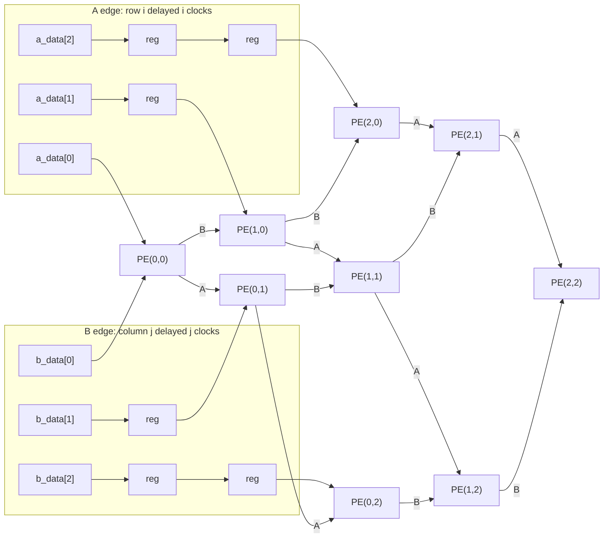
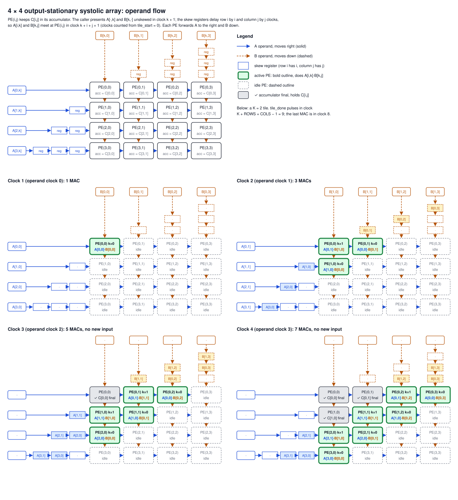

# Systolic array (`systolic_array`)

The systolic array is the compute core of the accelerator: `ROWS` × `COLS` [processing elements](processing-element.md) in a grid, with the input skew registers in front of them and a counter that says when a tile is finished. It computes one output tile, C (`ROWS` × `COLS`) = A (`ROWS` × K) · B (K × `COLS`), output-stationary: PE(i, j) keeps C[i, j] in its accumulator for the whole tile while the operands flow past it. One RTL serves every size; 4 × 4, 8 × 8 and 16 × 16 are the same file with different `ROWS` and `COLS`.

- RTL: [hardware/accelerators/matmul/rtl/systolic_array.sv](../../../hardware/accelerators/matmul/rtl/systolic_array.sv)
- Reference: [`matmulInt8`](../../../packages/accelerator-reference/src/model/matmul.ts) in `@vcpu/accelerator-reference`, a whole tile at a time
- Unit test: [tb/unit/tb_systolic_array.sv](../../../hardware/accelerators/matmul/tb/unit/tb_systolic_array.sv), run by `make -C hardware/accelerators/matmul test-array` at all three sizes
- Contract: [architecture.md](architecture.md), whose `systolic_array` port table and dataflow timing this module implements

## Parameters and ports

| Parameter | Default                  | Meaning                                      |
| --------- | ------------------------ | -------------------------------------------- |
| `ROWS`    | 4                        | PE rows: the M side of an output tile        |
| `COLS`    | 4                        | PE columns: the N side of an output tile     |
| `DATA_W`  | `matmul_pkg::DATA_W` (8) | Operand width, signed                        |
| `ACC_W`   | `matmul_pkg::ACC_W` (32) | Accumulator width, signed, wraps on overflow |

| Port         | Dir | Width                     | Meaning                                                                                        |
| ------------ | --- | ------------------------- | ---------------------------------------------------------------------------------------------- |
| `clk`, `rst` | in  | 1                         | The clock; synchronous active-high reset (clears the accumulators, valid bits and the counter) |
| `tile_start` | in  | 1                         | Start a tile: clear every accumulator and load the completion counter. Ignored while `busy`    |
| `tile_k`     | in  | `CFG_W` (16)              | The tile's reduction length K (1 … `MAX_DIM`), sampled with `tile_start`                       |
| `a_valid`    | in  | `ROWS`                    | Bit i: `a_data` element i is valid                                                             |
| `a_data`     | in  | `ROWS` × `DATA_W`, packed | Element i: row i's operand A[i, k], **unskewed**                                               |
| `b_valid`    | in  | `COLS`                    | Bit j: `b_data` element j is valid                                                             |
| `b_data`     | in  | `COLS` × `DATA_W`, packed | Element j: column j's operand B[k, j], **unskewed**                                            |
| `c`          | out | `ROWS` · `COLS` × `ACC_W` | Every accumulator, PE(i, j) at element i · `COLS` + j (a combinational read of the registers)  |
| `tile_done`  | out | 1                         | One-clock pulse: the first clock in which every accumulator holds the tile's final sum         |
| `busy`       | out | 1                         | High from the clock after an accepted `tile_start` until the clock before `tile_done`          |

The vector ports are packed (`logic [ROWS-1:0][DATA_W-1:0] a_data`), not unpacked arrays, because Yosys' `read_verilog -sv` rejects unpacked array ports. A packed element is unsigned as a slice; every element is a signed two's-complement value and the PEs' signed ports reinterpret it as one.

## Dataflow

The figure is a 3 × 3 array; every size is the same pattern from `generate` loops.

- **A moves right, B moves down.** Each PE registers its operands and their valid bits and passes them on every clock: A to PE(i, j + 1), B to PE(i + 1, j). The operands leaving the right and bottom edges are dropped.
- **The skew is inside the array.** The caller presents A[i, k] for every row and B[k, j] for every column in the same clock, k. Row i then passes through i delay registers before PE(i, 0), and column j through j before PE(0, j): a triangular shift-register structure of `ROWS` · (`ROWS` − 1) / 2 + `COLS` · (`COLS` − 1) / 2 stages, each `DATA_W` + 1 bits (operand and valid; the valid bits are reset). Row 0 and column 0 have no delay. A[i, k] reaches PE(i, j) after i + j clocks (i in the skew, j through the PEs to its left), and B[k, j] after j + i, so **the matching pair meets at PE(i, j) in operand clock k + i + j**.
- **A PE accumulates only when both arriving valid bits are high** (the PE ANDs them). Because the skew delays valid bits with the data, they coincide exactly for matching k.
- **Not all at once.** The PEs on one anti-diagonal (equal i + j) work in the same clocks; each anti-diagonal starts and finishes one clock after the previous one. No PE assumes its neighbours have valid operands in the same clock.

## Timing and the completion protocol

Clocks are numbered from the `tile_start` clock, 0. The **operand clocks** are the K clocks right after it: operand clock k is clock k + 1.

| Clock (from `tile_start`) | What happens                                                                                                                 |
| ------------------------: | ---------------------------------------------------------------------------------------------------------------------------- |
|                         0 | `tile_start` is high, `busy` low: the tile is accepted. Every accumulator is zeroed at the end of the clock; `tile_k` loaded |
|                     1 … K | Operand clocks 0 … K − 1: the caller presents A[·, k] and B[k, ·] with every valid bit high                                  |
|             k + i + j + 1 | PE(i, j) does its MAC for k (operand clock k + i + j)                                                                        |
|   K + `ROWS` + `COLS` − 2 | The far corner PE(`ROWS` − 1, `COLS` − 1) does its last MAC (k = K − 1)                                                      |
|   K + `ROWS` + `COLS` − 1 | **`tile_done` pulses**; `busy` is low; every element of `c` is final                                                         |

So **`tile_done` comes K + `ROWS` + `COLS` − 1 clocks after `tile_start`**, which is K + `ROWS` + `COLS` − 2 clocks after the first operand clock: operand clock K + `ROWS` + `COLS` − 2, exactly the clock [architecture.md](architecture.md) gives. Counting the first operand clock as the first clock, `tile_done` is in the (K + `ROWS` + `COLS` − 1)-th. The unit test asserts this clock for every tile, K = 1 and K = 64 included.

The counter implements it directly: an accepted `tile_start` loads `tile_k` + `ROWS` + `COLS` − 2, the counter counts down by one per clock, and `tile_done` is the clock it reads zero. `busy` is high while it is non-zero.

Rules for the caller (the controller of `matmul_top`):

- **Operands start the clock after `tile_start`.** The first operand clock must be clock 1; a clear and a MAC in the same clock would lose the MAC (the PE's clear wins).
- **No gaps.** The K operand clocks are consecutive, and every valid bit is low outside them. The counter counts clocks, not operands, so an idle clock inside a tile would make `tile_done` early: idle clocks are not supported in r1, and the unit test's driver self-checks that it never inserts one. The array has no stall input and no back-pressure: it is a **no-stall** pipeline.
- **All rows and columns stream together.** Edge-tile rows and columns past M or N are fed **valid zeros**, as [architecture.md](architecture.md) requires, so every PE sees exactly K valid pairs.
- **`tile_start` while `busy` is ignored**: no clear, no reload. The unit test pulses it, with a different `tile_k`, in the second operand clock and in the last busy clock (K + `ROWS` + `COLS` − 2) of every other tile and checks that nothing changes.
- **The next tile.** `busy` is low in the `tile_done` clock, so the next `tile_start` may come in that clock or any later one; the unit test starts tiles in the `tile_done` clock, in the clock right after it, and after idle clocks, with no reset in between. The results in `c` are final from the `tile_done` clock until the end of the clock of the next accepted `tile_start`, which clears them, so the caller reads (stores) them in that window.
- **`tile_k` is 1 … `MAX_DIM`.** The controller never sends 0 (it rejects K = 0 with `ERR_DIM_ZERO`); a 0 would give an all-zero tile with `tile_done` at clock `ROWS` + `COLS` − 1.

## A 4 × 4 tile with K = 3, clock by clock

`make -C hardware/accelerators/matmul trace-array` runs the 4 × 4 testbench and prints this table for its K = 3 tile (`random-4x4-k3-s1`) to `build/unit/array-4x4/trace-k3.md`. Every row is one clock, sampled 1 ns after the inputs change. A row's four "k at PE(i, 0…3)" columns show, for PE(i, 0), PE(i, 1), PE(i, 2) and PE(i, 3), the k of the pair that PE actually multiplied in that clock (its two input valid bits were both high), or · when it was idle. The testbench also checks that those operands were A[i, k] and B[k, j].

| Clock (from tile_start) | Operand clock | Inputs                     | k at PE(0, 0…3) | k at PE(1, 0…3) | k at PE(2, 0…3) | k at PE(3, 0…3) | MACs | busy | tile_done |
| ----------------------: | ------------: | -------------------------- | :-------------: | :-------------: | :-------------: | :-------------: | ---: | :--: | :-------: |
|                       0 |             – | `tile_start`, `tile_k` = K |     · · · ·     |     · · · ·     |     · · · ·     |     · · · ·     |    0 |  0   |     0     |
|                       1 |             0 | A[·, 0], B[0, ·]           |     0 · · ·     |     · · · ·     |     · · · ·     |     · · · ·     |    1 |  1   |     0     |
|                       2 |             1 | A[·, 1], B[1, ·]           |     1 0 · ·     |     0 · · ·     |     · · · ·     |     · · · ·     |    3 |  1   |     0     |
|                       3 |             2 | A[·, 2], B[2, ·]           |     2 1 0 ·     |     1 0 · ·     |     0 · · ·     |     · · · ·     |    6 |  1   |     0     |
|                       4 |             3 | –                          |     · 2 1 0     |     2 1 0 ·     |     1 0 · ·     |     0 · · ·     |    9 |  1   |     0     |
|                       5 |             4 | –                          |     · · 2 1     |     · 2 1 0     |     2 1 0 ·     |     1 0 · ·     |   10 |  1   |     0     |
|                       6 |             5 | –                          |     · · · 2     |     · · 2 1     |     · 2 1 0     |     2 1 0 ·     |    9 |  1   |     0     |
|                       7 |             6 | –                          |     · · · ·     |     · · · 2     |     · · 2 1     |     · 2 1 0     |    6 |  1   |     0     |
|                       8 |             7 | –                          |     · · · ·     |     · · · ·     |     · · · 2     |     · · 2 1     |    3 |  1   |     0     |
|                       9 |             8 | –                          |     · · · ·     |     · · · ·     |     · · · ·     |     · · · 2     |    1 |  1   |     0     |
|                      10 |             9 | –                          |     · · · ·     |     · · · ·     |     · · · ·     |     · · · ·     |    0 |  0   |     1     |

Reading it:

- **Fill.** The caller stops presenting operands after operand clock 2 (clock 3), but the skew registers and the PEs still hold them: PE(3, 0) does its first MAC (k = 0) only in operand clock 3, three clocks after PE(0, 0), and the active PEs grow 1, 3, 6, 9, 10 while the wavefront spreads.
- **Drain.** From operand clock 5 the number of active PEs shrinks again, 9, 6, 3, 1, until the corner PE(3, 3) multiplies its last pair, k = 2, in operand clock 8 = K + `ROWS` + `COLS` − 3.
- **Final values.** A PE's accumulator is final from the clock after its k = 2 MAC: PE(0, 0) from clock 4, an anti-diagonal later for each step towards the corner. Only when the corner is final, in clock 10 = K + `ROWS` + `COLS` − 1 after `tile_start`, does `tile_done` pulse; `busy` drops in the same clock.
- The 48 MACs (4 · 4 · 3) are spread over 9 clocks (1 … 9) of 16 PEs.

### Seeing it

The diagram above, [images/systolic-4x4-dataflow.svg](images/systolic-4x4-dataflow.svg), is the 4 × 4 array with its input skew registers (row i has i, column j has j), and then four clocks of a K = 2 tile: in each frame a green PE with a bold outline multiplies the A[i, k] · B[k, j] it names, a dashed PE is idle, a grey ✓ PE already holds C[i, j], and the skew registers show the operands still on their way. [images/systolic-4x4.html](images/systolic-4x4.html) animates the K = 3 tile of the table above with small signed values: open it from disk (it is one self-contained file and makes no network requests), step with ← / → or Prev / Next, or Play. Every clock shows the operands each PE multiplies, its accumulator, the skew registers' contents and the same schedule table with the current clock highlighted; at clock 10 (`tile_done`) all 16 accumulators equal C = A · B, which the page checks against the reference product.

Both are teaching aids drawn from the timing rule of this document, not simulations of the RTL. `pnpm --filter @vcpu/accelerator-reference gen-viz` regenerates the SVG and the trace the page embeds from [src/viz/schedule.ts](../../../packages/accelerator-reference/src/viz/schedule.ts), and its Vitest test checks that the schedule equals the table above clock for clock, that the final accumulators equal `matmulInt8`, and that the page's embedded trace is the regenerated one.

## Utilisation of one tile

A tile occupies the array for K + `ROWS` + `COLS` − 1 clocks, from `tile_start` through `tile_done`, and performs `ROWS` · `COLS` · K MACs, so its PE utilisation is

> `ROWS` · `COLS` · K / (`ROWS` · `COLS` · (K + `ROWS` + `COLS` − 1)) = K / (K + `ROWS` + `COLS` − 1)

(Counting only the clocks with a MAC, 1 … K + `ROWS` + `COLS` − 2, gives K / (K + `ROWS` + `COLS` − 2), the figure in [architecture.md](architecture.md).) The fill and drain cost `ROWS` + `COLS` − 1 clocks whatever K is, so short reductions on big arrays waste most of the grid:

| Array   | K = 3           | K = 16           | K = 64           |
| ------- | --------------- | ---------------- | ---------------- |
| 4 × 4   | 3 / 10 = 30.0 % | 16 / 23 = 69.6 % | 64 / 71 = 90.1 % |
| 8 × 8   | 3 / 18 = 16.7 % | 16 / 31 = 51.6 % | 64 / 79 = 81.0 % |
| 16 × 16 | 3 / 34 = 8.8 %  | 16 / 47 = 34.0 % | 64 / 95 = 67.4 % |

These follow from the `tile_done` clock the unit test measures; they are a single tile in isolation. A whole matmul adds the controller's own clocks (buffer reads, stores, tile changes), and its reported utilisation is measured on `matmul_top`, never computed from this table.

## Verification

`make -C hardware/accelerators/matmul test-array` runs `test-array-4`, `test-array-8` and `test-array-16` (the three required sizes), `test-array-4x8` (a non-square 4 × 8 array, so a mix-up of `ROWS` and `COLS` cannot pass on square arrays alone) and `test-array-corrupt`. Each generates its suite with `pnpm --filter @vcpu/accelerator-reference gen-tile-suite --rows R --cols C --seed S --count N` into `build/vectors/array-RxC/` (one matmul case per tile, M = `ROWS` and N = `COLS`, in the [vector format](architecture.md#verification-and-vectors), plus `cases.txt`), builds the testbench with Verilator `-Wall -GROWS=R -GCOLS=C` into `build/unit/array-RxC/`, and runs every case. `ARRAY_SEED` (default 1) and `ARRAY_RANDOM_TILES` (default 30) select other tiles. One case alone is `gen-tile-vectors --rows R --cols C --k K --seed S [--generator G]`.

Each suite is 8 directed tiles and then the random ones:

| Tile                  | K                           | What it covers                                                                    |
| --------------------- | --------------------------- | --------------------------------------------------------------------------------- |
| `zero`                | 16                          | B all zeros: C = 0 with random A                                                  |
| `identity`            | `COLS`                      | B the identity: C = A                                                             |
| `min`                 | 64                          | Every operand −128: the largest product (+16 384) at the largest K, C = 1 048 576 |
| `max`                 | 64                          | Every operand 127                                                                 |
| `mixed`               | 17                          | Checkerboards of 127 and −128: mixed signs at the extremes                        |
| `random` K = 1        | 1                           | One product per PE: the shortest tile                                             |
| `random` K = 3        | 3                           | The traced tile above                                                             |
| `random` K = 64       | `MAX_DIM`                   | The longest r1 tile                                                               |
| `rand000` … `rand029` | 1 … 64, drawn from the seed | Uniform operands over −128 … 127                                                  |

For every tile, in every clock, the testbench checks that each PE accumulates exactly when it is due (operand clock k + i + j) and then multiplies A[i, k] by B[k, j]; that there are `ROWS` · `COLS` · K MACs in all; that `busy` is high exactly in clocks 1 … K + `ROWS` + `COLS` − 2 and `tile_done` exactly in clock K + `ROWS` + `COLS` − 1; and that in the `tile_done` clock every `c` element equals the reference's C[i, j]. (It also self-checks that its own driver presents operands in exactly clocks 1 … K.) The tiles run after one reset with no reset between them, and the start of each cycles through three cases: in the previous tile's `tile_done` clock, in the clock right after it, and after three idle clocks. In those idle clocks and in the next tile's `tile_start` clock, `busy` and `tile_done` must be low (except the previous `tile_done` in its own clock) and `c` must still hold the previous C. Every other tile also gets two ignored `tile_start` pulses while busy. Finally the last tile is reset in the middle of its operand stream, while operands sit in the skew registers, and rerun from the next clock: `c` must read 0 in its `tile_start` clock, `busy` must be low, and no operand from before the reset may reach a PE. Any failure prints `MISMATCH …` and exits non-zero.

Results at the default seed:

| Array   | Tiles (directed + random) | `tile_done` clock at K = 1 / K = 64 | Mismatches |
| ------- | ------------------------- | ----------------------------------- | ---------: |
| 4 × 4   | 38 (8 + 30)               | 8 / 71                              |          0 |
| 8 × 8   | 38 (8 + 30)               | 16 / 79                             |          0 |
| 16 × 16 | 38 (8 + 30)               | 32 / 95                             |          0 |
| 4 × 8   | 38 (8 + 30)               | 12 / 75                             |          0 |

`test-array-corrupt` proves the harness can fail on every run: it reruns the 4 × 4 testbench on a copy of the suite with C[0][0] of the first random tile changed by one, and requires a non-zero exit naming that element. RTL mutants were also checked by hand to fail: a completion counter one clock long, a counter that is not reset, `busy` dropping a clock early, rejecting a `tile_start` in the `tile_done` clock, clearing the accumulators at `tile_done`, a one-register row skew, skew valid bits (of both the rows and the columns) that are not reset, and `ROWS` used in place of `COLS` (caught by the 4 × 8 array).

`make lint ROWS=4|8|16` lints `systolic_array` with Verilator `--lint-only -Wall` at that size (each module as its own top until `matmul_top` exists); it is clean at all three.
