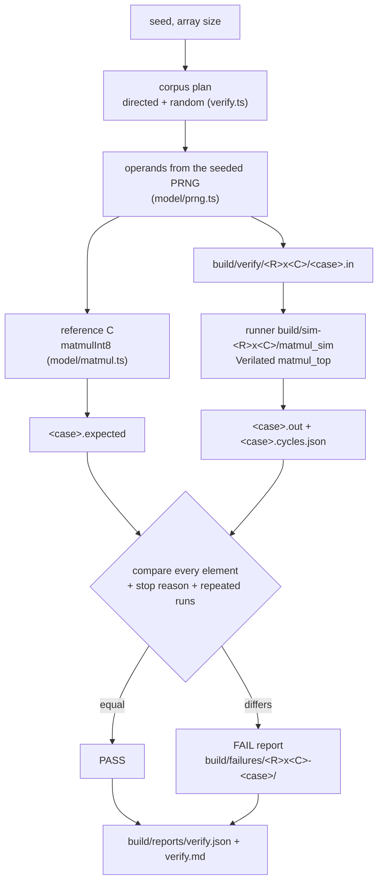

# Matmul accelerator verification strategy

The accelerator has to compute exactly what `@vcpu/accelerator-reference` computes: C = A · B with signed INT8 operands and a wrapping signed INT32 accumulator, for every M, N and K in 1 … 64, on every array size built from the one RTL. Several layers check this. Each layer can fail, and each one has been made to fail on purpose.

The most important layer is the **differential verification**, `make -C hardware/accelerators/matmul verify`. It generates matrices from a seed, computes the expected C in TypeScript, runs the same matrices through the Verilated `matmul_top` the way a host would (host port, `start`, `busy`, `done`, host port again), and compares every element of C. It does this for a directed corpus and seeded random matrices on the 4 × 4, 8 × 8 and 16 × 16 arrays.

## Verification layers

| Layer                         | Command (`make -C hardware/accelerators/matmul …`) | What it shows                                                                                                                                                                                                               | How it is made to fail                                                   |
| ----------------------------- | -------------------------------------------------- | --------------------------------------------------------------------------------------------------------------------------------------------------------------------------------------------------------------------------- | ------------------------------------------------------------------------ |
| Reference model               | `pnpm --filter @vcpu/accelerator-reference test`   | The triple loop, the wrap-around, the exact product and `fitsInt32`, the PRNG and the generators, the vector format, the verify corpus and report schema                                                                    | Vitest assertions                                                        |
| Processing element            | `test-pe`                                          | One PE against the clock-level PE model, clock by clock: signs, extremes, overflow wrap, `clear`, valid bits, reset ([processing-element.md](processing-element.md))                                                        | `test-pe-corrupt` changes one expected accumulator and requires the line |
| Systolic array                | `test-array`                                       | Single-tile matmuls at 4 × 4, 8 × 8, 16 × 16 and 4 × 8 through the skew registers and `tile_done` ([systolic-array.md](systolic-array.md))                                                                                  | `test-array-corrupt` changes one expected element and requires its name  |
| Top testbench                 | `test-top`                                         | Tiled matmuls through `matmul_top` at the same sizes, plus handshake timing, the cycle formulas, ignored writes and starts while busy, back-to-back runs and every error code ([controller.md](controller.md#verification)) | `test-top-corrupt`, the same way                                         |
| **Differential verification** | `verify`                                           | The directed corpus and `COUNT` (40) seeded random products per size, run through the Verilator runner and compared element by element; repeated runs, reset mid-run and restart                                            | `verify-mutant`, below                                                   |
| **Mutation**                  | `verify-mutant`                                    | Six deliberately broken copies of `rtl/`; `verify` must catch every one                                                                                                                                                     | A surviving mutant fails the target                                      |

`test-top` and `verify` overlap on purpose but differ in kind. `test-top` is a SystemVerilog testbench that watches internal signals and timing clock by clock. `verify` treats the accelerator as a black box behind its host port, as the benchmarks and any later integration will, and scales to hundreds of products; its runner is also the one the benchmark, waveform and CI tickets use.

## The pipeline



`@vcpu/accelerator-reference verify` ([verify.ts](../../../packages/accelerator-reference/src/harness/verify.ts)) asks each runner for its array size (`matmul_sim --info`, read from the built RTL's parameters, so a runner can never be paired with the wrong corpus), plans that size's corpus, and runs the cases with a bounded pool of runner processes (one per CPU). For every case it writes the vector files with `writeCase` (`.in`, `.expected`, `.json` sidecar), runs the runner, and judges the result. A case fails when:

- the runner exits non-zero or is killed (a malformed case file is exit 2; the wall-clock limit is 120 s);
- the runner's `stop` is `error` (the controller raised `error` on a valid case) or `timeout` (`done` never pulsed within four times the documented clocks from start to done, plus 1,000);
- C has the wrong length, or any element differs from the reference;
- in a repeated-execution case, any run after the first produced a different C or different clock counts;
- in the `reset-restart` case, the first run finished without reaching STORE, so the reset never interrupted it.

The run keeps going after a failure. It prints a report for each failing case (up to 25 are saved; the rest get one line), a summary per size, and `verify: PASS, <n>/<n> cases …` or `verify: FAIL, …`; the exit code is 0 only when every case passed, 1 when any failed, 2 when a runner is missing or unusable.

## The runner

`tb/sim/matmul_sim.cpp` drives `tb/sim/matmul_sim_top.sv` (`matmul_top` plus three constant outputs naming its size) directly through the Verilated model; there is no DPI. `make sim ROWS=8` builds `build/sim-8x8/matmul_sim`, `make sim-all` the three required sizes. One run is:

1. **transfer in**: A and B through the two host write ports in parallel, one element per port per clock: max(M · K, K · N) clocks;
2. **start**: one clock with `start` and `cfg_m`/`cfg_n`/`cfg_k`;
3. **busy**: until the `done` pulse (or `error`, or the cycle limit); the controller's `cycles_compute` and `cycles_store` counters are read at `done`;
4. **transfer out**: C through the registered host read port, M · N + 1 clocks, the first being the `done` clock.

It writes `<case>.out` (C, in the `.expected` format) and `<case>.cycles.json` (schema `RunnerCyclesSchema` in [report.ts](../../../packages/accelerator-reference/src/harness/report.ts)): the array, M, N, K, MACs, tiles, `transferIn`, `compute`, `store`, `busy`, `transferOut`, `total` = transferIn + 1 + busy + transferOut, the stop reason and error code, the repeat flags, whether the `--abort-first` run really was reset in STORE (a `reset-restart` case fails if not). The counts are RTL clock edges, identical to the formulas in [controller.md](controller.md#cycle-formulas); they are never wall-clock time. `--repeat N` runs the case N times in one process without a reset, `--reset-between` holds reset for two clocks between the runs, and `--abort-first` first starts the case and asserts reset in its first STORE clock, with part of C stored, before the runs. `make simulate CASE=<file.in> ROWS=…` runs one case, prints this breakdown and checks C against the `<name>.expected` next to the case:

```text
$ make -C hardware/accelerators/matmul simulate ROWS=16 CASE=…/random-m13-n11-k19-s1.in
case          …/random-m13-n11-k19-s1.in
array         16x16 (MAX_DIM 64)
dims          M 13, N 11, K 19 (2717 MACs, 1 tiles)
runs          1; 0 differ from the first
stop          done
transferIn    247
compute       51
store         143
busy          196 (compute + store + 2 control)
transferOut   144
total         588
C matches …/random-m13-n11-k19-s1.expected (143 elements)
```

`--wave <file.vcd>` exists only in a tracing build (Verilator `--trace`); the default runner rejects it, so verification never pays for tracing. The waveform targets are the waveform ticket's.

## Corpora

Every case is a function of the seed and the array size alone, so a run is reproducible: the same `SEED` and `COUNT` write byte-identical case files, outputs and cycle files, and `verify` deletes `build/verify/<R>x<C>/` first so the directory holds exactly the corpus.

**Directed** (22 per size, operands drawn from `SEED`):

| Case                     | M × K · K × N                                         | Why                                                      |
| ------------------------ | ----------------------------------------------------- | -------------------------------------------------------- |
| `small`                  | 2 × 2 · 2 × 3                                         | smaller than the array in every dimension                |
| `one-tile`               | R × R · R × C                                         | exactly one full output tile                             |
| `large`                  | 64 × 64 · 64 × 64                                     | the largest product within capacity                      |
| `nonsquare`              | 13 × 19 · 19 × 11                                     | non-square, not a multiple of any size                   |
| `wide`, `tall`           | 5 × 33 · 33 × 64, 64 × 50 · 50 × 7                    | a short wide C, a tall narrow C (N < M)                  |
| `edge-tiles`             | (2R + 1) × 7 · 7 × (2C − 1)                           | edge tiles in both dimensions                            |
| `edge-far`               | 63 × 62 · 62 × 61                                     | edge tiles at the far end of the buffers                 |
| `negative`               | 24 × 26 · 26 × 22                                     | A and B all negative                                     |
| `negpos`                 | 19 × 21 · 21 × 23                                     | A negative, B non-negative                               |
| `zero`                   | 23 × 31 · 31 × 29                                     | B all zeros                                              |
| `identity`               | 27 × 20 · 20 × 20                                     | B the identity, so C = A                                 |
| `all-min`, `all-max`     | 64³                                                   | every operand −128 (the largest products, +16384) or 127 |
| `mixed`                  | 33 × 37 · 37 × 35                                     | checkerboards of 127 and −128                            |
| `m1`, `n1`, `k1`, `mnk1` | M = 1, N = 1, K = 1, 1 × 1 × 1                        | degenerate dimensions                                    |
| `dot`                    | 1 × 64 · 64 × 1                                       | one dot product of length 64                             |
| `repeat`                 | 21 × 17 · 17 × 19, 3 runs                             | repeated execution in one runner process, no reset       |
| `reset-restart`          | 30³, reset in STORE, then 2 runs with a reset between | reset during execution, then restart                     |

No r1 product can overflow INT32 (the largest |C| is 64 · 16384 = 2²⁰), so overflow is covered where it can occur, in the PE unit test.

**Random** (`COUNT` per size, 40 by default, so 120 across the three sizes): M is 64 one time in eight, a multiple of `ROWS` one time in eight, and otherwise a non-multiple of `ROWS` below 64 (N likewise with `COLS`), so most products have edge tiles; K is uniform in 1 … 64 (64 one time in eight); every tenth case forces M, N or K in turn to 64. Each size draws its own cases (the size is mixed into the seed), and each case has its own operand seed, recorded in its name (`rand007-random-m45-n13-k64-s<seed>`) and in the report.

The default run is 186 cases (66 directed, 120 random) and takes about a second plus the three runner builds (about 12 s) on a laptop.

## Reports

`build/reports/verify.json` (schema `VerifyReportSchema` in [report.ts](../../../packages/accelerator-reference/src/harness/report.ts), `schemaVersion` 1) records the result, the seed and count, the provenance (revision from `REVISION`, git commit and dirty flag, the `build/tool-versions.json` toolchain, refreshed by `make tools-check` before every run), per-size counts and runner paths, and every case sorted by size and name: dimensions, generator, seed, MACs, runner flags, result, reason, the number of differing elements and the first eight, and the runner's clock counts. `build/reports/verify.md` is the same as tables, with the clock breakdown of every case.

## Failures and replay

A failing case is saved under `build/failures/<R>x<C>-<case>/`:

- `case.in` and `case.expected`: the inputs and the reference C;
- `actual.out` and `cycles.json`: what the runner wrote;
- `case.json`: the size, the case, its runner flags and the runner it failed on;
- `report.txt`: the failure report; `found.txt`: the reason, the exact runner command line and the replay command.

```text
FAIL 4x4 edge-far-m63-n61-k62-s1: 122 of 3843 elements differ, first C[61][0]: expected 13766, actual 0 (-13766)
  array 4x4 · M 63 N 61 K 62 · directed · generator random · seed 1 · edge tiles at the far end of the buffers
  C[61][0]: expected 13766, actual 0 (-13766)
  C[61][1]: expected -70169, actual 0 (+70169)
  …
  replay: make -C hardware/accelerators/matmul replay CASE=build/mutants/edge-row-mask-uses-n/failures/4x4-edge-far-m63-n61-k62-s1
```

`make replay CASE=<dir>` first rebuilds the three runners from `rtl/` (so after a fix it runs the fixed RTL), then reruns the saved case on the runner it failed on (`SIM=<runner>` picks another), prints the report and says whether it equals `report.txt`; it exits non-zero while the case still fails. `make simulate ROWS=<R> CASE=<dir>/case.in` shows the clock breakdown of a single run of the same case and checks it against `case.expected`; `found.txt` has the exact runner command, with the case's repeat and reset flags. To keep a failure in the corpus for good, add its dimensions, generator and seed as a directed case in `directedPlan` (a case is a function of those alone), with a line in the table above.

## Mutation testing

`make verify-mutant` proves the corpus can see real bugs. Each block of [scripts/mutants.txt](../../../hardware/accelerators/matmul/scripts/mutants.txt) names a file in `rtl/`, a text that must occur exactly once, and its replacement. For every mutant the harness ([mutants.ts](../../../packages/accelerator-reference/src/harness/mutants.ts)) copies `rtl/` to `build/mutants/<id>/rtl/`, applies the change, builds runners at 4 × 4, 8 × 8 and 16 × 16 from the copy, and runs `verify` on them (the directed corpus and `MUTANT_COUNT`, 10, random cases per size). A mutant is caught when `verify` exits 1 with at least one failing case; its failures are saved under `build/mutants/<id>/failures/` and replay with `make replay`. `rtl/` itself is never modified, and a mutant whose text no longer occurs exactly once is an error, never a skip. `MUTANT=<id>` runs one; `build/reports/mutants.json` records them all.

Seed 1, 32 cases per size:

| Mutant                 | The bug                                                                     | Failing cases (4 × 4, 8 × 8, 16 × 16) |
| ---------------------- | --------------------------------------------------------------------------- | ------------------------------------- |
| `pe-sign-extension`    | the PE zero-extends A instead of sign-extending it                          | 29, 29, 29                            |
| `skew-off-by-one`      | rows 2 and below of A get one skew register too few                         | 27, 27, 27                            |
| `edge-row-mask-uses-n` | the edge mask of A's rows compares with N instead of M                      | 14, 13, 13                            |
| `pe-clear-ignored`     | `tile_start` does not clear the accumulators                                | 27, 27, 26                            |
| `edge-col-store-short` | an edge tile stores one column too few                                      | 21, 23, 22                            |
| `last-k-dropped`       | COMPUTE ends one operand clock early (and never ends when K = 1: a timeout) | 31, 31, 31                            |

All six are caught at every size, `edge-row-mask-uses-n` only by products with N < M (`tall`, `n1`, `edge-far`, and random ones), which is why the corpus has them. Some plausible-looking mutants are equivalent and cannot be caught by any matmul: feeding garbage instead of zeros into rows ≥ M or columns ≥ N of an edge tile only changes PEs whose results are never stored, and storing past M or N only writes buffer entries outside C. The architecture zeroes and masks them anyway; `test-top` checks the zeros directly.

To add a mutant, append a block to `scripts/mutants.txt` and run `make verify-mutant MUTANT=<id>`. If it survives, either it is equivalent (explain why here) or the corpus has a gap: add the directed case that catches it, never weaken the mutant.

## What is not covered

- Timing inside a run is checked by `test-top` (the cycle formulas, the one-clock `done`), not by `verify`, which records the counts but accepts any timing that produces the right C. The benchmark ticket reports them.
- The `repeat` case reruns the same A and B, so a later run that skipped some stores would still read the earlier run's correct C back; `test-top`'s reuse cases run different products on the same buffers.
- Products above 64 in any dimension and K-chunking with partial-sum write-back are not in r1; invalid dimensions (0 or above 64) are covered by `test-top`'s error checks, not by `verify`.
- The host port is a testbench convenience; a production DMA or AXI interface, back-pressure and stalls are not modelled.
- Verification is simulation with two-state Verilator semantics; X propagation, gate-level netlists and formal proofs of the accelerator are not done.
