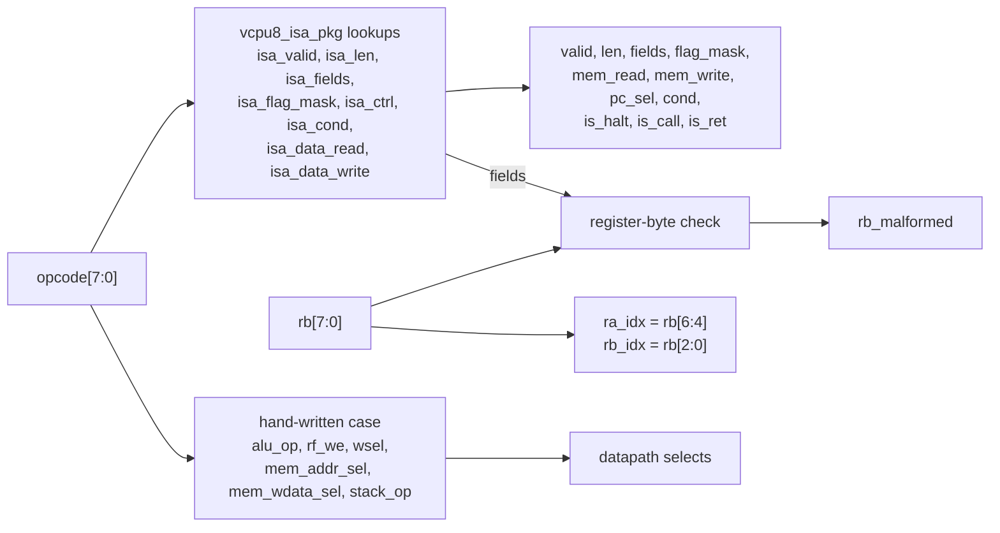
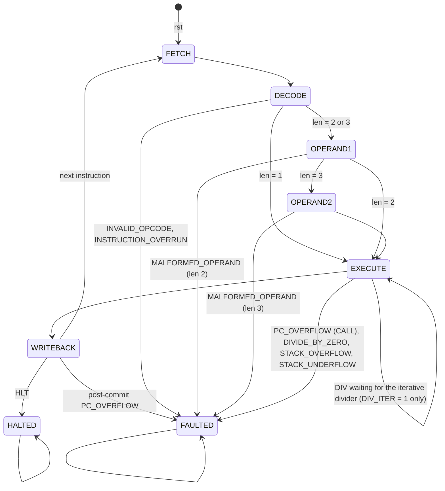

# Control Unit

The control unit tells the datapath what to do for each instruction. It has two parts:

- the **decoder**, `vcpu8_decoder`, a block of combinational logic. It turns the opcode byte and the register byte into control signals.
- the **control FSM**, which steps each instruction through fetch, decode, operands, execute and writeback, and detects faults.

[The decoder](#decoder) is described first, then [the control FSM](#control-fsm).

## Decoder

`hardware/rtl/vcpu8/core/vcpu8_decoder.sv` is purely combinational. It has no clock, no flip-flops and no memory. Its outputs depend only on its two inputs at that moment:

| Input         | Width | Meaning                                                                            |
| ------------- | ----- | ---------------------------------------------------------------------------------- |
| `opcode[7:0]` | 8     | Byte 0 of the instruction (`IR.op`)                                                |
| `rb[7:0]`     | 8     | Byte 1, the register byte `{a[3:0], b[3:0]}` (`IR.rb`); ignored when there is none |

| Output                         | Meaning                                                                                                       |
| ------------------------------ | ------------------------------------------------------------------------------------------------------------- |
| `valid`                        | The byte is an ISA 1.0.0 opcode. 0 means `INVALID_OPCODE`                                                     |
| `len[1:0]`                     | Instruction length, 1–3 bytes (0 when invalid)                                                                |
| `fields[1:0]`                  | Register-byte fields used: `ISA_FIELDS_NONE`, `_A` (field b must be 0) or `_AB`                               |
| `rb_malformed`                 | The register byte is malformed for this opcode. 1 means `MALFORMED_OPERAND`                                   |
| `ra_idx[2:0]`, `rb_idx[2:0]`   | Register-file read addresses: `rb[6:4]` (field a) and `rb[2:0]` (field b)                                     |
| `alu_op`                       | ALU operation (`alu_op_t`)                                                                                    |
| `rf_we`, `wsel`                | Register write enable and write-back source: `WSEL_ALU`, `_TB`, `_MEM` or `_RB`. The write address is field a |
| `mem_read`, `mem_write`        | One data-memory read (LOAD, POP, RET) or write (STORE, PUSH, CALL)                                            |
| `mem_addr_sel`                 | Data address: `MEM_ADDR_TB`, `_RA`, `_RB`, `_SP` or `_SP1` (SP + 1)                                           |
| `mem_wdata_sel`                | Write data: `MEM_WDATA_RA`, `_RB` or `_RET_ADDR` (CALL's return address, PC + 2)                              |
| `flag_mask[3:0]`               | FLAGS bits the instruction writes, `{Z, C, N, V}`                                                             |
| `stack_op`                     | `STACK_NONE`, `STACK_PUSH` (SP − 1, SD + 1) or `STACK_POP` (SP + 1, SD − 1)                                   |
| `pc_sel`                       | Next PC: `PC_SEQ` (PC + len), `PC_HOLD`, `PC_TB`, `PC_COND` or `PC_MEM` (the popped byte)                     |
| `cond`                         | Branch condition for `PC_COND`: `COND_Z`, `COND_NZ`, `COND_C` or `COND_NC`                                    |
| `is_halt`, `is_call`, `is_ret` | HLT, CALL and RET, which the FSM treats specially (halt, `PC_OVERFLOW` on CALL, stack checks)                 |
| `is_div`                       | DIV, for the `DIVIDE_BY_ZERO` check in EXECUTE                                                                |

The select enums are in `core/vcpu8_types_pkg.sv`. The value 0 of every enum is the decoder's default. So an output an instruction does not use reads 0, and an invalid opcode drives every output to 0.

### The opcode table as logic

In software, the opcode table is data that a program looks up. In hardware, the decoder _is_ the table. Each output is a Boolean function of the 16 input bits. The `case (opcode)` statement is just a readable way to write those functions down.

A synthesis tool can build such a function in two ways:

- **As a ROM.** Use the opcode as an address into a 256-entry memory whose words are the control signals. This is simple and regular. It is wasteful here, though, because 226 of the 256 entries are the same all-zero invalid row.
- **As sum-of-products logic.** For each output bit, OR together the opcodes that set it, and simplify. For example, `stack_op == STACK_PUSH` is 1 for exactly two opcodes (CALL `0x45` and PUSH `0x50`), so it needs only a few gates. Opcodes that share bits share logic. The opcode's high nibble is its category, so "is this an ALU instruction" is mostly a test of `opcode[7:4]`.

Yosys takes the second route: it synthesizes the case statements to gates and then minimizes them. The decoder is small. With the pinned Yosys 0.70, `synth -top vcpu8_decoder` gives 129 generic gates and no flip-flops, and `synth_ice40` maps it to 78 `SB_LUT4` cells. That is 16 input bits and 41 output bits. These figures come from running the two commands on the files in this commit. [synthesis-guide.md](synthesis-guide.md#results) reports the whole design.



### Generated outputs and design choices

The outputs fall into two groups, and they come from different places on purpose.

**ISA-derived outputs** come from the lookup functions in the generated `core/vcpu8_isa_pkg.sv`. That file is rendered from `OPCODES` in `@vcpu/shared` and drift-checked, so these outputs cannot disagree with the emulator. No opcode byte is typed by hand anywhere in the RTL.

| Output                                   | Source                                                                                                    |
| ---------------------------------------- | --------------------------------------------------------------------------------------------------------- |
| `valid`, `len`, `fields`, `flag_mask`    | `isa_valid`, `isa_len`, `isa_fields`, `isa_flag_mask`                                                     |
| `mem_read`, `mem_write`                  | `isa_data_read`, `isa_data_write` (CALL and PUSH write; POP and RET read)                                 |
| `pc_sel`, `is_halt`, `is_call`, `is_ret` | `isa_ctrl`: SEQ → `PC_SEQ`, HALT → `PC_HOLD`, JUMP and CALL → `PC_TB`, BRANCH → `PC_COND`, RET → `PC_MEM` |
| `cond`                                   | `isa_cond`, which is `{flag bit index, value}`, re-encoded as `{is C, value}`                             |
| `is_div`                                 | `opcode == OP_DIV`                                                                                        |

**Microarchitectural outputs** are choices this datapath makes. A different implementation of ISA 1.0.0 could make different ones. They come from one hand-written `case (opcode)` that follows the decoder table in [hardware-porting.md](../hardware-porting.md#decoder-decoder). The block sets every default first, and each row then names only what it uses:

- `alu_op`. CMP has no ALU operation of its own: it uses `ALU_SUB` with `rf_we = 0`, so it sets exactly the flags SUB would.
- `rf_we` and `wsel`: the ALU result, the trailing byte (LDI), the memory read data (LOAD, POP) or port B (MOV).
- `mem_addr_sel` and `mem_wdata_sel`. The two STORE forms carry their registers in different fields. `STORE [addr8], Rs` has Rs in field a, so its data comes from port A. `STORE [Rp], Rs` has the pointer in field a and Rs in field b, so its address comes from port A and its data from port B.
- `stack_op`: CALL and PUSH push, RET and POP pop.

Nothing in TypeScript names these selects. So the testbench checks them against a directed copy of the 30-row table, and cross-checks what TypeScript _can_ express. `rf_we` must equal "the opcode has an operand with role `dest`", and `mem_read`/`mem_write` must equal `dataReads`/`dataWrites`.

### Register-byte validation and `MALFORMED_OPERAND`

A register byte holds two 4-bit fields, a = `rb[7:4]` and b = `rb[3:0]`. Only R0–R7 exist, so the top bit of a used field must be 0, and a field the format does not use must be all zero:

| `fields` | Formats               | Malformed when               |
| -------- | --------------------- | ---------------------------- |
| `A`      | R, RI, RA             | `rb[7]` or `rb[3:0] != 4'h0` |
| `AB`     | RR                    | `rb[7]` or `rb[3]`           |
| `NONE`   | N, A, invalid opcodes | never                        |

Opcodes whose `fields` is `NONE` can never be malformed. That covers the one-byte instructions (NOP, HLT, RET) and the A format (JMP, Jcc, CALL), whose byte 1 is an address. The FSM latches that byte into `IR.tb`, not `IR.rb`. Because the decoder still computes `rb_malformed` for every opcode, the FSM can sample it at the end of OPERANDS without first checking the format.

`rb_malformed` is a request to fault, not the fault itself. The FSM raises `MALFORMED_OPERAND` from it in OPERANDS. That is after `INVALID_OPCODE` and `INSTRUCTION_OVERRUN` have been ruled out in DECODE, and before any architectural state is written, so the fault is precise. The emulator reports field a before field b, but both give the same fault code, so the decoder needs only one bit.

### Invalid opcodes and `INVALID_OPCODE`

226 of the 256 opcode bytes are not instructions: `0x02`–`0x0F`, `0x16`–`0x1F`, `0x26`–`0x2F`, `0x37`–`0x3F`, `0x47`–`0x4F` and `0x52`–`0xFF`. They are never silently ignored. For any of them the decoder drives `valid = 0`, `len = 0`, `fields = NONE`, and every enable and select 0. The FSM sees `valid = 0` in DECODE and goes to FAULTED with `INVALID_OPCODE`. It does not fetch an operand byte or write anything. Because every enable is already 0, a wrong FSM transition could still not write state for an invalid opcode.

### Verification

`make -C hardware/rtl/vcpu8 test-decoder`, which is part of `make test`, builds `tb/unit/tb_vcpu8_decoder.sv` with Verilator and runs three checks. Each compares against a source outside the RTL:

1. **Opcode sweep.** It checks all 256 opcode bytes against `build/vectors/decoder-ops.hex`, which `@vcpu/rtl-tools` derives from `OPCODES`. The checks are `valid`, `len`, `fields`, `flag_mask`, the control flow (`pc_sel`, `is_halt`, `is_call`, `is_ret`), `cond`, `mem_read`/`mem_write` against the data reads and writes, and `rf_we` against "has a `dest` operand". An invalid byte must also drive every select to 0. The sweep must find exactly 30 valid opcodes. The generator's vitest test checks that this set equals `Op`.
2. **Register-byte sweep.** It checks all 65,536 (opcode, register byte) pairs against `build/vectors/decoder-rb.hex`. The generator builds that file by placing `[opcode, rb, 0x00]` at address 0 of a zeroed memory and calling cpu-core `decode()`. A pair is malformed exactly when `decode()` returns `MALFORMED_OPERAND`.
3. **Directed table.** The 30 rows of the decoder table in `hardware-porting.md` are transcribed into the testbench, one `row(...)` call each. Every row is checked in full, including the selects TypeScript has no notion of. The check also confirms that the rows cover exactly the valid opcodes.

The testbench prints the first mismatches with the opcode's name and exits non-zero if there are any. A passing run prints:

```text
tb_vcpu8_decoder: 256 opcode records (30 valid), 65536 register-byte records, 30 directed rows, 0 mismatches
```

`make -C hardware/rtl/vcpu8 test-decoder-mutant` shows that the testbench has teeth. It copies the decoder into `build/` with PUSH's `stack_op` changed to `STACK_NONE`, and passes only if the testbench then fails with a mismatch that names PUSH's `stack_op`. The source in `core/` is never modified.

To regenerate the vectors by hand, run `make -C hardware/rtl/vcpu8 gen-decoder-vectors`, or `pnpm --filter @vcpu/rtl-tools gen:decoder-vectors --out-dir <dir>`.

## Control FSM

`hardware/rtl/vcpu8/core/vcpu8_control.sv` is the sequential half of the control unit. It holds the FSM state and the CPU's control state (PC, SP, SD, IR, status, the fault record and `instret`), chooses the decoder's inputs, detects every fault, and drives the datapath's address select and write enables. It follows [hardware-porting.md](../hardware-porting.md#control-fsm-control_fsm); the few places where it differs are listed [at the end of this section](#differences-from-hardware-portingmd).

### States



The states are `fsm_state_t` in `core/vcpu8_types_pkg.sv`, and `dbg_state` shows the current one. In the default design every state lasts one cycle. The iterative-divider variant (`DIV_ITER = 1`, [below](#div-with-the-iterative-divider)) is the one exception: a DIV stays in EXECUTE until the divider is done. Reset puts the FSM in FETCH. HALTED and FAULTED are terminal: the FSM stays there, and nothing changes, until the next reset.

| State     | RAM address                                                                         | Decoder sees                       | Does                                                                                                                                                                               |
| --------- | ----------------------------------------------------------------------------------- | ---------------------------------- | ---------------------------------------------------------------------------------------------------------------------------------------------------------------------------------- |
| FETCH     | PC                                                                                  | IR (stale; ignored)                | Presents the opcode address. The RAM returns the byte at the end of the cycle.                                                                                                     |
| DECODE    | PC + 1 if the instruction is longer than 1 byte and has no fault, else PC           | opcode = `mem_rdata`               | Latches IR.op and the fetched length. Checks `INVALID_OPCODE`, then `INSTRUCTION_OVERRUN` (`{1'b0, PC} + len > 9'h100`). Goes to OPERAND1, or to EXECUTE for a 1-byte instruction. |
| OPERAND1  | PC + 2 for a 3-byte instruction, else PC                                            | IR.op, register byte = `mem_rdata` | Latches byte 1 into IR.rb and IR.tb. For a 2-byte instruction, checks `MALFORMED_OPERAND`. Goes to OPERAND2 or EXECUTE.                                                            |
| OPERAND2  | PC                                                                                  | IR.op, IR.rb                       | Latches byte 2 into IR.tb. Checks `MALFORMED_OPERAND` for the 3-byte instruction.                                                                                                  |
| EXECUTE   | the data address (LOAD, POP, RET read it; STORE, PUSH, CALL will write it), else PC | IR.op, IR.rb                       | Checks, in order, `PC_OVERFLOW` for a CALL at `0xFE`, then `DIVIDE_BY_ZERO`, `STACK_OVERFLOW` or `STACK_UNDERFLOW`. The ALU and the register reads settle.                         |
| WRITEBACK | the data address, else PC                                                           | IR.op, IR.rb                       | The single commit point; see below.                                                                                                                                                |
| HALTED    | PC                                                                                  | —                                  | Nothing. PC stays at the HLT.                                                                                                                                                      |
| FAULTED   | PC                                                                                  | —                                  | Nothing. `fault_code` and `fault_pc` hold the fault.                                                                                                                               |

The decoder is combinational and needs its inputs in the same cycle the bytes arrive. So the FSM routes them: in DECODE the opcode comes straight from `mem_rdata`, before IR.op is latched, and in OPERAND1 the register byte comes from `mem_rdata`. In every other state the decoder reads the latched IR. That keeps DECODE and OPERAND1 to one cycle each instead of adding a cycle to latch the byte first.

### DIV with the iterative divider

`vcpu8_control` takes the same `DIV_ITER` parameter as `vcpu8_core`, and the three handshake signals of [`vcpu8_divider`](alu.md#iterative-divider): `div_start` out, `div_busy` and `div_done` in.

- **In the first EXECUTE cycle of a DIV**, the divide-by-zero check runs exactly as in the default design. Only if `fault_now` is `FAULT_NONE` does `div_start` pulse, so a DIV by zero goes straight to FAULTED and never starts the divider.
- **In the following EXECUTE cycles** the divider is busy, `div_wait` (DIV and not `div_done`) is high, and the FSM stays in EXECUTE. Nothing is written in these cycles, because every write enable is gated by WRITEBACK as always. The operands cannot change under the divider either, since the register file is written only in WRITEBACK.
- **In the cycle `div_done` is high**, the FSM goes to WRITEBACK, where the ALU passes the divider's quotient to the register write and to FLAGS. WRITEBACK, and the post-commit `PC_OVERFLOW` of a DIV at `0xFE` (`tb/programs/div-pc-overflow.asm`), are unchanged.

So DIV spends 9 cycles in EXECUTE instead of 1 and takes 13 clocks instead of 5. With `DIV_ITER = 0` the parameter removes `div_wait` and `div_start` outright, the handshake inputs are ignored, and EXECUTE always lasts one cycle. The formal properties `fsm_t_execute` and `div_wait_bounded` ([formal-verification.md](formal-verification.md#2-legal-fsm)) allow EXECUTE → EXECUTE only for a DIV still waiting, and for at most 8 extra cycles.

### WRITEBACK, the commit point

At the rising edge that ends WRITEBACK, and at no other time:

- the register file writes field a, if the decoder's `rf_we` is set (data selected by `wsel`);
- the RAM writes, if the decoder's `mem_write` is set (address and data selected as in [datapath.md](datapath.md));
- FLAGS update through the decoder's `flag_mask` (the mask is 0 in every other state);
- SP and SD move by the decoder's `stack_op`;
- PC takes its next value;
- `instret` increments and `retire` is set for the next cycle, with `retire_pc` = this instruction's PC and `retire_op` its opcode;
- status becomes HALTED for HLT, or FAULTED for the post-commit `PC_OVERFLOW`, and otherwise the FSM returns to FETCH.

The next PC is chosen by the decoder's `pc_sel`:

| `pc_sel`  | Instructions     | Next PC                                                                                 |
| --------- | ---------------- | --------------------------------------------------------------------------------------- |
| `PC_HOLD` | HLT              | PC                                                                                      |
| `PC_TB`   | JMP, CALL        | IR.tb                                                                                   |
| `PC_MEM`  | RET              | `mem_rdata`, the byte popped from SP + 1                                                |
| `PC_COND` | JZ, JNZ, JC, JNC | IR.tb if the condition holds, else as `PC_SEQ`                                          |
| `PC_SEQ`  | everything else  | `seq[7:0]` = PC + len, or PC unchanged when `seq` = `0x100` (post-commit `PC_OVERFLOW`) |

The branch condition is `cond = {flag is C, value}`: the branch is taken when `(cond[1] ? C : Z) == cond[0]`. It reads FLAGS as they were before the instruction, which is correct because branches never write FLAGS.

### Faults

Every fault is detected by combinational logic (`fault_now`) in the state where its inputs are first available. When `fault_now` is non-zero at a rising edge, the FSM goes to FAULTED, status becomes `STATUS_FAULTED`, `fault_code` takes the fault's number and `fault_pc` the instruction's PC.

| Order | Fault                 | State                                | Condition                                                | Kind        | Fixtures                                                                      |
| ----- | --------------------- | ------------------------------------ | -------------------------------------------------------- | ----------- | ----------------------------------------------------------------------------- |
| 1     | `INVALID_OPCODE`      | DECODE                               | the decoder's `valid` is 0                               | precise     | `fault-invalid-opcode`, `-at-ff`                                              |
| 2     | `INSTRUCTION_OVERRUN` | DECODE                               | `{1'b0, PC} + len > 9'h100`                              | precise     | `fault-instruction-overrun-at-fe`, `-at-ff`, `fault-overrun-before-malformed` |
| 3     | `MALFORMED_OPERAND`   | OPERAND1 (len 2) or OPERAND2 (len 3) | the decoder's `rb_malformed`                             | precise     | `fault-malformed-register`, `-unused-field`, `-field-b`                       |
| 4     | `PC_OVERFLOW`         | EXECUTE                              | CALL and `seq[8]` (a CALL at `0xFE`)                     | precise     | `fault-pc-overflow-call`                                                      |
| 5     | `DIVIDE_BY_ZERO`      | EXECUTE                              | DIV and `rb_data == 0`                                   | precise     | `fault-divide-by-zero`                                                        |
| 5     | `STACK_OVERFLOW`      | EXECUTE                              | `stack_op` = push and SD = 64                            | precise     | `fault-stack-overflow`, `-call`                                               |
| 5     | `STACK_UNDERFLOW`     | EXECUTE                              | `stack_op` = pop and SD = 0                              | precise     | `fault-stack-underflow-pop`, `-ret`                                           |
| 6     | `PC_OVERFLOW`         | WRITEBACK                            | `pc_sel` sequential (or a branch not taken) and `seq[8]` | post-commit | `fault-pc-overflow-nop`, `-inc`, `-branch-not-taken`                          |

**Priority comes from the order of the states.** A fault can only be raised in the state where the FSM first has the information, and the FSM leaves for FAULTED as soon as one is found, so a later check never runs. An invalid opcode at `0xFF` is reported as `INVALID_OPCODE` because the validity test comes first in DECODE. `11 90` at `0xFE` is `INSTRUCTION_OVERRUN` because DECODE stops before OPERAND1 would examine the register byte. A CALL at `0xFE` with a full stack is `PC_OVERFLOW` because that test comes first in EXECUTE. The three faults of step 5 belong to different instructions (DIV, a push, a pop), so at most one can apply.

**No address past `0xFF` is driven.** DECODE asks for byte 1 only when the instruction fits (no fault), and OPERAND1 asks for byte 2 only for a 3-byte instruction that has already passed the overrun check. So PC + 1 and PC + 2 never wrap.

### Precise and post-commit faults

A **precise** fault is found in DECODE, OPERAND1, OPERAND2 or EXECUTE, before WRITEBACK. The FSM goes straight to FAULTED, and since every write enable (`rf_we`, `mem_we`, `flags_mask`, the SP/SD/PC updates) is gated by the WRITEBACK state, nothing architectural is written: registers, FLAGS, memory, SP, SD and PC keep their values, PC still points at the faulting instruction, `retire` does not pulse and `instret` does not change. No undo logic exists or is needed; precision comes from the shape of the FSM.

The **post-commit** `PC_OVERFLOW` is different. An instruction with a sequential next PC that ends at `0xFF` (a NOP at `0xFF`, an INC at `0xFE`, an LDI at `0xFD`, a branch at `0xFE` that is not taken) has nowhere to go: `seq` is `0x100`, which does not fit in PC. The instruction is otherwise fine, so its WRITEBACK commits as usual: the register, memory and flag writes happen, it retires (`retire` pulses, `instret` increments), and then status becomes FAULTED with `PC_OVERFLOW`. PC keeps the instruction's address, because `0x100` cannot be stored. A taken branch or a JMP at `0xFE` does not fault, because its next PC is the target.

The two fixtures that show the difference both pass on the RTL:

| Fixture                 | Final step                      | Steps | `instret` | Kind                                                             |
| ----------------------- | ------------------------------- | ----- | --------- | ---------------------------------------------------------------- |
| `fault-pc-overflow-nop` | NOP at `0xFF`, `PC_OVERFLOW`    | 2     | 2         | post-commit: the NOP retired, PC stays `0xFF`                    |
| `fault-divide-by-zero`  | DIV at `0x0B`, `DIVIDE_BY_ZERO` | 5     | 4         | precise: the DIV is a step but not a retirement, nothing written |

### Retirement

`retire` is a registered one-cycle pulse. It rises at the edge that ends WRITEBACK, together with every write of the instruction, so during the pulse the debug taps (`dbg_regs`, `dbg_pc`, `dbg_sp`, `dbg_sd`, `dbg_flags`), `status`, `fault_code` and `instret` already show the state **after** the instruction. `retire_pc` and `retire_op` name the instruction that retired. This makes the pulse the natural place to compare with the emulator's trace: the RTL runner writes one trace line per pulse.

A precise fault does not retire, but it is still a step (the emulator counts it toward `maxInstructions` and writes a trace line for it). Observers see it as the edge where `status` becomes FAULTED without a `retire` pulse; `fault_pc` gives the instruction's address. The post-commit `PC_OVERFLOW` is both: `retire` pulses and status is FAULTED in the same cycle.

`instret` is 32 bits and counts every retirement, HLT and the post-commit `PC_OVERFLOW` instruction included. It is compared with the fixtures' `expected.instructions`.

### Differences from hardware-porting.md

The FSM is the one hardware-porting.md describes, with these details settled:

- **Two named operand states.** "OPERANDS ×2" is two states, OPERAND1 and OPERAND2, so `dbg_state` says which byte is being read.
- **Byte 1 goes into both IR.rb and IR.tb, and byte 2 overwrites IR.tb.** IR.rb is then the register byte and IR.tb the instruction's last byte for every format, with no format-dependent mux on the latch. For the A format (JMP … CALL) the copy in IR.rb is unused: those opcodes have no register fields, so the decoder never reports it malformed and nothing reads it.
- **The register byte is checked once every byte is in.** For a 3-byte instruction the check is in OPERAND2, after byte 2 is latched, so a faulting step's IR holds all its bytes, as the emulator's does. The priority is unchanged: `INSTRUCTION_OVERRUN` has already been ruled out in DECODE, and nothing is written before EXECUTE.
- **DIV is combinational**, so it takes 5 clocks, not the 12 of the iterative divider hardware-porting.md describes ([vcpu8-microarchitecture.md](vcpu8-microarchitecture.md#clocks-per-instruction)). The optional iterative divider (`DIV_IMPL=ITER`) takes 13: its first iteration happens at the start edge and `done` is registered, so DIV holds EXECUTE for 8 extra cycles.
- **`retire` is registered**: it is high in the cycle after the WRITEBACK edge, when the committed state is visible, rather than during WRITEBACK.
