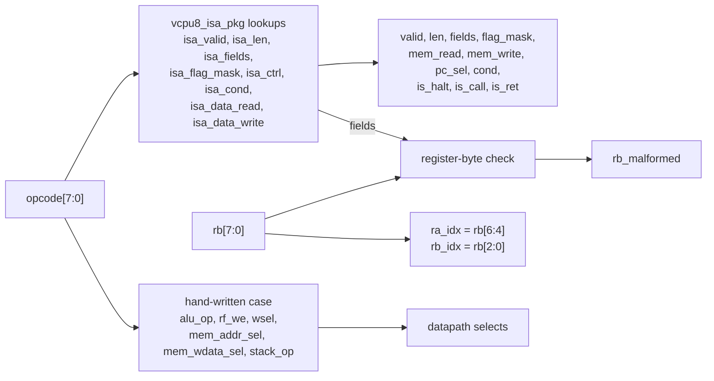

# Control Unit

The control unit tells the datapath what to do for each instruction. It has two parts:

- the **decoder**, `vcpu8_decoder`, a block of combinational logic. It turns the opcode byte and the register byte into control signals.
- the **control FSM**, which steps each instruction through fetch, decode, operands, execute and writeback, and detects faults.

The decoder is described here. The FSM section is written by the ticket that builds it.

## Decoder

`hardware/rtl/vcpu8/core/vcpu8_decoder.sv` is purely combinational. It has no clock, no flip-flops and no memory. Its outputs depend only on its two inputs at that moment:

| Input         | Width | Meaning                                                                            |
| ------------- | ----- | ---------------------------------------------------------------------------------- |
| `opcode[7:0]` | 8     | Byte 0 of the instruction (`IR.op`)                                                |
| `rb[7:0]`     | 8     | Byte 1, the register byte `{a[3:0], b[3:0]}` (`IR.rb`); ignored when there is none |

| Output                         | Meaning                                                                                                       |
| ------------------------------ | ------------------------------------------------------------------------------------------------------------- |
| `valid`                        | The byte is an ISA 1.0.0 opcode. 0 means `INVALID_OPCODE`                                                     |
| `len[1:0]`                     | Instruction length, 1–3 bytes (0 when invalid)                                                                |
| `fields[1:0]`                  | Register-byte fields used: `ISA_FIELDS_NONE`, `_A` (field b must be 0) or `_AB`                               |
| `rb_malformed`                 | The register byte is malformed for this opcode. 1 means `MALFORMED_OPERAND`                                   |
| `ra_idx[2:0]`, `rb_idx[2:0]`   | Register-file read addresses: `rb[6:4]` (field a) and `rb[2:0]` (field b)                                     |
| `alu_op`                       | ALU operation (`alu_op_t`)                                                                                    |
| `rf_we`, `wsel`                | Register write enable and write-back source: `WSEL_ALU`, `_TB`, `_MEM` or `_RB`. The write address is field a |
| `mem_read`, `mem_write`        | One data-memory read (LOAD, POP, RET) or write (STORE, PUSH, CALL)                                            |
| `mem_addr_sel`                 | Data address: `MEM_ADDR_TB`, `_RA`, `_RB`, `_SP` or `_SP1` (SP + 1)                                           |
| `mem_wdata_sel`                | Write data: `MEM_WDATA_RA`, `_RB` or `_RET_ADDR` (CALL's return address, PC + 2)                              |
| `flag_mask[3:0]`               | FLAGS bits the instruction writes, `{Z, C, N, V}`                                                             |
| `stack_op`                     | `STACK_NONE`, `STACK_PUSH` (SP − 1, SD + 1) or `STACK_POP` (SP + 1, SD − 1)                                   |
| `pc_sel`                       | Next PC: `PC_SEQ` (PC + len), `PC_HOLD`, `PC_TB`, `PC_COND` or `PC_MEM` (the popped byte)                     |
| `cond`                         | Branch condition for `PC_COND`: `COND_Z`, `COND_NZ`, `COND_C` or `COND_NC`                                    |
| `is_halt`, `is_call`, `is_ret` | HLT, CALL and RET, which the FSM treats specially (halt, `PC_OVERFLOW` on CALL, stack checks)                 |
| `is_div`                       | DIV, for the `DIVIDE_BY_ZERO` check in EXECUTE                                                                |

The select enums are in `core/vcpu8_types_pkg.sv`. The value 0 of every enum is the decoder's default. So an output an instruction does not use reads 0, and an invalid opcode drives every output to 0.

### The opcode table as logic

In software, the opcode table is data that a program looks up. In hardware, the decoder _is_ the table. Each output is a Boolean function of the 16 input bits. The `case (opcode)` statement is just a readable way to write those functions down.

A synthesis tool can build such a function in two ways:

- **As a ROM.** Use the opcode as an address into a 256-entry memory whose words are the control signals. This is simple and regular. It is wasteful here, though, because 226 of the 256 entries are the same all-zero invalid row.
- **As sum-of-products logic.** For each output bit, OR together the opcodes that set it, and simplify. For example, `stack_op == STACK_PUSH` is 1 for exactly two opcodes (CALL `0x45` and PUSH `0x50`), so it needs only a few gates. Opcodes that share bits share logic. The opcode's high nibble is its category, so "is this an ALU instruction" is mostly a test of `opcode[7:4]`.

Yosys takes the second route: it synthesizes the case statements to gates and then minimizes them. The decoder is small. With the pinned Yosys 0.70, `synth -top vcpu8_decoder` gives 129 generic gates and no flip-flops, and `synth_ice40` maps it to 78 `SB_LUT4` cells. That is 16 input bits and 41 output bits. These figures come from running the two commands on the files in this commit. The synthesis ticket reports the whole design.



### Generated outputs and design choices

The outputs fall into two groups, and they come from different places on purpose.

**ISA-derived outputs** come from the lookup functions in the generated `core/vcpu8_isa_pkg.sv`. That file is rendered from `OPCODES` in `@vcpu/shared` and drift-checked, so these outputs cannot disagree with the emulator. No opcode byte is typed by hand anywhere in the RTL.

| Output                                   | Source                                                                                                    |
| ---------------------------------------- | --------------------------------------------------------------------------------------------------------- |
| `valid`, `len`, `fields`, `flag_mask`    | `isa_valid`, `isa_len`, `isa_fields`, `isa_flag_mask`                                                     |
| `mem_read`, `mem_write`                  | `isa_data_read`, `isa_data_write` (CALL and PUSH write; POP and RET read)                                 |
| `pc_sel`, `is_halt`, `is_call`, `is_ret` | `isa_ctrl`: SEQ → `PC_SEQ`, HALT → `PC_HOLD`, JUMP and CALL → `PC_TB`, BRANCH → `PC_COND`, RET → `PC_MEM` |
| `cond`                                   | `isa_cond`, which is `{flag bit index, value}`, re-encoded as `{is C, value}`                             |
| `is_div`                                 | `opcode == OP_DIV`                                                                                        |

**Microarchitectural outputs** are choices this datapath makes. A different implementation of ISA 1.0.0 could make different ones. They come from one hand-written `case (opcode)` that follows the decoder table in [hardware-porting.md](../hardware-porting.md#decoder-decoder). The block sets every default first, and each row then names only what it uses:

- `alu_op`. CMP has no ALU operation of its own: it uses `ALU_SUB` with `rf_we = 0`, so it sets exactly the flags SUB would.
- `rf_we` and `wsel`: the ALU result, the trailing byte (LDI), the memory read data (LOAD, POP) or port B (MOV).
- `mem_addr_sel` and `mem_wdata_sel`. The two STORE forms carry their registers in different fields. `STORE [addr8], Rs` has Rs in field a, so its data comes from port A. `STORE [Rp], Rs` has the pointer in field a and Rs in field b, so its address comes from port A and its data from port B.
- `stack_op`: CALL and PUSH push, RET and POP pop.

Nothing in TypeScript names these selects. So the testbench checks them against a directed copy of the 30-row table, and cross-checks what TypeScript _can_ express. `rf_we` must equal "the opcode has an operand with role `dest`", and `mem_read`/`mem_write` must equal `dataReads`/`dataWrites`.

### Register-byte validation and `MALFORMED_OPERAND`

A register byte holds two 4-bit fields, a = `rb[7:4]` and b = `rb[3:0]`. Only R0–R7 exist, so the top bit of a used field must be 0, and a field the format does not use must be all zero:

| `fields` | Formats               | Malformed when               |
| -------- | --------------------- | ---------------------------- |
| `A`      | R, RI, RA             | `rb[7]` or `rb[3:0] != 4'h0` |
| `AB`     | RR                    | `rb[7]` or `rb[3]`           |
| `NONE`   | N, A, invalid opcodes | never                        |

Opcodes whose `fields` is `NONE` can never be malformed. That covers the one-byte instructions (NOP, HLT, RET) and the A format (JMP, Jcc, CALL), whose byte 1 is an address. The FSM latches that byte into `IR.tb`, not `IR.rb`. Because the decoder still computes `rb_malformed` for every opcode, the FSM can sample it at the end of OPERANDS without first checking the format.

`rb_malformed` is a request to fault, not the fault itself. The FSM raises `MALFORMED_OPERAND` from it in OPERANDS. That is after `INVALID_OPCODE` and `INSTRUCTION_OVERRUN` have been ruled out in DECODE, and before any architectural state is written, so the fault is precise. The emulator reports field a before field b, but both give the same fault code, so the decoder needs only one bit.

### Invalid opcodes and `INVALID_OPCODE`

226 of the 256 opcode bytes are not instructions: `0x02`–`0x0F`, `0x16`–`0x1F`, `0x26`–`0x2F`, `0x37`–`0x3F`, `0x47`–`0x4F` and `0x52`–`0xFF`. They are never silently ignored. For any of them the decoder drives `valid = 0`, `len = 0`, `fields = NONE`, and every enable and select 0. The FSM sees `valid = 0` in DECODE and goes to FAULTED with `INVALID_OPCODE`. It does not fetch an operand byte or write anything. Because every enable is already 0, a wrong FSM transition could still not write state for an invalid opcode.

### Verification

`make -C hardware/rtl/vcpu8 test-decoder`, which is part of `make test`, builds `tb/unit/tb_vcpu8_decoder.sv` with Verilator and runs three checks. Each compares against a source outside the RTL:

1. **Opcode sweep.** It checks all 256 opcode bytes against `build/vectors/decoder-ops.hex`, which `@vcpu/rtl-tools` derives from `OPCODES`. The checks are `valid`, `len`, `fields`, `flag_mask`, the control flow (`pc_sel`, `is_halt`, `is_call`, `is_ret`), `cond`, `mem_read`/`mem_write` against the data reads and writes, and `rf_we` against "has a `dest` operand". An invalid byte must also drive every select to 0. The sweep must find exactly 30 valid opcodes. The generator's vitest test checks that this set equals `Op`.
2. **Register-byte sweep.** It checks all 65,536 (opcode, register byte) pairs against `build/vectors/decoder-rb.hex`. The generator builds that file by placing `[opcode, rb, 0x00]` at address 0 of a zeroed memory and calling cpu-core `decode()`. A pair is malformed exactly when `decode()` returns `MALFORMED_OPERAND`.
3. **Directed table.** The 30 rows of the decoder table in `hardware-porting.md` are transcribed into the testbench, one `row(...)` call each. Every row is checked in full, including the selects TypeScript has no notion of. The check also confirms that the rows cover exactly the valid opcodes.

The testbench prints the first mismatches with the opcode's name and exits non-zero if there are any. A passing run prints:

```text
tb_vcpu8_decoder: 256 opcode records (30 valid), 65536 register-byte records, 30 directed rows, 0 mismatches
```

To regenerate the vectors by hand, run `make -C hardware/rtl/vcpu8 gen-decoder-vectors`, or `pnpm --filter @vcpu/rtl-tools gen:decoder-vectors --out-dir <dir>`.

## Control FSM

_To be written by the control-FSM ticket._
