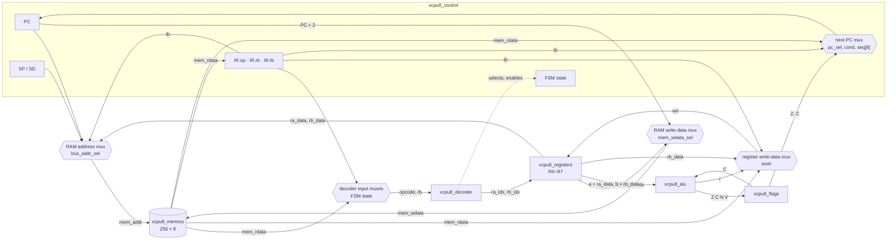

# Datapath

The datapath is the part of the CPU that holds and moves data: the registers, the ALU, the RAM and the multiplexers between them. The control unit ([control-unit.md](control-unit.md)) does not move data itself. Every cycle it sets the mux selects and the write enables, and the datapath does the rest.

All of it is in `core/vcpu8_core.sv` (the muxes and the wiring) and `core/vcpu8_control.sv` (PC, SP, SD, IR and the next-PC logic).

## Diagram

The decoder's selects (dotted) and the FSM's write enables drive every mux and write port in the diagram. Neither is drawn on each mux, to keep the picture readable; the table below says which signal drives which mux.

## Multiplexers and their selects

| Mux                   | Inputs                                                          | Select                     | Source of the select                                                                                            |
| --------------------- | --------------------------------------------------------------- | -------------------------- | --------------------------------------------------------------------------------------------------------------- |
| RAM address           | PC, PC + 1, PC + 2, IR.tb, `ra_data`, `rb_data`, SP, SP + 1     | `bus_addr_sel`             | FSM state: FETCH → PC, DECODE → PC + 1, OPERAND1 → PC + 2; EXECUTE and WRITEBACK → the decoder's `mem_addr_sel` |
| RAM write data        | `ra_data`, `rb_data`, PC + 2 (CALL's return address)            | `mem_wdata_sel`            | decoder                                                                                                         |
| RAM write enable      | —                                                               | `mem_we`                   | FSM: WRITEBACK and the decoder's `mem_write`                                                                    |
| Register write data   | `alu_r`, IR.tb, `mem_rdata`, `rb_data`                          | `wsel`                     | decoder                                                                                                         |
| Register write enable | —                                                               | `rf_we`                    | FSM: WRITEBACK and the decoder's `rf_we`. The write address is always field a (`ra_idx`)                        |
| Register read address | the register byte's field a (`rb[6:4]`) and field b (`rb[2:0]`) | —                          | wired: port A reads field a, port B reads field b                                                               |
| Decoder opcode input  | `mem_rdata`, IR.op                                              | FSM state                  | DECODE → `mem_rdata` (the opcode is arriving), otherwise IR.op                                                  |
| Decoder register byte | `mem_rdata`, IR.rb                                              | FSM state                  | OPERAND1 → `mem_rdata` (byte 1 is arriving), otherwise IR.rb                                                    |
| ALU operation         | ADD … SHR                                                       | `alu_op`                   | decoder (CMP uses SUB)                                                                                          |
| ALU carry in          | FLAGS.C                                                         | —                          | wired; only INC and DEC use it                                                                                  |
| FLAGS update          | each flag's old value, the ALU's new value                      | `flags_mask`               | FSM: the decoder's `flag_mask` in WRITEBACK, otherwise 0                                                        |
| Next PC               | PC (hold), PC + len, IR.tb, `mem_rdata`                         | `pc_sel`, `cond`, `seq[8]` | decoder; the branch condition reads FLAGS; `seq[8]` is the 9th bit of PC + len                                  |
| SP / SD update        | SP − 1 / SD + 1 (push), SP + 1 / SD − 1 (pop), unchanged        | `stack_op`                 | decoder, applied in WRITEBACK                                                                                   |

`bus_addr_sel` maps the decoder's `mem_addr_sel` one to one: `MEM_ADDR_TB` → `BUS_TB`, `_RA` → `BUS_RA`, `_RB` → `BUS_RB`, `_SP` → `BUS_SP`, `_SP1` → `BUS_SP1`. An instruction with no data access keeps the address at PC in EXECUTE and WRITEBACK.

The ALU's inputs are not muxed. Port A is always the first operand (field a) and port B the second (field b). The one-operand operations (INC, DEC, NOT, SHL, SHR) ignore `b`, and so does every instruction that does not use the ALU result. Likewise, the ALU and the register read ports compute something every cycle; only the selects and enables decide whether the result is kept.

## How each instruction class moves through the datapath

Every instruction spends FETCH presenting PC to the RAM, and DECODE reading the opcode from `mem_rdata` into the decoder and into IR.op. A 2- or 3-byte instruction then reads byte 1 in OPERAND1 into IR.rb and IR.tb, and a 3-byte one reads byte 2 in OPERAND2 into IR.tb. The table shows what the rest of the instruction does. "EX" is EXECUTE and "WB" is WRITEBACK; everything written in WB is written at the rising edge that ends it.

| Class             | EX: RAM address  | WB: register write | WB: RAM write              | WB: FLAGS   | WB: SP, SD     | WB: next PC                               |
| ----------------- | ---------------- | ------------------ | -------------------------- | ----------- | -------------- | ----------------------------------------- |
| NOP               | PC (idle)        | —                  | —                          | —           | —              | PC + 1                                    |
| HLT               | PC (idle)        | —                  | —                          | —           | —              | PC (held), status ← HALTED                |
| MOV Rd, Rs        | PC (idle)        | Rd ← `rb_data`     | —                          | —           | —              | PC + 2                                    |
| LDI Rd, imm8      | PC (idle)        | Rd ← IR.tb         | —                          | —           | —              | PC + 3                                    |
| ADD … SHR         | PC (idle)        | Rd ← `alu_r`       | —                          | mask `1111` | —              | PC + 2                                    |
| INC, DEC          | PC (idle)        | Rd ← `alu_r`       | —                          | mask `1011` | —              | PC + 2                                    |
| CMP Ra, Rb        | PC (idle)        | —                  | —                          | mask `1111` | —              | PC + 2                                    |
| LOAD Rd, [addr8]  | IR.tb (read)     | Rd ← `mem_rdata`   | —                          | —           | —              | PC + 3                                    |
| LOAD Rd, [Rp]     | `rb_data` (read) | Rd ← `mem_rdata`   | —                          | —           | —              | PC + 2                                    |
| STORE [addr8], Rs | IR.tb            | —                  | mem[IR.tb] ← `ra_data`     | —           | —              | PC + 3                                    |
| STORE [Rp], Rs    | `ra_data`        | —                  | mem[`ra_data`] ← `rb_data` | —           | —              | PC + 2                                    |
| PUSH Rs           | SP               | —                  | mem[SP] ← `ra_data`        | —           | SP − 1, SD + 1 | PC + 2                                    |
| POP Rd            | SP + 1 (read)    | Rd ← `mem_rdata`   | —                          | —           | SP + 1, SD − 1 | PC + 2                                    |
| JMP addr8         | PC (idle)        | —                  | —                          | —           | —              | IR.tb                                     |
| JZ, JNZ, JC, JNC  | PC (idle)        | —                  | —                          | —           | —              | IR.tb if the condition holds, else PC + 2 |
| CALL addr8        | SP               | —                  | mem[SP] ← PC + 2           | —           | SP − 1, SD + 1 | IR.tb                                     |
| RET               | SP + 1 (read)    | —                  | —                          | —           | SP + 1, SD − 1 | `mem_rdata`                               |

Some consequences of the structure:

- **Sources are read before they are written.** The register file's read ports are combinational and its write happens at the WRITEBACK edge, so `ADD R0, R0` adds the old R0 to itself and `LOAD R1, [R1]` uses the old R1 as the address.
- **A read costs no extra state.** LOAD, POP and RET present their address in EXECUTE; the RAM registers the byte at the EXECUTE edge, and WRITEBACK uses it from `mem_rdata`.
- **SP is the address, SP − 1 the new SP.** PUSH and CALL write at SP and then decrement it, and POP and RET read at SP + 1 and then increment it. So the stack grows down from `0xFF`, SP always points at the next free byte, and `SP == 0xFF − SD` holds after every instruction.
- **CALL's return address is PC + 2**, the address after the 2-byte CALL. It is computed from PC, which does not change until the WRITEBACK edge.
- **The next PC needs a 9th bit.** `seq = {1'b0, PC} + len` is 9 bits wide. If a sequential instruction ends exactly at `0xFF`, `seq` is `0x100`: the PC keeps its value and the post-commit `PC_OVERFLOW` is raised ([control-unit.md](control-unit.md#faults)).
