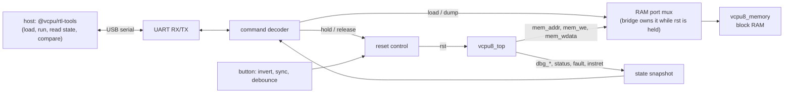

# FPGA Readiness

This page says how close the VCPU-8 RTL is to running on an FPGA board, and what Project 5 has to build to get it there. Every resource and timing figure comes from `make -C hardware/rtl/vcpu8 synth` and is the same as the committed baseline, [research/cpu/synth/baseline.json](../../research/cpu/synth/baseline.json). The [Project 2 audit](project-2-report.md) reran synthesis in a fresh clone and `make synth-compare` reported 0 deltas. The iterative-divider figures come from the [div-impl experiment](../../research/cpu/experiments/div-impl/README.md).

Nothing here has run on a board. Fmax is nextpnr's estimate from its timing model after placement and routing with seed 1, not a measurement. Cell counts are FPGA primitives, not transistors or silicon area, and no power was estimated ([synthesis-guide.md](synthesis-guide.md#why-cells-are-not-transistors)).

**Assessment: ready for FPGA integration planning, not yet for bring-up.** The CPU fits both target parts with plenty of room, its RAM becomes one block RAM with the program built in through `INIT_FILE`, and it uses one clock and a synchronous reset. Three things stand between it and a working board:

1. **The default design misses 12 MHz on the iCE40UP5K** (10.48 MHz estimated). The iterative-divider variant (`DIV_IMPL=ITER`) meets it (18.09 MHz), and so does the default design on the ECP5 (28.21 MHz).
2. **There is no board-level top.** The synthesis wrapper has the right shape, but a real button needs inverting and debouncing, and the LEDs need a visible signal.
3. **There is no way in or out at run time.** The ISA has no I/O, so a program's results are only visible through the debug ports, and loading a new program means rebuilding the bitstream. Project 5 needs the debug bridge planned [below](#debug-interface-plan-for-project-5).

## Contents

- [Resource fit](#resource-fit)
- [Timing at a 12 MHz board clock](#timing-at-a-12-mhz-board-clock)
- [Clocking and reset on a board](#clocking-and-reset-on-a-board)
- [Memory: block RAM and INIT_FILE](#memory-block-ram-and-init_file)
- [Debug interface plan for Project 5](#debug-interface-plan-for-project-5)
- [IO wrapper](#io-wrapper)
- [Recommended changes before bring-up](#recommended-changes-before-bring-up)
- [Gaps and risks](#gaps-and-risks)
- [Reproducing these numbers](#reproducing-these-numbers)

## Resource fit

Both flows synthesize `hardware/fpga/vcpu8_fpga_wrapper.sv`, which is `vcpu8_top` with `clk`, `rst` and eight status outputs ([IO wrapper](#io-wrapper)). Utilisation is nextpnr's count of the device's sites after placement.

| Resource             | iCE40UP5K SG48 (default) |  Share | LFE5U-25F CABGA256 (default) | Share |
| -------------------- | -----------------------: | -----: | ---------------------------: | ----: |
| Logic cells          |  906 / 5,280 ICESTORM_LC | 17.2 % |    767 / 24,288 TRELLIS_COMB | 3.2 % |
| LUT4                 |                      727 |        |                          507 |       |
| Carry cells          |             143 SB_CARRY |        |                     91 CCU2C |       |
| Flip-flops           |                      150 |        |                 124 / 24,288 | 0.5 % |
| Block RAM            |       1 / 30 SB_RAM40_4K |  3.3 % |                1 / 56 DP16KD | 1.8 % |
| DSP                  |                        0 |        |            1 / 28 MULT18X18D | 3.6 % |
| IO                   |            10 / 39 SB_IO | 25.6 % |          10 / 197 TRELLIS_IO | 5.1 % |
| Global clock buffers |              2 / 8 SB_GB |        |                  1 / 56 DCCA |       |

On iCE40 the flip-flops sit inside the logic cells, so they are part of the 906. The two FPGA columns count different structures and are not comparable with each other ([synthesis-guide.md](synthesis-guide.md#fpga)).

The iterative-divider variant uses 744 LUT4 and 179 flip-flops on the iCE40, and 646 LUT4 and 153 flip-flops on the ECP5 ([experiment result](../../research/cpu/experiments/div-impl/results/2026-10-17-6028b98.md)). In the audit's rerun of the experiment, that came to 874 of 5,280 logic cells (16.6 %) on the iCE40 and 800 of 24,288 (3.3 %) on the ECP5. The fit does not change.

What will grow on a board:

- **The debug taps.** The wrapper leaves `instret`, `retire_pc`, `retire_op`, `fault_code`, `fault_pc` and the `dbg_*` buses unconnected, so synthesis removes the logic only they use. A debug bridge that reads them brings that logic back. The generic core keeps 182 flip-flops with every tap connected ([synthesis-guide.md](synthesis-guide.md#generic-yosys-internal-cells)), against 124 in the ECP5 wrapper build, which adds the fewest flip-flops around its RAM. Expect roughly that difference, about 60 flip-flops and the logic that feeds them. This is an estimate; no build with the taps connected has been placed.
- **The bridge itself:** a UART, a command decoder and a RAM port multiplexer. It is small next to the 4,374 logic cells still free on the UP5K.

**Fit: comfortable on both parts.** The UP5K is the tighter one, and less than a fifth of it is used.

## Timing at a 12 MHz board clock

The flows constrain `clk` to 12 MHz, the iCEBreaker board's oscillator, so one clock period is 83.33 ns. Slack is the period minus the critical path.

| Design                      | Device             | Fmax estimate | Critical path |       Slack at 12 MHz | Fmax / 12 MHz |
| --------------------------- | ------------------ | ------------: | ------------: | --------------------: | ------------: |
| default (`DIV_IMPL=COMB`)   | iCE40UP5K SG48     |     10.48 MHz |      95.43 ns | **−12.10 ns** (fails) |      **0.87** |
| default (`DIV_IMPL=COMB`)   | LFE5U-25F, speed 6 |     28.21 MHz |      35.45 ns |             +47.88 ns |          2.35 |
| iterative (`DIV_IMPL=ITER`) | iCE40UP5K SG48     |     18.09 MHz |      55.26 ns |             +28.07 ns |          1.51 |
| iterative (`DIV_IMPL=ITER`) | LFE5U-25F, speed 6 |     41.53 MHz |      24.08 ns |             +59.25 ns |          3.46 |

The default design's critical path runs from the RAM's read data through the register-byte select, a register-file read port and the ALU's combinational divider (`core/vcpu8_alu.sv:39`) into a register-file flip-flop ([synthesis-guide.md](synthesis-guide.md#the-critical-path)). The iterative divider removes the divider from that path. The iterative rows' critical paths come from the synthesis summaries that the audit's `make experiment NAME=div-impl` wrote (`build/variants/dc2a7876cbd4/synth/summary.json`). The committed experiment result records only the Fmax, and the audit's rerun gave the same Fmax.

What this means for a board:

- **iCE40UP5K at 12 MHz needs `DIV_IMPL=ITER`.** It meets 12 MHz with 51 % headroom. DIV then takes 13 clocks instead of 5, which costs the benchmark suite 8 cycles out of 3,245 ([performance-analysis.md](performance-analysis.md#the-divider-experiment)). The alternative is to keep the combinational divider and run the core at 6 MHz, from the UP5K's PLL or with a clock enable on every other cycle. That halves every program's speed to save 8 cycles of DIV, so it is the worse trade.
- **ECP5 at 12 MHz works with either divider**, with more than twice the headroom needed.
- **Headroom matters because the estimate moves.** A change that added no logic moved the iCE40 Fmax from 10.63 to 10.48 MHz ([performance-analysis.md](performance-analysis.md#estimated-execution-time)), and another seed or nextpnr version will move it too. Neither part has been tried with more than one seed. The 51 % margin of the iterative design on the iCE40 is large next to those moves; the default design's −13 % is not close enough to hope for.

Timing analysis follows the netlist's structural paths. It does not know that the register file is written only in WRITEBACK, so it also times paths that the FSM never uses for a write. A multicycle-path exception could exempt those paths, but this flow has none, and the functional WRITEBACK path goes through the same divider anyway. The iterative divider is the clean fix.

`make synth` passes `--timing-allow-fail` to nextpnr, so a missed target is reported, not fatal. That is right for a report. A board build must fail on it ([Recommended changes](#recommended-changes-before-bring-up)).

## Clocking and reset on a board

**Clock.** The design has one clock, `clk`, and every flip-flop updates on its rising edge ([vcpu8-microarchitecture.md](vcpu8-microarchitecture.md#clock-and-reset)). There is no gated clock, no second clock domain and no clock enable. On the iCEBreaker the 12 MHz oscillator reaches pin 35, a global-buffer input, and `vcpu8_up5k_sg48.pcf` already places `clk` there. nextpnr routed it on a global buffer on both parts (`SB_GB`, `DCCA`). A UART bridge in the same clock domain adds no clock crossing.

**The sync-reset assumption.** `rst` is synchronous and active-high. The core samples it only at a rising edge of `clk`, so:

- the clock must be running for reset to take effect;
- `rst` must be held for at least one rising edge;
- `rst` must meet setup and hold time at the core's flip-flops like any other synchronous input, so a signal from a pin must be synchronized first.

The formal properties prove that after any cycle with `rst` high, whatever the state before it, the core is in its reset state ([formal-verification.md](formal-verification.md#1-deterministic-reset)). Every verification run starts that way.

**What the wrapper already does.** `vcpu8_fpga_wrapper` passes the `rst` pin through a two-flop synchronizer, `rst_sync`, whose initial value is `2'b11`. The FPGA loads that value at configuration, so the core starts held in reset for two clocks after power-up and then follows the pin.

**What a board top must add for a push button:**

- **Inversion.** The iCEBreaker's user button (pin 10 in the PCF) is active-low, and the wrapper's `rst` is active-high. Without an inverter, the CPU would be held in reset whenever the button is _not_ pressed. The PCF's header says so.
- **Debouncing.** A mechanical button bounces for milliseconds when it is pressed and released. At 12 MHz a 1 ms bounce lasts 12,000 clocks, and the demo program finishes in 78. A bouncing release therefore runs the program several times, a few hundred clocks at a time, until the contact settles. Reset itself is safe to repeat, but the RAM is not reset (next point), so each partial run can leave data behind. A debouncer that waits for the synchronized button to be stable for 2¹⁸ clocks (21.8 ms at 12 MHz) before it changes `rst` is enough. It goes after the synchronizer, so it only ever sees a synchronous signal.
- **Power-on hold.** Keeping the core in reset until the debouncer has settled, and for as long as the bridge is loading the RAM, is simpler than relying on the two-clock power-on hold alone.

**Reset does not restore the program.** The RAM has no reset, and FPGA block RAM cannot be reset ([memory-interface.md](memory-interface.md#no-reset)). The emulator's `reset()` restores the loaded image. The RTL's `rst` restarts the program on whatever the last run left in memory. A program that writes its own data region, as most of the examples do, or that writes over its code, starts the second run from different memory than the first. Verification always loads the image before it releases reset, so it never sees this. On a board, the fresh image comes back only by reconfiguring the FPGA, which reloads the block RAM's initial contents, or by reloading it through the debug bridge.

## Memory: block RAM and INIT_FILE

`vcpu8_memory` is written in the standard inference template: one synchronous write and one registered read ([memory-interface.md](memory-interface.md#1-synthesizable-memory-hardware)). Synthesis maps it to one block RAM on each part, and the register file and decoder tables stay in logic, as they must:

| Memory                      | iCE40                               | ECP5                 |
| --------------------------- | ----------------------------------- | -------------------- |
| `vcpu8_memory.mem`, 256 × 8 | 1 `SB_RAM40_4K` (4 Kbit, half used) | 1 `DP16KD` (18 Kbit) |
| `vcpu8_registers.r`, 8 × 8  | flip-flops and logic                | flip-flops and logic |
| `vcpu8_decoder`, 8 ROMs     | logic                               | logic                |

The RTL used a registered read from the start, because block RAM has one. Nothing about the memory's timing changes on an FPGA.

**Program loading with `INIT_FILE`.** `vcpu8_memory`'s only `initial` block is `$readmemh(INIT_FILE, mem)`. FPGA synthesis turns it into the block RAM's power-on contents, so the program is part of the bitstream. `make synth` assembles `tb/programs/wave-demo.asm` with the Project 1 assembler into `build/synth/wave-demo.mem.hex` and passes its absolute path to the wrapper ([synthesis-guide.md](synthesis-guide.md#the-fpga-flows-and-the-wrapper)). The file format is the fixtures' `.mem.hex`: 256 lines of one hex byte each. Any `examples/*.asm`, assembled by `@vcpu/rtl-tools assemble`, can be built in the same way.

**Changing the program without place and route.** Rebuilding the bitstream for every program takes the whole synthesis and place-and-route flow. The pinned OSS CAD Suite has `icebram` (iCE40) and `ecpbram` (ECP5). These replace the contents of a block RAM in a finished bitstream. They work by finding a known pattern: synthesize once with an `INIT_FILE` of random words that `icebram -g` generates, then swap in each program's `.mem.hex`. Neither tool has been tried with this design. It is the quickest way to run many programs on a board before a loader exists.

**Read-first logic on iCE40.** The iCE40 block RAM does not define what a read returns when it hits the address being written in the same cycle, so Yosys adds 26 flip-flops and 17 LUTs to give `vcpu8_memory` the read-first behaviour it promises. The CPU never reads `rdata` in a write cycle, so the memory could be marked `no_rw_check` to drop that logic ([memory-interface.md](memory-interface.md#1-synthesizable-memory-hardware)). It is a small saving and is not needed for fit.

## Debug interface plan for Project 5

The ISA has no I/O instructions, so a program on a board can only show its results through memory and registers. The debug ports of `vcpu8_top` already expose everything the differential verification compares ([vcpu8-microarchitecture.md](vcpu8-microarchitecture.md#ports-of-vcpu8_top)): `dbg_regs` (R7..R0), `dbg_pc`, `dbg_sp`, `dbg_sd`, `dbg_flags`, `status`, `fault_code`, `fault_pc`, `instret`, the `retire` pulse with `retire_pc` and `retire_op`, and the FSM state and IR. Project 5 needs a bridge that loads programs and reads these out.

**Recommendation: a UART bridge.** iCE40 parts have no user JTAG port; they are configured over SPI. A UART works on both families and needs two pins. The iCEBreaker's FTDI USB chip provides a serial channel to the FPGA, and many other boards have one too. A JTAG bridge is an option on ECP5 only, through its user JTAG primitive, and would make the two targets diverge.



The bridge needs only a few commands:

| Command | Does                                                                                                                                                                        |
| ------- | --------------------------------------------------------------------------------------------------------------------------------------------------------------------------- |
| `LOAD`  | Hold `rst`, take the RAM port and write all 256 bytes. This replaces the image that `INIT_FILE` built in, and the host can resend it to restore the image before every run. |
| `RUN`   | Release `rst` and let the CPU run until `status` is HALTED or FAULTED, or until a cycle limit the host gives.                                                               |
| `STATE` | Read a snapshot of the debug ports: registers, PC, SP, SD, FLAGS, status, fault code and PC, and `instret`.                                                                 |
| `DUMP`  | With the CPU halted or held in reset, read all 256 bytes through the RAM port.                                                                                              |

The snapshot and the dump hold exactly the fields of the runner's end-state format (`vcpu8-rtl-state/1`, [simulation-guide.md](simulation-guide.md)). The host side can then compare a board run with `@vcpu/cpu-core` using the comparator that `make verify` already uses, so the board becomes one more corpus for the differential verification. Comparing every instruction, as the simulation does, would need the bridge to stream each `retire`, which a UART at 12 MHz cannot keep up with. End-state comparison is the realistic first goal.

What the bridge needs from the RTL:

- **A RAM port the bridge can own.** Today the RAM is inside `vcpu8_top`, and the `mem_*` ports are outputs only. The bridge needs a multiplexer in front of the RAM's single port, selected while `rst` is held ([memory-interface.md](memory-interface.md#3-debug-interface)), which means a small structural change to `vcpu8_top` or a second top. Neither changes any cycle count.
- **Optionally, a clock enable.** Single-stepping at human speed, or pausing a run, needs the core to stop between clocks. That must be a clock enable on the core's flip-flops, not a gated clock. Gating `clk` in FPGA fabric creates skew and a second clock domain. The core has no clock enable today, so this is an RTL change. The bridge can do without it at first by running to HLT.

## IO wrapper

`hardware/fpga/vcpu8_fpga_wrapper.sv` exists so that synthesis and place and route have a pin-legal design. It keeps `clk` and `rst`, adds the reset synchronizer, and brings out eight outputs: `status[2:0]`, `retire` and `pc_lo[3:0]` (PC[3:0]). They depend on the PC, the FSM and the branch flags, and through those on the ALU, the register file and the RAM, so synthesis cannot remove the CPU. `vcpu8_up5k_sg48.pcf` places them on the iCEBreaker's PMOD1A connector. The ECP5 flow lets nextpnr place its IO, so no ECP5 board's pins are fixed.

That wrapper is not a board design. A Project 5 board top should:

| Part         | What it does                                                                                                                                  |
| ------------ | --------------------------------------------------------------------------------------------------------------------------------------------- |
| Clock        | Takes the oscillator pin straight to `clk`. A PLL is needed only for a clock other than 12 MHz.                                               |
| Reset        | Inverts the active-low button, synchronizes it, debounces it, and combines it with the bridge's reset hold and the power-on hold.             |
| CPU          | `vcpu8_top` with `DIV_ITER = 1` on the iCE40, so timing closes at 12 MHz. On ECP5 either value meets timing.                                  |
| Debug bridge | The UART bridge above, wired to the debug ports and to the RAM port multiplexer.                                                              |
| LEDs         | `status` decoded to HALTED and FAULTED lights, and `retire` stretched to a visible blink. A one-cycle pulse at 12 MHz is invisible on an LED. |
| PCF / LPF    | The board's real pins for all of the above, starting from the board vendor's reference constraint file.                                       |

## Recommended changes before bring-up

In order of need:

1. **Build the iCE40 board with `DIV_IMPL=ITER`**, or make the iterative divider the default in a new revision, `vcpu8-mc-r2`, as the [divider experiment](performance-analysis.md#the-divider-experiment) recommends. Either way, rerun `make verify DIV_IMPL=ITER` and the benchmark for it.
2. **Fail the board build on timing.** Drop `--timing-allow-fail` from the board flow (it stays in the report flow), and run place and route with a few seeds to see how far the Fmax estimate spreads.
3. **Write the board top** with the reset conditioner and LEDs, and the board's real pin file.
4. **Add the bitstream steps.** `icepack` and `ecppack` turn the place-and-route output into a bitstream, and `iceprog` or `openFPGALoader` program the board. All four are in the pinned OSS CAD Suite. No make target runs them yet.
5. **Build the UART debug bridge** and the RAM port multiplexer, then add board runs to the differential verification by end-state comparison.
6. **Optional:** mark the memory `no_rw_check` on iCE40 (relaxing the read-during-write unit test to match), and add a core clock enable for single-stepping.

## Gaps and risks

| Gap or risk                                                                             | Effect                                                                                                                                          | Mitigation                                                                                            |
| --------------------------------------------------------------------------------------- | ----------------------------------------------------------------------------------------------------------------------------------------------- | ----------------------------------------------------------------------------------------------------- |
| The default design misses 12 MHz on iCE40UP5K (10.48 MHz)                               | It cannot run from the iCEBreaker's oscillator                                                                                                  | `DIV_IMPL=ITER` (18.09 MHz), or run the core at 6 MHz                                                 |
| Fmax is a single-seed estimate from one nextpnr version                                 | The real margin is uncertain                                                                                                                    | Design for the 51 % margin of the iterative build, sweep seeds, fail the board build on timing        |
| Nothing has run on an FPGA                                                              | Board-only failures (pins, configuration, clock, reset polarity) are untested                                                                   | Project 5 bring-up; start with the status LEDs on a known program                                     |
| No simulation of the synthesized netlist                                                | A synthesis-only mismatch with the RTL would go unseen. The lint, synthesis gates and synchronous style make it unlikely, but nothing checks it | Run the fixtures on Yosys's post-synthesis netlist (`write_verilog`) with Verilator in a later ticket |
| The RAM is not restored by reset                                                        | A second run after a reset starts from the first run's memory, unlike the emulator's `reset()`                                                  | Reload the image through the bridge before each run, or reconfigure the FPGA                          |
| The button is active-low and bounces; the wrapper does neither inversion nor debouncing | Wired straight to the current wrapper, the CPU stays in reset, and each release runs a few partial programs                                     | The board-level reset conditioner                                                                     |
| The ISA has no I/O                                                                      | Results are invisible on a board without the debug bridge                                                                                       | The UART bridge; LEDs show only status                                                                |
| The debug taps are optimized away in the wrapper builds                                 | Reading them on a board adds logic: an estimated 60 flip-flops plus the bridge                                                                  | Ample room on both parts. Rerun `make synth` on the board top                                         |
| No clock enable                                                                         | No single-stepping or pausing on the board                                                                                                      | Add a core clock enable (an RTL change), never a gated clock                                          |
| The ECP5 flow has no board and no fixed pins                                            | Its figures are a second data point, not a board plan                                                                                           | Pick an ECP5 board in Project 5 and add its pin file                                                  |

None of these is a correctness defect in the CPU. The RTL matches the emulator on every corpus the audit ran ([project-2-report.md](project-2-report.md#verification-test-results)), and every item above is about the board around it.

## Reproducing these numbers

```sh
pnpm install
pnpm hardware:setup
make -C hardware/rtl/vcpu8 synth                     # default design: build/synth/summary.{json,md}
make -C hardware/rtl/vcpu8 -o synth synth-compare    # 0 deltas against research/cpu/synth/baseline.json
make -C hardware/rtl/vcpu8 synth DIV_IMPL=ITER       # iterative divider: build/synth-div-iter/
make -C hardware/rtl/vcpu8 experiment NAME=div-impl  # both variants: verify, benchmark, synth
```
