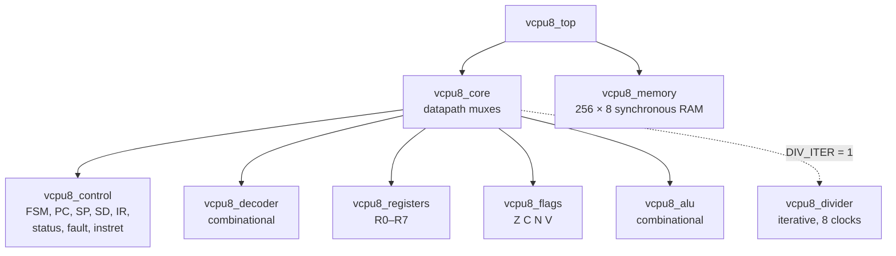

# Project 2 Report: VCPU-8 in SystemVerilog

This is the completion report for Project 2 of the semiconductor initiative: VCPU-8 rebuilt as a synthesizable multicycle SystemVerilog CPU that runs the Project 1 machine code unmodified and matches the TypeScript emulator at every instruction boundary. It gives the ten final deliverables of the project brief's §23, the commands that reproduce them, and the evidence for each item of the §22 Definition of Done.

Every number below was observed on 2026-10-17 in a fresh `git clone` of commit `3c8a067` (the tip of `master` when the audit ran) into a temporary directory. The run used Node v24.15.0, pnpm 10.34.7 and GNU Make 3.81 on macOS 26 (Darwin 25.6.0), on an Apple M2 Pro, with the pinned OSS CAD Suite 2026-10-16. The fixes made during the audit are documentation only and are listed under [Audit fixes](#audit-fixes). None of them touches the RTL, the tooling or a gate.

Nothing here was built as a chip or run on an FPGA. Cycle counts are clock edges of the simulated RTL. Fmax figures are nextpnr's estimates for named FPGAs. Cell counts are synthesis cells, not transistors. No area or power was measured.

## Contents

1. [Definition of Done](#definition-of-done)
2. [The audit run](#the-audit-run)
3. [RTL module architecture](#rtl-module-architecture)
4. [Supported ISA version](#supported-isa-version)
5. [Verification test results](#verification-test-results)
6. [Differential equivalence report](#differential-equivalence-report)
7. [Synthesis resource report](#synthesis-resource-report)
8. [CPU benchmark results](#cpu-benchmark-results)
9. [Waveform generation instructions](#waveform-generation-instructions)
10. [Known limitations](#known-limitations)
11. [FPGA readiness assessment](#fpga-readiness-assessment)
12. [Recommended improvements for the next revision](#recommended-improvements-for-the-next-revision)
13. [Commands to reproduce everything](#commands-to-reproduce-everything)
14. [Documentation](#documentation)
15. [Audit fixes](#audit-fixes)

## Definition of Done

Each bullet of brief §22, with the evidence for it from this audit's run. "Log" names the step of [the audit run](#the-audit-run) whose output is quoted.

| §22 item                                          | Status | Evidence                                                                                                                                                                                                                                                                                                                                                                                                                                                                                                                                |
| ------------------------------------------------- | ------ | --------------------------------------------------------------------------------------------------------------------------------------------------------------------------------------------------------------------------------------------------------------------------------------------------------------------------------------------------------------------------------------------------------------------------------------------------------------------------------------------------------------------------------------- |
| Implemented in synthesizable SystemVerilog        | Done   | Log `synth`: Yosys synthesized `vcpu8_top`, and the iCE40 and ECP5 flows placed and routed it, with every structural gate passing (`synth: gates passed; 558 warnings, all in the reviewed allowlist`): no latch, combinational loop, multiple driver or undriven net. Log `lint`: Verilator `--lint-only -Wall` printed no warning. `core/` holds no `#` delay, `$display`, `$finish` or `initial` except the memory's documented `INIT_FILE` load (`grep` over `core/*.sv`). [Synthesis resource report](#synthesis-resource-report). |
| All Project 1 instructions are supported          | Done   | Log `test`: `tb_vcpu8_decoder: 256 opcode records (30 valid), 65536 register-byte records, 30 directed rows, 0 mismatches`. Log `verify`: `opcodes retired (30/30)`, each of the 30 opcodes retired between 470 (RET) and 15,026 (LDI) times, and `faults hit (7/7)`.                                                                                                                                                                                                                                                                   |
| Machine-code binaries are compatible              | Done   | The RTL runs the bytes the Project 1 toolchain produces, unchanged: the 98 fixtures' `.mem.hex` images (`98/98 fixtures passed`, log `test`), and the 20 `examples/*.asm` assembled by `@vcpu/assembler` (`examples 20 20 0`, log `verify`). Log `check-isa`: `vcpu8_isa_pkg.sv matches ISA 1.0.0`, so every opcode number in the RTL comes from `@vcpu/shared`. `fixtures/v1/` was last changed in Project 1 (`git log -- fixtures/v1`: `1d7f943`, PR #8).                                                                             |
| The CPU executes programs correctly               | Done   | Log `test`: `98/98 fixtures passed (end state + lock-step)`, 1,526 instructions in 7,824 clocks. Log `verify`: `PASS, 1132/1132 cases match the reference in lock-step and at the end`. Log `benchmark`: the correctness gate passed for all 20 programs.                                                                                                                                                                                                                                                                               |
| Registers and flags match the reference model     | Done   | R0–R7 and FLAGS are compared after every instruction in every verify case (96,374 steps in `make verify`, 953,979 in the `verify-long` sample). Log `test`: `alu: 532992 vectors, 0 mismatches` against the TypeScript ALU, `tb_vcpu8_registers: PASS (103592 checks, 10000 random operations)`, `tb_vcpu8_flags: PASS (16388 checks, 4096 masked updates)`. Log `formal`: `PASS alu_prove`. Log `verify-mutants`: the flag mutants `alu-add-carry`, `alu-sub-overflow` and `alu-shr-carry` were caught.                                |
| Stack and memory behaviour match                  | Done   | SP, SD and every step's memory writes are compared after each instruction, and all 256 memory bytes at the end. Log `verify`: `max stack depth: 64`, `STACK_OVERFLOW 24`, `STACK_UNDERFLOW 19`. Log `test`: `tb_vcpu8_memory: PASS (2630 checks …)`. Log `verify-mutants`: `pop-sp-step`, `call-return-address`, `store-ind-data` and `sd-unchecked` were caught.                                                                                                                                                                       |
| All 20+ reference programs pass                   | Done   | Log `verify`: 20 of 20 examples, 12 of 12 directed programs in `tb/programs/`, 2 of 2 promoted regressions and 98 of 98 fixtures. Log `benchmark`: `PASS, the correctness gate passed for all 20 programs`.                                                                                                                                                                                                                                                                                                                             |
| Differential verification passes                  | Done   | Log `verify`: `verify: PASS, 1132/1132 cases`, 96,374 steps compared in lock-step against `@vcpu/cpu-core` run live. [Differential equivalence report](#differential-equivalence-report).                                                                                                                                                                                                                                                                                                                                               |
| Randomized instruction tests pass                 | Done   | Log `verify`: 1,000 of 1,000 random programs (seeds 1–1000). Log `verify-long`: a fresh sample of 10,000 of 10,000 (seeds 20261017–20271016), 950,781 random steps, with every opcode, fault and branch direction hit. This audit did not repeat the full 100,000-program run; [verification-strategy.md](verification-strategy.md#results) records an earlier 100,132 of 100,132.                                                                                                                                                      |
| Waveform generation works                         | Done   | Log `wave`: wrote `build/waves/wave-demo.fst` (15 instructions, 78 cycles, HALTED). Log `wave-check`: `24 required signals checked`, `37 signals of … vcpu8.gtkw checked`, `retire pulses 15, final instret 15, emulator 15`.                                                                                                                                                                                                                                                                                                           |
| Synthesis completes without critical errors       | Done   | Log `synth`: exit 0, `gates passed`, 0 errors. The 558 warnings are all in the reviewed allowlist (`synth/warnings.allow`): 557 ABC "network is combinational" notes and nextpnr's report that the iCE40 build misses 12 MHz. That timing miss is not a synthesis error, but it matters on a board ([FPGA readiness](#fpga-readiness-assessment)).                                                                                                                                                                                      |
| Hardware resource reports are generated           | Done   | Log `synth`: wrote `build/synth/summary.json` and `summary.md`. Log `synth-compare`: `0 deltas: the fresh summary matches research/cpu/synth/baseline.json`.                                                                                                                                                                                                                                                                                                                                                                            |
| Benchmark reports are reproducible                | Done   | Log `benchmark-compare`: `the modelled sections are byte-identical` to the committed [research/cpu/reports/2026-10-17-937d447-default.md](../../research/cpu/reports/2026-10-17-937d447-default.md). Log `experiment`: the fresh `div-impl` result differs from the committed [2026-10-17-6028b98.md](../../research/cpu/experiments/div-impl/results/2026-10-17-6028b98.md) only in its commit and timestamp line (`diff`).                                                                                                            |
| Documentation is complete                         | Done   | All 11 documents of brief §20 exist in `docs/hardware/`, and every "Explain" topic has a section ([Documentation](#documentation)). A link check over `docs/hardware/`, `docs/`, `research/cpu/` and `README.md` found 0 broken relative links or anchors.                                                                                                                                                                                                                                                                              |
| The design is ready for FPGA integration planning | Done   | [fpga-readiness.md](fpga-readiness.md): resource fit on both parts, timing at 12 MHz, clocking and reset, block RAM and `INIT_FILE`, the Project 5 debug bridge, the IO wrapper, and the gaps. Ready for planning, not for bring-up: the default design misses 12 MHz on the iCE40UP5K, and no board top exists yet.                                                                                                                                                                                                                    |

All 15 items are met. Nothing is marked unmet.

## The audit run

The repository was cloned into `.fredrin/tmp/p2-audit/repo/` (git-ignored) at `3c8a067`, and each command ran from its root with its output captured. The required list from the ticket ran first, in this order, then `benchmark-compare` as the evidence for reproducible benchmarks.

| Step                | Command                                                                 | Exit | Time | Key result                                                                                                |
| ------------------- | ----------------------------------------------------------------------- | ---: | ---: | --------------------------------------------------------------------------------------------------------- |
| `pnpm-install`      | `pnpm install --frozen-lockfile`                                        |    0 |  2 s | lockfile unchanged                                                                                        |
| `pnpm-check`        | `pnpm check`                                                            |    0 | 32 s | typecheck, lint, format clean; 59 test files, 1,078 tests passed                                          |
| `hardware-setup`    | `pnpm hardware:setup`                                                   |    0 |  2 s | `OSS CAD Suite 2026-10-16 is already installed` (the shared cache; see [limitations](#known-limitations)) |
| `tools-check`       | `make -C hardware/rtl/vcpu8 tools-check`                                |    0 |  1 s | Verilator 5.053, Yosys 0.70+145, SBY 0.70, nextpnr 0.11.1-63, GTKWave 4.0.0                               |
| `check-isa`         | `make -C hardware/rtl/vcpu8 check-isa`                                  |    0 |  1 s | `vcpu8_isa_pkg.sv matches ISA 1.0.0 and parses in Verilator and Yosys`                                    |
| `lint`              | `make -C hardware/rtl/vcpu8 lint`                                       |    0 |  0 s | no warnings                                                                                               |
| `test`              | `make -C hardware/rtl/vcpu8 test`                                       |    0 | 62 s | 6 unit tests passed; 98/98 fixtures                                                                       |
| `verify`            | `make -C hardware/rtl/vcpu8 verify`                                     |    0 |  3 s | 1,132/1,132 cases                                                                                         |
| `verify-mutants`    | `make -C hardware/rtl/vcpu8 verify-mutants`                             |    0 | 88 s | `all 12 mutants caught`                                                                                   |
| `verify-long`       | `make -C hardware/rtl/vcpu8 verify-long SEED=20261017 LONG_COUNT=10000` |    0 | 22 s | 10,132/10,132 cases                                                                                       |
| `wave`              | `make -C hardware/rtl/vcpu8 wave`                                       |    0 |  7 s | `build/waves/wave-demo.fst`                                                                               |
| `wave-check`        | `make -C hardware/rtl/vcpu8 wave-check`                                 |    0 |  2 s | every signal present; retire count = emulator                                                             |
| `synth`             | `make -C hardware/rtl/vcpu8 synth`                                      |    0 | 12 s | gates passed                                                                                              |
| `synth-compare`     | `make -C hardware/rtl/vcpu8 -o synth synth-compare`                     |    0 |  1 s | 0 deltas against the baseline                                                                             |
| `formal`            | `make -C hardware/rtl/vcpu8 formal`                                     |    0 | 40 s | `alu_prove`, `core_prove`, `core_bmc`: PASS                                                               |
| `benchmark`         | `make -C hardware/rtl/vcpu8 benchmark`                                  |    0 |  2 s | 20/20 programs; 3,245 cycles, CPI 5.110                                                                   |
| `experiment`        | `make -C hardware/rtl/vcpu8 experiment NAME=div-impl`                   |    0 | 41 s | both variants verified, benchmarked and synthesised                                                       |
| `benchmark-compare` | `make -C hardware/rtl/vcpu8 benchmark-compare`                          |    0 |  4 s | byte-identical to the committed report                                                                    |

Every step exited 0. The required list took 318 s in all. Afterwards `git status` in the clone showed only the new experiment result, `research/cpu/experiments/div-impl/results/2026-10-17-3c8a067.{json,md}`, which `make experiment` writes by design. It is not committed, because it repeats the committed result.

## RTL module architecture

The CPU is a **multicycle** processor with no pipeline, cache or prefetch. Each instruction passes through FETCH, DECODE, one OPERAND state per operand byte, EXECUTE and WRITEBACK, so it takes 4, 5 or 6 clocks depending only on its length. A precise fault goes to FAULTED before WRITEBACK, so it never asserts a write enable. [vcpu8-microarchitecture.md](vcpu8-microarchitecture.md) is the full map.



| Module            | File                      | Lines | Kind                                     | Described in                                             |
| ----------------- | ------------------------- | ----: | ---------------------------------------- | -------------------------------------------------------- |
| `vcpu8_isa_pkg`   | `core/vcpu8_isa_pkg.sv`   |   397 | package, generated from `@vcpu/shared`   | [isa-compatibility.md](isa-compatibility.md)             |
| `vcpu8_types_pkg` | `core/vcpu8_types_pkg.sv` |   105 | package: ALU ops, selects, FSM states    | [control-unit.md](control-unit.md)                       |
| `vcpu8_top`       | `core/vcpu8_top.sv`       |    81 | structural: the core plus the RAM        | [vcpu8-microarchitecture.md](vcpu8-microarchitecture.md) |
| `vcpu8_core`      | `core/vcpu8_core.sv`      |   317 | structural plus the datapath muxes       | [datapath.md](datapath.md)                               |
| `vcpu8_control`   | `core/vcpu8_control.sv`   |   299 | sequential FSM and next-state logic      | [control-unit.md](control-unit.md#control-fsm)           |
| `vcpu8_decoder`   | `core/vcpu8_decoder.sv`   |   209 | combinational                            | [control-unit.md](control-unit.md#decoder)               |
| `vcpu8_registers` | `core/vcpu8_registers.sv` |    44 | 8 × 8 flip-flops, 2 read ports, 1 write  | [register-file.md](register-file.md)                     |
| `vcpu8_flags`     | `core/vcpu8_flags.sv`     |    28 | 4 flip-flops, masked update              | [register-file.md](register-file.md#vcpu8_flags)         |
| `vcpu8_alu`       | `core/vcpu8_alu.sv`       |    91 | combinational, 12 operations             | [alu.md](alu.md)                                         |
| `vcpu8_divider`   | `core/vcpu8_divider.sv`   |    89 | iterative divider (`DIV_IMPL=ITER` only) | [alu.md](alu.md#iterative-divider)                       |
| `vcpu8_memory`    | `core/vcpu8_memory.sv`    |    29 | synchronous RAM, registered read         | [memory-interface.md](memory-interface.md)               |

There is one clock, `clk`, and one synchronous active-high reset, `rst`. All state changes in `always_ff` blocks, and every `always_comb` block assigns a default first, so no latch is inferred. Outside `core/`, `hardware/fpga/vcpu8_fpga_wrapper.sv` gives the synthesis flows a pin-legal top, and `tb/sim/` holds the Verilator runner that every system test uses. The design revision is `vcpu8-mc-r1` (`hardware/rtl/vcpu8/REVISION`).

## Supported ISA version

**VCPU-8 ISA 1.0.0, unchanged.** The [ISA compatibility audit](isa-compatibility.md) records the version, the 30 opcodes (28 mnemonics), the architectural state, the seven fault codes and their priority, and every discrepancy between the brief and this repository. Its result: every Project 1 feature can be built in synthesizable RTL, and nothing in the ISA had to change.

The RTL takes every opcode, fault, status and reset number from `core/vcpu8_isa_pkg.sv`, which `@vcpu/rtl-tools` generates from `@vcpu/shared`. `make check-isa` regenerates it and fails if it differs from the committed file. A vitest test makes the same check inside `pnpm check`. No Project 1 package and no fixture changed in Project 2.

## Verification test results

**Unit tests** (log `test`, `6 unit tests passed: alu decoder divider registers flags memory`):

| Test                    | What it checks                                                                    | Result                                                                                      |
| ----------------------- | --------------------------------------------------------------------------------- | ------------------------------------------------------------------------------------------- |
| `test-alu`              | every ALU operation over every operand pair and incoming FLAGS, against `alu.ts`  | 532,992 vectors, 0 mismatches; 9 directed edge cases; DIV `b = 0` sweep X-free              |
| `test-alu` (self-check) | a corrupted vector must fail the test                                             | `MISMATCH vector 65537`, so the harness can fail                                            |
| `test-decoder`          | all 256 opcode bytes and all 65,536 register bytes against the ISA table          | 256 opcode records (30 valid), 65,536 register-byte records, 30 directed rows, 0 mismatches |
| `test-divider`          | the iterative divider over every dividend and non-zero divisor, and its handshake | 65,280 vectors, 0 mismatches, done 8 cycles after start                                     |
| `test-registers`        | reset, writes, read-during-write, random operations                               | 103,592 checks, 10,000 random operations, PASS                                              |
| `test-flags`            | every old × mask × new FLAGS combination, the byte view, reset                    | 16,388 checks, PASS                                                                         |
| `test-memory`           | `INIT_FILE` load, all 256 addresses, latency, read-first, `we = 0`, reset         | 2,630 checks, PASS                                                                          |

**System tests.** `make fixtures` (part of `make test`) runs every Project 1 fixture on the RTL and compares the end state and every trace line:

| Kind        | Fixtures | Passed | Failed | Instructions |    Clocks |
| ----------- | -------: | -----: | -----: | -----------: | --------: |
| example     |       20 |     20 |      0 |          635 |     3,245 |
| instruction |       61 |     61 |      0 |          485 |     2,499 |
| fault       |       17 |     17 |      0 |          406 |     2,080 |
| **total**   |   **98** | **98** |  **0** |    **1,526** | **7,824** |

**Mutation testing** (log `verify-mutants`). Each of the 12 mutants in `scripts/mutants.txt` is a one-line bug built into a copy of `core/`. `make verify` caught every one, on the number of the 1,132 cases shown:

| Mutant                | Bug                                                      | Cases that caught it |
| --------------------- | -------------------------------------------------------- | -------------------: |
| `branch-inverted`     | every conditional branch takes the opposite decision     |                  885 |
| `alu-add-carry`       | ADD's carry out is inverted                              |                  500 |
| `alu-sub-overflow`    | SUB's V uses ADD's sign rule                             |                  495 |
| `branch-c-reads-z`    | JC and JNC test Z instead of C                           |                  411 |
| `store-ind-data`      | `STORE [Rp], Rs` writes the pointer instead of Rs        |                  338 |
| `alu-shr-carry`       | SHR shifts bit 1 into C instead of bit 0                 |                  215 |
| `pop-sp-step`         | POP and RET move SP up by 2                              |                  184 |
| `call-return-address` | CALL pushes PC + 1 instead of PC + 2                     |                  169 |
| `div-zero-unchecked`  | DIV by zero does not fault                               |                   56 |
| `sd-unchecked`        | PUSH and CALL do not check SD against the capacity       |                   24 |
| `pc-overflow-ignored` | a sequential next PC of 0x100 does not fault             |                   21 |
| `field-b-unchecked`   | an RR register byte with field b = 8–15 is not malformed |                    4 |

**Formal verification** (log `formal`, [formal-verification.md](formal-verification.md)):

```text
PASS    alu_prove    k-induction, depth 1, smtbmc boolector; induction closed at k = 1 (1s)
PASS    core_prove   k-induction, depth 20, smtbmc boolector; induction closed at k = 3 (7s)
PASS    core_bmc     BMC, depth 40, smtbmc boolector (32s)
```

`alu_prove` is a complete proof of the ALU's results and flags against their arithmetic definitions. `core_prove` proves deterministic reset, the legal FSM transitions, that registers, FLAGS and memory are written only in WRITEBACK, halt and fault behaviour, retirement and memory-access validity, for every reachable state. `core_bmc` checks the same properties to 40 cycles from reset.

**Project 1** (log `pnpm-check`): typecheck, ESLint and Prettier clean, and `Test Files 59 passed (59)`, `Tests 1078 passed (1078)`. That includes the pure-TypeScript tests of `@vcpu/rtl-tools`. No test that needs the hardware toolchain runs in `pnpm test`.

## Differential equivalence report

`make verify` runs every program on `@vcpu/cpu-core`, executed live, and on the Verilated RTL. After every instruction it compares R0–R7, FLAGS, PC, SP, SD, status, the fault and the step's memory writes. At the end it compares the full state and all 256 memory bytes. [verification-strategy.md](verification-strategy.md) explains the corpora, the random generator, the reports and how to replay a failure.

| Corpus                            | `make verify` |    Passed |      Steps | `verify-long` sample |     Passed |       Steps |
| --------------------------------- | ------------: | --------: | ---------: | -------------------: | ---------: | ----------: |
| fixtures (`fixtures/v1`)          |            98 |        98 |      1,540 |                   98 |         98 |       1,540 |
| examples (`examples/*.asm`)       |            20 |        20 |        635 |                   20 |         20 |         635 |
| directed programs (`tb/programs`) |            12 |        12 |        955 |                   12 |         12 |         955 |
| regressions (`tb/regressions`)    |             2 |         2 |         68 |                    2 |          2 |          68 |
| random                            |         1,000 |     1,000 |     93,176 |               10,000 |     10,000 |     950,781 |
| **total**                         |     **1,132** | **1,132** | **96,374** |           **10,132** | **10,132** | **953,979** |

The random programs of `make verify` use seeds 1–1000. The `verify-long` sample used seeds 20261017–20271016, well outside the 1–100,000 of the long run that [verification-strategy.md](verification-strategy.md#results) records.

Coverage in `make verify`: all 30 opcodes retired (fewest: RET, 470 times); all 7 fault codes ended at least one run (fewest: INSTRUCTION_OVERRUN and STACK_UNDERFLOW, 19 each); every conditional branch taken and not taken (fewest: JNC not taken, 185); the stack filled to its full depth of 64. The runs stopped 892 times halted, 226 faulted and 14 at the step limit. In the `verify-long` sample every opcode retired at least 4,263 times, every fault code ended at least 188 runs, and the runs stopped 7,765 times halted, 2,224 faulted and 143 at the step limit.

**No mismatch was found** in either run. The two regression cases are not past bugs of the RTL. They are random programs that caught a mutant, kept so the path each exercises is always covered: `random-s262` is the only program in seeds 1–1000 with an RR register byte whose field b is 8 or more ([tb/regressions/README.md](../../hardware/rtl/vcpu8/tb/regressions/README.md)).

## Synthesis resource report

From log `synth`, identical to the committed [baseline](../../research/cpu/synth/baseline.md) (log `synth-compare`: 0 deltas). Tools: Yosys 0.70+145, nextpnr 0.11.1-63. [synthesis-guide.md](synthesis-guide.md) explains every figure.

**Generic flow** (Yosys internal cells, `vcpu8_top` with every debug port connected):

| Module                        | Cells | Flip-flops | Combinational |
| ----------------------------- | ----: | ---------: | ------------: |
| `vcpu8_top`, whole design     | 7,480 |      2,238 |         5,242 |
| `vcpu8_core`, without the RAM | 1,981 |        182 |         1,799 |
| `vcpu8_memory` (RAM as flops) | 5,499 |      2,056 |         3,443 |

Flattened to simple gates: 7,012 cells (2,238 flip-flops and 4,774 gates), and the longest combinational path is 82 gates. A generic netlist has no RAM cell, so the 256-byte RAM becomes 2,048 flip-flops there. On both FPGAs it is one block RAM.

**FPGA flows** (`hardware/fpga/vcpu8_fpga_wrapper.sv`, 12 MHz target, seed 1):

| Device                      | LUT4 | Carry | Flip-flops | Block RAM | DSP | Logic cells used     | Fmax estimate | Meets 12 MHz |
| --------------------------- | ---: | ----: | ---------: | --------: | --: | -------------------- | ------------: | ------------ |
| iCE40UP5K SG48              |  727 |   143 |        150 |         1 |   0 | 906 / 5,280 (17.2 %) |     10.48 MHz | **no**       |
| LFE5U-25F CABGA256, speed 6 |  507 |    91 |        124 |         1 |   1 | 767 / 24,288 (3.2 %) |     28.21 MHz | yes          |

**Memory inference:** the 256 × 8 RAM became an `SB_RAM40_4K` on iCE40 and a `DP16KD` on ECP5. The register file (10 combinational read ports, synchronous reset) and the decoder tables correctly stay in logic. **Critical path:** on both parts it runs from the RAM's read data through a register-file read port and the ALU's combinational divider (`core/vcpu8_alu.sv:39`) into the register file: 95.43 ns on the iCE40 and 35.45 ns on the ECP5.

## CPU benchmark results

From log `benchmark`: the 20 example programs on the RTL, each gated on the differential comparison, with time estimated from the baseline's Fmax. [performance-analysis.md](performance-analysis.md) has the per-class and per-opcode analysis.

| Program                 | Instructions | RTL cycles |       CPI | Model cycles | µs at iCE40 Fmax | µs at ECP5 Fmax |
| ----------------------- | -----------: | ---------: | --------: | -----------: | ---------------: | --------------: |
| `01-addition`           |            4 |         21 |     5.250 |           13 |             2.00 |            0.74 |
| `02-subtraction`        |            9 |         50 |     5.556 |           34 |             4.77 |            1.77 |
| `03-multiplication`     |            9 |         50 |     5.556 |           40 |             4.77 |            1.77 |
| `04-division`           |           10 |         53 |     5.300 |           45 |             5.06 |            1.88 |
| `05-and`                |           14 |         78 |     5.571 |           53 |             7.44 |            2.76 |
| `06-or`                 |            9 |         50 |     5.556 |           34 |             4.77 |            1.77 |
| `07-xor`                |           13 |         71 |     5.462 |           48 |             6.77 |            2.52 |
| `08-shift-left`         |            9 |         48 |     5.333 |           32 |             4.58 |            1.70 |
| `09-shift-right`        |           45 |        230 |     5.111 |          152 |            21.95 |            8.15 |
| `10-compare`            |           17 |         94 |     5.529 |           63 |             8.97 |            3.33 |
| `11-conditional-branch` |           13 |         69 |     5.308 |           46 |             6.58 |            2.45 |
| `12-countdown`          |           54 |        261 |     4.833 |          173 |            24.90 |            9.25 |
| `13-sum-integers`       |           57 |        288 |     5.053 |          186 |            27.48 |           10.21 |
| `14-fibonacci`          |           85 |        428 |     5.035 |          277 |            40.84 |           15.17 |
| `15-factorial-overflow` |           48 |        244 |     5.083 |          183 |            23.28 |            8.65 |
| `16-array-sum`          |           58 |        295 |     5.086 |          201 |            28.15 |           10.46 |
| `17-array-max`          |           70 |        356 |     5.086 |          239 |            33.97 |           12.62 |
| `18-memory-copy`        |           40 |        202 |     5.050 |          139 |            19.27 |            7.16 |
| `19-subroutines`        |           16 |         79 |     4.938 |           66 |             7.54 |            2.80 |
| `20-stack`              |           55 |        278 |     5.055 |          196 |            26.53 |            9.85 |
| **total**               |      **635** |  **3,245** | **5.110** |    **2,220** |       **309.64** |      **115.03** |

RTL cycles are clock edges of the simulated circuit. Model cycles are the emulator's instructional estimate, not a circuit, and the RTL takes 1.46 times as many because DECODE and WRITEBACK are states of their own. Every opcode took the same number of clocks every time: 4 for NOP, HLT and RET, 5 for every 2-byte instruction, 6 for every 3-byte instruction, and a taken branch costs the same as one not taken. The time columns inherit the uncertainty of nextpnr's Fmax estimate, and the iCE40 figure assumes a clock the default design cannot reach on that part.

**The divider experiment** (log `experiment`, [div-impl](../../research/cpu/experiments/div-impl/README.md)): both variants passed the same 1,132 verify cases first.

| Metric                     | `div-comb` (default) | `div-iter` (`DIV_IMPL=ITER`) |
| -------------------------- | -------------------: | ---------------------------: |
| Suite cycles / CPI         |        3,245 / 5.110 |                3,253 / 5.123 |
| Generic cells / flip-flops |        7,480 / 2,238 |                7,399 / 2,267 |
| Logic depth (gates)        |                   82 |                           57 |
| iCE40 LUTs / Fmax          |      727 / 10.48 MHz |              744 / 18.09 MHz |
| ECP5 LUTs / Fmax           |      507 / 28.21 MHz |              646 / 41.53 MHz |

DIV costs 8 more clocks (13 instead of 5), and the estimated Fmax rises by 73 % on the iCE40, where it now meets 12 MHz, and by 47 % on the ECP5.

## Waveform generation instructions

```sh
make -C hardware/rtl/vcpu8 wave                                      # the demo → build/waves/wave-demo.fst
make -C hardware/rtl/vcpu8 wave PROGRAM=examples/19-subroutines.asm  # any .asm or .mem.hex
make -C hardware/rtl/vcpu8 wave WAVE_FORMAT=vcd                      # VCD instead of FST
make -C hardware/rtl/vcpu8 wave-check                                # check the demo's waveform
cd hardware/rtl/vcpu8 && gtkwave build/waves/wave-demo.fst tb/wave/vcpu8.gtkw
```

`make wave` builds a tracing copy of the runner, runs the program from reset to two cycles past HALTED or FAULTED, and writes every signal of the design, including R0–R7 and all 256 RAM bytes. `tb/wave/vcpu8.gtkw` opens it in seven groups, with the FSM state, the ALU operation, the status and the fault code shown by name. [simulation-guide.md](simulation-guide.md) covers the options, the GTKWave view and a cycle-by-cycle walkthrough of the demo. In the audit, `make wave` wrote the demo (15 instructions, 78 cycles), and `make wave-check` found all 24 required signals and all 37 signals of the GTKWave view, with 15 `retire` pulses, the same count as the emulator.

## Known limitations

**Architecture (ISA 1.0.0, deliberate).** No interrupts, no I/O, no privileged modes, no branch on N or V, a 256-byte address space and a 64-byte stack ([architecture.md](../architecture.md#limitations-of-v10)). On a board this means a program's results are visible only through the debug ports.

**Microarchitecture.**

- Multicycle with no overlap: CPI 5.110 on the suite. DECODE and WRITEBACK cost a clock each on every instruction.
- The default combinational divider sets the critical path and keeps the iCE40UP5K below 12 MHz. The iterative divider fixes this, but it is not the default.
- The RAM has one port shared by fetch and data, and no reset. A second `rst` restarts the program on the memory the last run left, unlike the emulator's `reset()`, which restores the loaded image ([memory-interface.md](memory-interface.md#no-reset)).
- There is no clock enable, so a board cannot single-step or pause the core.

**Verification.**

- Differential verification compares architectural state at instruction boundaries, not every clock. Internal signals are covered only by the formal properties ([verification-strategy.md](verification-strategy.md#what-is-not-covered)).
- The formal properties cover control (reset, FSM, write enables, halt, retirement, memory access) and the ALU, not the ISA semantics of whole instructions or the memory contents ([formal-verification.md](formal-verification.md#what-is-not-proven)).
- Random programs are bounded at 2,000 steps. This audit ran a 10,000-program `verify-long` sample, not the full 100,000.
- Verification runs on Verilator's model of the RTL. No post-synthesis netlist is simulated.

**Synthesis and measurement.** No area, power or ASIC timing: the flow has no standard-cell library. Fmax is a single-seed nextpnr estimate per device, and it moves by a few percent even on renaming ([performance-analysis.md](performance-analysis.md#limits-of-these-numbers)). The benchmark suite is small (635 instructions, one DIV).

**This audit.**

- It ran only on macOS on Apple silicon. The `hardware` CI workflow runs the same gates on Ubuntu 24.04 ([README.md](README.md#ci)).
- `pnpm hardware:setup` found the toolchain already in the shared cache (`~/.cache/vcpu8`), so the download and checksum path was not exercised here. CI exercises it whenever its cache misses.

## FPGA readiness assessment

**Ready for FPGA integration planning, not yet for bring-up.** [fpga-readiness.md](fpga-readiness.md) has the full assessment. In short:

- **Fit:** comfortable. 17.2 % of the iCE40UP5K's logic cells and 1 of its 30 block RAMs; 3.2 % of the LFE5U-25F.
- **Timing at 12 MHz:** the default design misses on the iCE40UP5K (10.48 MHz, −12.10 ns slack) and meets on the ECP5 (28.21 MHz). With `DIV_IMPL=ITER` the iCE40 meets it with 51 % headroom (18.09 MHz).
- **Clock and reset:** one clock and a synchronous reset, with a two-flop synchronizer already in the wrapper. A board needs the button inverted and debounced.
- **Memory:** one block RAM per part, with the program built in through `INIT_FILE`. `icebram` and `ecpbram` can swap programs without place and route.
- **Debug:** a UART bridge that loads the RAM while the core is held in reset, runs it, and reads the debug ports and memory back, so a board run can be compared with the emulator.

## Recommended improvements for the next revision

For `vcpu8-mc-r2` and Project 5, in order:

1. **Make the iterative divider the default.** It is the only change needed for timing closure on the iCE40UP5K at 12 MHz, and it costs 8 cycles per DIV. DIV's cycle count changes, so it bumps the revision ([divider experiment](performance-analysis.md#the-divider-experiment)).
2. **Give the RAM a port a loader can own**, through a multiplexer selected while `rst` is held, and build the UART debug bridge on it ([fpga-readiness.md](fpga-readiness.md#debug-interface-plan-for-project-5)).
3. **Add a core clock enable** for single-stepping and pausing on a board. Never gate the clock.
4. **Add a board flow** that fails on missed timing, sweeps nextpnr seeds, and runs `icepack`/`ecppack` to make a bitstream. All the tools are in the pinned suite.
5. **Simulate the synthesized netlist.** Run the fixtures on Yosys's `write_verilog` output with Verilator, so a synthesis-only mismatch would be caught.
6. **Mark the RAM `no_rw_check` on iCE40** to drop the 26 flip-flops and 17 LUTs of read-first logic, and relax the read-during-write unit test to match.
7. **Measure a lower-CPI design as an experiment.** Every instruction spends a clock in DECODE and in WRITEBACK. Overlapping WRITEBACK with the next FETCH, for example, would save up to one clock per instruction. That is an untested idea, not a measured result; the experiment framework (`make experiment`) is the way to measure its cycle and Fmax trade.
8. **Extend the formal properties** toward instruction semantics, for example that a retired ADD wrote a + b, which today only simulation shows.

## Commands to reproduce everything

Requirements: Node.js 22.12 or newer and pnpm 10 (`corepack enable`), plus the build prerequisites in [README.md](README.md#toolchain-setup) (Xcode command-line tools on macOS, `build-essential` and `curl` on Ubuntu).

```sh
git clone https://github.com/KeyesCode/virtual-cpu.git && cd virtual-cpu
pnpm install --frozen-lockfile
pnpm check                                               # Project 1: typecheck, lint, format, 1,078 tests
pnpm hardware:setup                                      # pinned OSS CAD Suite into ~/.cache/vcpu8

HW=hardware/rtl/vcpu8
make -C $HW tools-check                                  # tool versions → build/tool-versions.json
make -C $HW check-isa                                    # generated ISA package is current
make -C $HW lint                                         # Verilator -Wall
make -C $HW test                                         # 6 unit tests, then the 98 fixtures
make -C $HW verify                                       # differential: 1,132 cases → build/reports/verify.*
make -C $HW verify-mutants                               # all 12 mutants must be caught
make -C $HW verify-long SEED=20261017 LONG_COUNT=10000   # this audit's sample (default: 100,000 from seed 1)
make -C $HW wave                                         # build/waves/wave-demo.fst
make -C $HW wave-check
make -C $HW synth                                        # build/synth/summary.{json,md}
make -C $HW -o synth synth-compare                       # 0 deltas against research/cpu/synth/baseline.json
make -C $HW formal                                       # alu_prove, core_prove, core_bmc
make -C $HW benchmark                                    # build/reports/benchmark.{json,md}
make -C $HW benchmark-compare                            # byte-identical to research/cpu/reports/
make -C $HW experiment NAME=div-impl                     # combinational vs iterative divider

make -C $HW simulate PROGRAM=examples/14-fibonacci.asm   # run one program on the RTL
make -C $HW synth DIV_IMPL=ITER                          # the iterative-divider design alone
```

The checks that prove each gate can fail are separate targets: `fixtures-tamper`, `formal-selftest`, `formal-mutant`, `synth-latch-check` and `benchmark-mutant-check`. `test-alu` runs its own corrupted-vector check every time. [README.md](README.md#make-targets) lists every target.

## Documentation

Brief §20 asks for eleven documents in `docs/hardware/`. All exist:

| Document                                                 | Covers                                                                                            |
| -------------------------------------------------------- | ------------------------------------------------------------------------------------------------- |
| [vcpu8-microarchitecture.md](vcpu8-microarchitecture.md) | module hierarchy, how RTL becomes logic, clock and reset, clocks per instruction, RTL vs emulator |
| [datapath.md](datapath.md)                               | registers, multiplexers and how each instruction class moves through them                         |
| [control-unit.md](control-unit.md)                       | the decoder and the multicycle FSM, faults, retirement                                            |
| [alu.md](alu.md)                                         | ALU equations, flags, how each operation becomes logic, MUL and DIV                               |
| [register-file.md](register-file.md)                     | flip-flops and sequential logic, ports, read-during-write, FLAGS                                  |
| [memory-interface.md](memory-interface.md)               | the synchronous RAM, port sharing, loading, debug and FPGA memory                                 |
| [verification-strategy.md](verification-strategy.md)     | verification layers, differential verification, random programs, coverage, mutants                |
| [simulation-guide.md](simulation-guide.md)               | running programs, waveforms, GTKWave, a cycle-by-cycle walkthrough                                |
| [synthesis-guide.md](synthesis-guide.md)                 | what synthesis does, the flows, timing constraints, the results and their limits                  |
| [performance-analysis.md](performance-analysis.md)       | RTL cycles and CPI, the timing model, Fmax-based time, experiments                                |
| [fpga-readiness.md](fpga-readiness.md)                   | fit, timing, clock and reset, block RAM, the debug plan, the gaps                                 |

[isa-compatibility.md](isa-compatibility.md), [formal-verification.md](formal-verification.md) and this report complete the set. [README.md](README.md) is the index, with setup, make targets and CI.

Where each "Explain" topic of §20 is covered:

| Topic                                        | Section                                                                                                                                                                                                                          |
| -------------------------------------------- | -------------------------------------------------------------------------------------------------------------------------------------------------------------------------------------------------------------------------------- |
| How the RTL corresponds to physical logic    | [vcpu8-microarchitecture.md: How the RTL becomes logic](vcpu8-microarchitecture.md#how-the-rtl-becomes-logic)                                                                                                                    |
| What combinational logic is                  | [vcpu8-microarchitecture.md: How the RTL becomes logic](vcpu8-microarchitecture.md#how-the-rtl-becomes-logic), [datapath.md](datapath.md#multiplexers-and-their-selects)                                                         |
| What sequential logic is                     | [register-file.md: Flip-flops and sequential logic](register-file.md#flip-flops-and-sequential-logic)                                                                                                                            |
| How flip-flops store state                   | [register-file.md: Flip-flops and sequential logic](register-file.md#flip-flops-and-sequential-logic), [vcpu8-microarchitecture.md](vcpu8-microarchitecture.md#how-the-rtl-becomes-logic)                                        |
| How the clock controls execution             | [vcpu8-microarchitecture.md: Clock and reset](vcpu8-microarchitecture.md#clock-and-reset), [simulation-guide.md: Walkthrough](simulation-guide.md#walkthrough-fetch-decode-execute-writeback)                                    |
| How instructions move through the datapath   | [datapath.md: How each instruction class moves through the datapath](datapath.md#how-each-instruction-class-moves-through-the-datapath)                                                                                          |
| How the control FSM works                    | [control-unit.md: Control FSM](control-unit.md#control-fsm)                                                                                                                                                                      |
| How the ALU is implemented                   | [alu.md: How each operation becomes logic](alu.md#how-each-operation-becomes-logic)                                                                                                                                              |
| How RTL becomes logic gates                  | [synthesis-guide.md: What synthesis does](synthesis-guide.md#what-synthesis-does), [alu.md](alu.md#how-each-operation-becomes-logic)                                                                                             |
| What synthesis does                          | [synthesis-guide.md: What synthesis does](synthesis-guide.md#what-synthesis-does)                                                                                                                                                |
| Why timing constraints matter                | [synthesis-guide.md: Why timing constraints matter](synthesis-guide.md#why-timing-constraints-matter), [fpga-readiness.md](fpga-readiness.md#timing-at-a-12-mhz-board-clock)                                                     |
| How hardware differs from software emulation | [vcpu8-microarchitecture.md: How this differs from the emulator](vcpu8-microarchitecture.md#how-this-differs-from-the-emulator), [performance-analysis.md](performance-analysis.md#compared-with-the-instructional-timing-model) |

Mermaid diagrams: the module hierarchy ([vcpu8-microarchitecture.md](vcpu8-microarchitecture.md#module-hierarchy) and above), the datapath ([datapath.md](datapath.md#diagram)), the FSM and the decoder ([control-unit.md](control-unit.md)), the verification pipeline ([verification-strategy.md](verification-strategy.md#the-pipeline)) and the board debug bridge ([fpga-readiness.md](fpga-readiness.md#debug-interface-plan-for-project-5)).

## Audit fixes

Every gate passed in the fresh clone, so the audit found no defect in the RTL, the tooling or the gates. It found these documentation defects and fixed them:

1. **The RAM's reset behaviour was described wrongly.** [memory-interface.md](memory-interface.md#no-reset) said the RTL matches the emulator, "whose `reset()` leaves memory alone", and [vcpu8-microarchitecture.md](vcpu8-microarchitecture.md#clock-and-reset) said the RAM survives reset "exactly as the emulator's `reset()` keeps the loaded program". In fact `reset()` in `packages/cpu-core/src/cpu.ts` restores the image of the last `loadProgram()`, undoing the program's writes, while the RTL's `rst` leaves them in place. Verification is not affected, because every run loads the image before releasing reset. Both pages now say so, and [fpga-readiness.md](fpga-readiness.md#clocking-and-reset-on-a-board) covers what it means for a reset button.
2. **"Why timing constraints matter" (§20) had no section of its own.** The synthesis guide explained why timing needs a target, but not what goes wrong when a path misses the clock. [synthesis-guide.md](synthesis-guide.md#why-timing-constraints-matter) now explains setup time, why simulation cannot show a timing failure, and what the iCE40 miss would mean on a board.
3. **Pages still pointed at work as future.** Thirteen sentences in `alu.md`, `control-unit.md`, `memory-interface.md`, `performance-analysis.md`, `register-file.md`, `verification-strategy.md` and `vcpu8-microarchitecture.md` said "the synthesis ticket", "the formal ticket" or "a later experiment" about work that is done. They now link the document that has it. [isa-compatibility.md](isa-compatibility.md#brief-vs-repo-discrepancies) keeps its start-of-project table and notes which rows Project 2 has since resolved.
4. **The index listed `fpga-readiness.md` as planned.** It is written, and [README.md](README.md) now indexes it and this report. The root `README.md` has a Project 2 section.

Nothing else turned up that needed fixing. The items under [Known limitations](#known-limitations) are recorded there, not changed here, and none is a correctness defect in the CPU.
