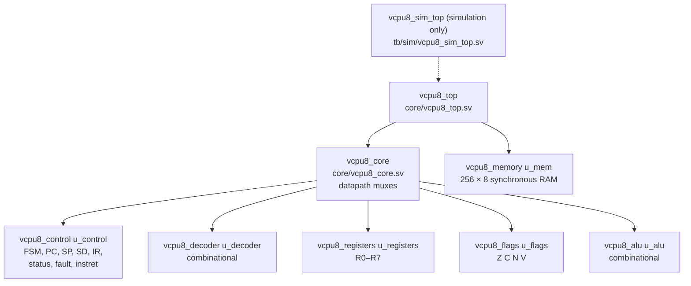

# VCPU-8 Microarchitecture

The RTL VCPU-8 is a **multicycle** processor. It works on one instruction at a time and spends 4 to 6 clock cycles on it: one state to fetch the opcode, one to decode it, one per operand byte, one to execute and one to write the results back. There is no pipeline, no cache and no prefetch. It runs ISA 1.0.0 machine code unmodified and matches the TypeScript emulator at every instruction boundary on all 98 committed fixtures.

This page is the map. [datapath.md](datapath.md) follows the data through the multiplexers, [control-unit.md](control-unit.md) explains the decoder and the FSM, and the module pages ([register-file.md](register-file.md), [alu.md](alu.md), [memory-interface.md](memory-interface.md)) describe each block.

## Module hierarchy



| Module            | File                      | Kind                                 | Holds                                                                                |
| ----------------- | ------------------------- | ------------------------------------ | ------------------------------------------------------------------------------------ |
| `vcpu8_top`       | `core/vcpu8_top.sv`       | structural                           | nothing; joins the core and the RAM on one memory bus                                |
| `vcpu8_core`      | `core/vcpu8_core.sv`      | structural + combinational muxes     | nothing; the RAM-address, RAM write-data and register write-data muxes               |
| `vcpu8_control`   | `core/vcpu8_control.sv`   | sequential FSM + next-state logic    | FSM state, PC, SP, SD, IR (op, rb, tb, length), status, fault code and PC, `instret` |
| `vcpu8_decoder`   | `core/vcpu8_decoder.sv`   | combinational                        | nothing; opcode and register byte → control signals                                  |
| `vcpu8_registers` | `core/vcpu8_registers.sv` | sequential, 2 read ports, 1 write    | R0–R7                                                                                |
| `vcpu8_flags`     | `core/vcpu8_flags.sv`     | sequential, masked update            | Z, C, N, V                                                                           |
| `vcpu8_alu`       | `core/vcpu8_alu.sv`       | combinational                        | nothing; result and flags of the 12 ALU operations                                   |
| `vcpu8_memory`    | `core/vcpu8_memory.sv`    | synchronous RAM, registered read     | the 256 bytes of code, data and stack                                                |
| `vcpu8_sim_top`   | `tb/sim/vcpu8_sim_top.sv` | simulation wrapper (not synthesized) | nothing; DPI functions that load and dump `u_top.u_mem.mem`                          |

The packages come first: `vcpu8_isa_pkg` (generated from `@vcpu/shared`, every opcode, fault, status and reset number) and `vcpu8_types_pkg` (this design's internal encodings: `alu_op_t`, the decoder selects, `fsm_state_t` and `bus_addr_sel_t`).

### Ports of `vcpu8_top`

| Port                                  | Direction | Width   | Meaning                                                            |
| ------------------------------------- | --------- | ------- | ------------------------------------------------------------------ |
| `clk`                                 | in        | 1       | The only clock. Every flip-flop updates on its rising edge         |
| `rst`                                 | in        | 1       | Synchronous, active-high reset                                     |
| `status`                              | out       | 3       | `STATUS_READY` (0), `STATUS_HALTED` (3) or `STATUS_FAULTED` (4)    |
| `fault_code`, `fault_pc`              | out       | 3, 8    | `FAULT_*` number and faulting instruction address; 0 until a fault |
| `retire`                              | out       | 1       | One-cycle pulse after each instruction's WRITEBACK edge            |
| `retire_pc`, `retire_op`              | out       | 8, 8    | Address and opcode of the instruction that just retired            |
| `instret`                             | out       | 32      | Retired-instruction counter                                        |
| `dbg_regs`                            | out       | 64      | R7..R0 packed, R0 in bits 7:0                                      |
| `dbg_pc`, `dbg_sp`, `dbg_sd`          | out       | 8, 8, 7 | PC, SP and the stack depth SD                                      |
| `dbg_flags`                           | out       | 8       | The FLAGS byte `{4'h0, Z, C, N, V}`                                |
| `dbg_state`                           | out       | 3       | `fsm_state_t`                                                      |
| `dbg_ir_op`, `dbg_ir_rb`, `dbg_ir_tb` | out       | 8, 8, 8 | IR: opcode, register byte, trailing byte                           |
| `dbg_ir_len`                          | out       | 2       | Bytes fetched into IR: 1 when DECODE faulted, otherwise the length |
| `mem_addr`, `mem_we`, `mem_wdata`     | out       | 8, 1, 8 | The memory bus, as the core drives it                              |
| `mem_rdata`                           | out       | 8       | The RAM's registered read data                                     |

Everything except `clk` and `rst` is an output for observation. They are plain ports, cheap to leave unconnected on an FPGA, and nothing in `core/` prints, reads files or uses a delay. The RTL runner and the fixture check read them; the formal and differential-verification tickets build on them.

## How the RTL becomes logic

An RTL description is not a program that runs step by step. Each construct describes a piece of circuitry that exists all the time and works in parallel with every other piece.

**Flip-flops hold state.** Every `always_ff @(posedge clk)` block becomes a bank of D flip-flops. Between clock edges they hold their value. At a rising edge each one loads the value its input logic computed during the cycle. Yosys 0.70's `synth -top vcpu8_core` maps the core's state to 182 flip-flops:

| Module            | Flip-flops | What they store                                                                                                   |
| ----------------- | ---------- | ----------------------------------------------------------------------------------------------------------------- |
| `vcpu8_control`   | 114        | FSM state, PC, SP, SD, IR.op/rb/tb, IR length, status, fault code and PC, retire, retire PC and opcode, `instret` |
| `vcpu8_registers` | 64         | R0–R7                                                                                                             |
| `vcpu8_flags`     | 4          | Z, C, N, V                                                                                                        |

The 256 × 8 memory is not built from flip-flops. It is inferred as a RAM block (see [memory-interface.md](memory-interface.md)). The synthesis ticket reports the whole design's resources and timing.

**Combinational logic computes.** Every `always_comb` block and `assign` becomes gates whose outputs follow their inputs after a propagation delay. They have no memory. The decoder, the ALU, the fault checks, the next-state and next-PC logic, and the muxes are all combinational. Each `always_comb` block assigns a default first, so every output has a value on every path: no latch is inferred, and Verilator's `-Wall` lint and Yosys both confirm it.

**Muxes choose.** A `case` on a select signal becomes a multiplexer: all inputs are computed all the time, and the select decides which one reaches the output. The datapath has a mux on the RAM address, one on the RAM write data, one on the register write data, one on the next PC and two on the decoder's inputs ([datapath.md](datapath.md) lists them).

| Kind                    | Blocks                                                                                                      |
| ----------------------- | ----------------------------------------------------------------------------------------------------------- |
| Sequential (flip-flops) | `vcpu8_control`'s state and registers, `vcpu8_registers`, `vcpu8_flags`, the RAM and its registered `rdata` |
| Combinational           | `vcpu8_decoder`, `vcpu8_alu`, fault detection, next state, next PC, every datapath mux, the write enables   |

There are no combinational loops. Every path from a flip-flop's output through combinational logic ends at a flip-flop's input or at an output port. The only path through the RAM goes through its registered read.

## Clock and reset

There is one clock, `clk`, and every piece of state changes only on its rising edge. Within a cycle the combinational logic settles to the values the flip-flops will load at the next edge. The FSM state says which part of an instruction this cycle is doing.

`rst` is **synchronous and active-high**. While it is 1 at a rising edge, every flip-flop in the core loads its reset value: R0–R7 = 0, PC = `RESET_PC`, SP = `RESET_SP`, SD = 0, FLAGS = 0, IR = 0, status = `STATUS_READY`, no fault, `instret` = 0, and the FSM state = FETCH. The RAM has no reset, so its contents survive, exactly as the emulator's `reset()` keeps the loaded program. The first rising edge after `rst` falls is the FETCH of the instruction at address 0.

A program gets into the RAM before reset is released: through `INIT_FILE`, or, in the runner, by writing `u_top.u_mem.mem` through DPI while `rst` is held.

## Clocks per instruction

Each instruction takes one clock per FSM state it passes through. These counts were measured, not predicted: `make -C hardware/rtl/vcpu8 fixtures` runs all 98 fixtures, and the RTL runner records the clock count at every retirement. `build/reports/fixtures.json` then lists, per opcode, the clocks between consecutive retirements (`clocksByOpcode`). Every opcode took the same number of clocks every time it ran.

| Class                                                                            | States                                                | Clocks | Retirements measured |
| -------------------------------------------------------------------------------- | ----------------------------------------------------- | ------ | -------------------- |
| NOP, HLT, RET                                                                    | FETCH, DECODE, EXECUTE, WRITEBACK                     | 4      | 13, 81, 5            |
| 2-byte: MOV, ALU (except MUL, DIV), LOAD/STORE `[Rp]`, PUSH, POP, JMP, Jcc, CALL | FETCH, DECODE, OPERAND1, EXECUTE, WRITEBACK           | 5      | 1,158                |
| 3-byte: LDI, LOAD/STORE `[addr8]`                                                | FETCH, DECODE, OPERAND1, OPERAND2, EXECUTE, WRITEBACK | 6      | 250                  |
| MUL                                                                              | as 2-byte (combinational multiplier)                  | 5      | 15                   |
| DIV                                                                              | as 2-byte (combinational divider)                     | 5      | 4                    |

A taken branch costs the same as one not taken, because nothing is fetched ahead. A data read (LOAD, POP, RET) is addressed in EXECUTE and its byte arrives in WRITEBACK, so it costs no extra state. A precise fault ends the step when it is detected: 2 clocks for a DECODE fault (`fault-invalid-opcode`, `fault-instruction-overrun-at-fe`), 3 for a malformed register byte of a 2-byte instruction (`fault-malformed-field-b`), 4 for a malformed 3-byte instruction (`fault-malformed-register`), and 3 or 4 for an EXECUTE fault of a 1- or 2-byte instruction (`fault-stack-underflow-ret`, `fault-divide-by-zero`).

This microarchitecture is revision `vcpu8-mc-r1` (`hardware/rtl/vcpu8/REVISION`). Any change to the counts above bumps it ([research/cpu/README.md](../../research/cpu/README.md#the-architecture-revision)). [performance-analysis.md](performance-analysis.md) has the cycles and CPI of the benchmark programs.

[hardware-porting.md](../hardware-porting.md#per-instruction-state-sequence) predicted 12 clocks for DIV with an 8-iteration divider. This design divides combinationally, so DIV costs 5. The iterative divider is a later experiment.

## How this differs from the emulator

The emulator and the RTL compute the same architectural results, but they are built in different ways.

| Emulator (`@vcpu/cpu-core`)                                                       | RTL (`vcpu8_top`)                                                                                                                       |
| --------------------------------------------------------------------------------- | --------------------------------------------------------------------------------------------------------------------------------------- |
| `step()` runs one whole instruction atomically. Nothing exists between two steps. | An instruction takes 4–6 clock cycles. Mid-instruction state (IR, the FSM state) is real and observable.                                |
| Code runs one statement after another.                                            | All the logic works at once; the FSM state decides which results are kept at the next edge.                                             |
| A precise fault returns before the commit code runs.                              | A precise fault moves the FSM to FAULTED before WRITEBACK, so no write enable is ever asserted.                                         |
| Fetch, operand reads and data accesses are array reads with no timing.            | They share one RAM port with a registered read, one access per cycle (see [memory-interface.md](memory-interface.md#sharing-the-port)). |
| "Estimated cycles" come from the instructional timing model.                      | Clock cycles are counted by the runner at real clock edges (table above).                                                               |
| A step is a function call that returns a trace entry.                             | A step is a `retire` pulse, or the entry into FAULTED by a precise fault.                                                               |

The architectural state at every instruction boundary is the same, and that is what the fixture check compares: after each `retire` pulse (or precise fault), R0–R7, FLAGS, SP, SD, PC, status, fault and the memory writes of the step must equal the emulator's trace line, and at the end the full state and all 256 memory bytes must equal the fixture's `expected`.

## Running programs on the RTL

`build/sim/vcpu8_sim` is the Verilated `vcpu8_top` with a C++ harness, `tb/sim/vcpu8_sim.cpp`:

```sh
make -C hardware/rtl/vcpu8 simulate PROGRAM=examples/14-fibonacci.asm   # assemble, run, print the end state
make -C hardware/rtl/vcpu8 fixtures                                      # all 98 fixtures, end state + lock-step
make -C hardware/rtl/vcpu8 fixtures FILTER='fault-*'                     # a subset
make -C hardware/rtl/vcpu8 test                                          # unit tests, then the fixtures
```

`simulate` assembles a `.asm` file with the Project 1 assembler (`@vcpu/rtl-tools assemble`) or takes a `.mem.hex` image, and writes `build/simulate/<name>.state.json` (format `vcpu8-rtl-state/1`) and `<name>.trace.jsonl`. The runner itself takes `--image`, `--max-steps` (default 1,000,000), `--max-cycles`, `--state`, `--trace` and `--quiet`; its header comment documents both output formats. `pnpm hardware:simulate PROGRAM=…` does the same from the repository root. [simulation-guide.md](simulation-guide.md) covers both formats, waveforms and GTKWave.
