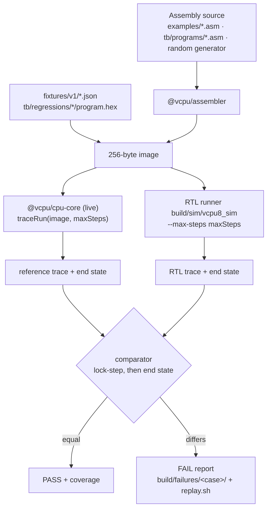

# VCPU-8 RTL verification strategy

The RTL CPU must be binary-compatible with Project 1 and match the TypeScript emulator (`@vcpu/cpu-core`) at every instruction boundary. Several layers of checks show this. Each layer can fail, and each one has been made to fail on purpose.

The most important layer is the **live differential verification**, `make verify`. It runs the same machine code on the TypeScript CPU and on the RTL, then compares the architectural state after every retired instruction and again at the end. Its inputs are the committed fixtures, the example programs, directed programs, promoted regressions and seeded random programs.

## Verification layers

| Layer                       | Command (`make -C hardware/rtl/vcpu8 …`)           | What it shows                                                                                                                                                           | How it is made to fail                                                      |
| --------------------------- | -------------------------------------------------- | ----------------------------------------------------------------------------------------------------------------------------------------------------------------------- | --------------------------------------------------------------------------- |
| Unit: state-holding modules | `test-registers`, `test-flags`, `test-memory`      | Register file, FLAGS and the 256-byte RAM: reset, writes, read-during-write, latency ([register-file.md](register-file.md), [memory-interface.md](memory-interface.md)) | Self-checking testbenches exit non-zero on a mismatch                       |
| Exhaustive ALU              | `test-alu`                                         | Every operation × every `a`, `b` and carry-in against the TypeScript ALU ([alu.md](alu.md))                                                                             | `test-alu-corrupt` flips one expected flag and requires the test to name it |
| Decoder                     | `test-decoder`                                     | All 256 opcodes and 65,536 register bytes against the ISA table and cpu-core `decode()` ([control-unit.md](control-unit.md))                                            | `test-decoder-mutant` breaks PUSH's row and requires the test to name it    |
| Fixtures                    | `fixtures` (part of `make test`)                   | All 98 `fixtures/v1` programs: end state and the committed per-step trace                                                                                               | `fixtures-tamper` edits two fixtures and requires precise failure reports   |
| **Live differential**       | `verify`                                           | Fixtures, examples, directed programs and regressions run on both CPUs live, compared in lock-step and at the end, with opcode and fault coverage                       | `verify-mutants`, below                                                     |
| **Seeded random programs**  | `verify` (1,000 programs), `verify-long` (100,000) | Program shapes no human wrote, compared the same way                                                                                                                    | `verify-mutants`                                                            |
| **Mutation**                | `verify-mutants`                                   | Twelve deliberately broken copies of the RTL; `verify` must catch every one                                                                                             | A surviving mutant fails the target                                         |
| Formal                      | `formal`, `formal-selftest`, `formal-mutant`       | SymbiYosys properties of reset, the FSM, writes, halt, retirement and the ALU, for every input sequence ([formal-verification.md](formal-verification.md))              | `formal-selftest` (a false property must fail) and `formal-mutant`          |

The fixture check and `verify` share the comparator (`packages/rtl-tools/src/verify/compare.ts`). They differ in where the expected side comes from. `fixtures` reads the expected traces that Project 1's `pnpm fixtures:export` committed. `verify` produces the expected trace by running `@vcpu/cpu-core` now, so it can check programs that have no committed expectation, such as random programs. The reference is always the real emulator, executed live; nothing re-implements it.

## The pipeline



For every case, `@vcpu/rtl-tools verify` (`packages/rtl-tools/src/commands/verify.ts`) does the following:

1. It builds the image. Assembly is assembled fresh by `@vcpu/assembler`, a fixture uses its `initial.memory`, and a regression uses its committed `program.hex`.
2. It runs the image on `@vcpu/cpu-core` from reset through `traceRun` (`packages/cpu-core/src/fixture.ts`), the same code `pnpm fixtures:export` uses. This produces a fixture-shaped trace line per step and the end state (`src/verify/reference.ts`).
3. It runs the image on the RTL runner with the same step limit (`src/verify/rtl.ts`). Runner processes run in parallel, one per CPU core.
4. It compares the two traces line by line and stops at the first step that differs, then compares the end states.

A case that cannot be built, or whose runner crashes, times out or writes unreadable output, counts as a failure, with its error. `verify` never stops at the first failing case. It runs every case, reports them all, and exits 1 if any failed.

## What is compared

**After every step** (`compareStep`), the comparator checks the step number, the PC of the instruction, the status (READY, HALTED or FAULTED), the fault code, R0–R7, FLAGS, SP, SD, the next PC and every memory write (address and value, in order).

A step is one retired instruction, or the step that ends in a precise fault. The RTL runner counts a step on its `retire` pulse, or on entry into FAULTED without one. That is exactly how the emulator counts steps. A precise fault retires nothing. Its trace line therefore repeats the state from before the step, with `nextPc` equal to `pc` and no writes. An RTL line that matches it field by field shows that the fault changed nothing.

IR is the one field not compared. It is not architectural, and a design that fetches differently may legitimately show other bytes there (see [hardware-porting.md](../hardware-porting.md)).

**At the end** (`compareEnd`), the comparator checks why the run stopped (halted, faulted or the step limit), the status, the fault code, its number and its PC, the retired instruction count, R0–R7, PC, SP, SD, FLAGS and all 256 memory bytes.

Both sides run under the same step limit. A program that does not stop is cut off at that limit on both sides, and the state there is compared like any other. A mismatch at the limit is reported like any other mismatch. The runner also gets a clock limit of 32 cycles per step, so an RTL that hangs without retiring produces a `max_cycles` mismatch instead of a stuck run.

### Why per instruction boundary and not per cycle

The emulator has no cycles to compare against. It executes one instruction per `step()`, and its timing model is an estimate, not a cycle-accurate machine. The ISA defines state only at instruction boundaries, so that is the only place where "the same" has a meaning. The RTL may take any number of clocks per instruction, 4 to 6 today and more with an iterative divider, and may hold any internal values in between.

Comparing every boundary still finds the **first** instruction that went wrong, not just a wrong final answer. A failure report therefore points at one instruction with its operands and the step before it. Cycle counts are measured separately (the runner records `cycle` per step), but they are not checked against the emulator.

## Corpora

The default `make verify` runs all five corpora. The counts below are from the run recorded in [Results](#results).

| Corpus        | Source                                 |           Cases | Step limit                           |
| ------------- | -------------------------------------- | --------------: | ------------------------------------ |
| `fixtures`    | `fixtures/v1/*.json`                   |              98 | the fixture's `maxInstructions`      |
| `examples`    | `examples/*.asm`, assembled fresh      |              20 | the `.expect.json` `maxInstructions` |
| `programs`    | `hardware/rtl/vcpu8/tb/programs/*.asm` |              11 | `; max-steps: N` header, else 10,000 |
| `regressions` | `hardware/rtl/vcpu8/tb/regressions/*/` |               2 | `case.json` `maxSteps`               |
| `random`      | `generateProgram(seed)`, seeds `SEED`… | `COUNT` (1,000) | 2,000                                |

Every example is also a fixture (`example-NN-…`). Running both is deliberate. The fixture is the committed image, and the example is assembled now, so the examples corpus also catches a change in the assembler.

### The brief's §13 list

| #   | Brief item                   | Covered by                                                                                |
| --- | ---------------------------- | ----------------------------------------------------------------------------------------- |
| 1   | Addition                     | `examples/01-addition.asm`                                                                |
| 2   | Subtraction                  | `examples/02-subtraction.asm`                                                             |
| 3   | Multiplication               | `examples/03-multiplication.asm`                                                          |
| 4   | Division                     | `examples/04-division.asm`                                                                |
| 5   | Bitwise AND                  | `examples/05-and.asm`                                                                     |
| 6   | Bitwise OR                   | `examples/06-or.asm`                                                                      |
| 7   | Bitwise XOR                  | `examples/07-xor.asm`                                                                     |
| 8   | Shifts                       | `examples/08-shift-left.asm`, `examples/09-shift-right.asm`                               |
| 9   | Comparisons                  | `examples/10-compare.asm`                                                                 |
| 10  | Conditional branches         | `examples/11-conditional-branch.asm`                                                      |
| 11  | Loops                        | `examples/12-countdown.asm`, `examples/13-sum-integers.asm`                               |
| 12  | Fibonacci                    | `examples/14-fibonacci.asm`                                                               |
| 13  | Factorial                    | `examples/15-factorial-overflow.asm`                                                      |
| 14  | Array operations             | `examples/16-array-sum.asm`, `examples/17-array-max.asm`                                  |
| 15  | Memory copy                  | `examples/18-memory-copy.asm`                                                             |
| 16  | Stack operations             | `examples/20-stack.asm`; `tb/programs/full-stack.asm` (all 64 bytes)                      |
| 17  | Subroutine calls             | `examples/19-subroutines.asm`                                                             |
| 18  | Nested calls                 | `tb/programs/nested-calls.asm` (five deep; example 19 nests two)                          |
| 19  | Overflow behaviour           | `tb/programs/overflow.asm` (ADD, SUB, MUL, INC, DEC and the branches on them); example 15 |
| 20  | Invalid instruction handling | `tb/programs/fault-*.asm`: one whole program per fault code (7)                           |

Each directed program opens with a header that names its target and its expected result, derived by hand. For example, `fault-stack-overflow.asm` recurses until the 65th CALL faults with R0 = 65 and the stack full of return addresses. The seven fault programs are invalid opcode, malformed operand, instruction overrun, PC overflow, divide by zero, stack overflow and stack underflow. Each one does real work before it faults. The malformed-operand program writes its bad ADD into RAM and jumps to it, and the PC-overflow program runs straight-line code off the end of memory.

V and N have no branch in ISA 1.0, so `overflow.asm` cannot branch on them. The lock-step comparison checks the whole FLAGS byte after every instruction, so a wrong V is still caught at the instruction that set it.

## Random programs

`packages/rtl-tools/src/random/` generates the random programs.

- **Seeds.** `prng.ts` is mulberry32 seeded through splitmix32. It is implemented in the package, and `Math.random` is never called (a test checks this). A program is a function of its seed alone. Seed `s` is case `random/s<s>`, and the default run uses seeds 1–1000. `make verify SEED=… COUNT=…` picks other seeds.
- **Valid encodings.** Programs are written as assembly and assembled by `@vcpu/assembler`. A program that does not assemble is a generator bug, and the generator test fails on it. Outside the fault and raw shapes, a test disassembles every generated program and finds only valid instructions.
- **Shapes**, chosen by weight so that programs run long enough to matter instead of faulting on their first bytes:

  | Shape    | Weight | What it is                                                                                                                                                                                                                                        |
  | -------- | -----: | ------------------------------------------------------------------------------------------------------------------------------------------------------------------------------------------------------------------------------------------------- |
  | `alu`    |     25 | LDI of boundary values (0, 1, 0x7F, 0x80, 0xFF, …), then random ALU instructions with nested forward branches (conditional, or JMP over dead code)                                                                                                |
  | `memory` |     20 | Absolute and register-indirect loads and stores, and pointers computed from program values (`0x80 \| (Rx & 0x3F)`). 15% of these programs may also store into their own code                                                                      |
  | `loop`   |     20 | Bounded loops: DEC/JNZ down-counters and INC/CMP/JC up-counters, sometimes nested, whose bodies never write the counters. 8% end in an endless loop on purpose, to exercise the step-limit comparison                                             |
  | `calls`  |     17 | `main` calls up to four functions, and function _i_ may call only function _j_ > _i_, so calls nest but never recurse. Bodies hold balanced PUSH/POP pairs. `main` sometimes pushes 1–64 bytes in a loop and pops them again (up to a full stack) |
  | `fault`  |     13 | A short ALU prefix, then a sequence built to end in a chosen fault: each of the seven fault codes, with variants such as CALL at 0xFE, invalid bytes stored into data and jumped to, and unbounded recursion                                      |
  | `raw`    |      5 | 1–128 raw random bytes from 0x00 (each a valid opcode byte 40% of the time), to exercise encodings no assembler would write. Many fault on the first instruction, which is valid and compared                                                     |

- **Memory layout.** Code stays in 0x00–0x7F, data stores in 0x80–0xBF and the stack in 0xC0–0xFF, except for the self-modifying share and the fault variants that place bytes at 0xFD–0xFF.
- **Termination.** Programs end with HLT unless they fault. Every random program has a 2,000-step limit, applied to both sides.

## Coverage

`verify` counts coverage on the reference run (`src/verify/coverage.ts`). On a passing case, the RTL did exactly the same. It counts:

- retired instructions per opcode;
- the fault each run ended in;
- taken and not-taken outcomes per conditional branch, decided from the flags before the branch;
- how runs stopped;
- the deepest stack.

The default run (`--all`) fails if any of the 30 opcodes was never retired or any of the 7 fault codes was never hit.

Coverage of the default run (`make verify`, random seeds 1–1000, 1,131 cases):

| Opcode   | Retired | Opcode    | Retired | Opcode    | Retired | Opcode | Retired | Opcode   | Retired |
| -------- | ------: | --------- | ------: | --------- | ------: | ------ | ------: | -------- | ------: |
| NOP      |   2,652 | HLT       |     892 | MOV       |   3,109 | LDI    |  15,023 | LOAD_ABS |   2,201 |
| LOAD_IND |   1,762 | STORE_ABS |   1,498 | STORE_IND |   2,150 | ADD    |   1,670 | SUB      |   1,301 |
| MUL      |   2,297 | DIV       |   1,454 | INC       |   5,993 | DEC    |   8,649 | AND      |   2,262 |
| OR       |   3,963 | XOR       |   2,057 | NOT       |     902 | SHL    |     933 | SHR      |   1,601 |
| CMP      |   1,967 | JMP       |  10,021 | JZ        |   2,274 | JNZ    |   7,881 | JC       |   2,526 |
| JNC      |   1,296 | CALL      |   1,238 | RET       |     470 | PUSH   |   3,477 | POP      |   2,644 |

| Fault               | Runs ending in it |
| ------------------- | ----------------: |
| INVALID_OPCODE      |                51 |
| MALFORMED_OPERAND   |                23 |
| INSTRUCTION_OVERRUN |                19 |
| PC_OVERFLOW         |                33 |
| DIVIDE_BY_ZERO      |                56 |
| STACK_OVERFLOW      |                24 |
| STACK_UNDERFLOW     |                19 |

| Branch | Taken | Not taken |
| ------ | ----: | --------: |
| JZ     | 1,156 |     1,118 |
| JNZ    | 7,215 |       666 |
| JC     | 1,381 |     1,145 |
| JNC    | 1,111 |       185 |

All 30 opcodes retired and all 7 fault codes hit. The 1,131 runs ended 892 halted, 225 faulted and 14 at the step limit (the endless-loop share), over 96,368 steps (96,163 retired). The maximum stack depth was 64, a full stack.

## Mutation testing

`make verify-mutants` proves that the differential verification can fail. `scripts/mutants.txt` lists twelve one-line textual mutations of `core/`. For each one, `@vcpu/rtl-tools mutants` (`src/commands/mutants.ts`) does the following:

1. It copies `core/` to `build/mutants/<id>/core/` and applies the mutation. The text being replaced must occur exactly once. If a mutation no longer applies because the RTL changed, that is an error, never a skip, and a vitest test checks every mutation against the current `core/`.
2. It builds that copy into its own runner, `build/mutants/<id>/sim/vcpu8_sim`.
3. It runs the full default `verify` against that runner and requires at least one mismatching case.

The real `core/` is only read. A mutant that survives fails the target, and `MUTANT=<id>` runs one mutant alone.

Result of the run recorded here: all 12 mutants caught, out of 1,131 cases each (default `verify`, seeds 1–1000).

| Mutant                | Planted bug                                              | Cases that differ | First caught by                                                  |
| --------------------- | -------------------------------------------------------- | ----------------: | ---------------------------------------------------------------- |
| `alu-add-carry`       | ADD's carry out is inverted                              |               499 | `example-01-addition`, step 2: FLAGS 0x00 → 0x04                 |
| `alu-sub-overflow`    | SUB's V uses ADD's sign rule                             |               495 | `example-04-division`, step 6: FLAGS 0x00 → 0x01                 |
| `alu-shr-carry`       | SHR shifts bit 1 into C instead of bit 0                 |               215 | `example-09-shift-right`, step 6: FLAGS 0x04 → 0x00              |
| `branch-inverted`     | every conditional branch takes the opposite decision     |               885 | `example-11-conditional-branch`, step 3: nextPc 0x09 → 0x0D      |
| `branch-c-reads-z`    | JC and JNC test Z instead of C                           |               411 | `example-11-conditional-branch`, step 3: nextPc 0x09 → 0x0D      |
| `sd-unchecked`        | PUSH and CALL do not check SD against the capacity       |                24 | `fault-stack-overflow`, step 193: status FAULTED → READY         |
| `div-zero-unchecked`  | DIV by zero does not fault                               |                56 | `fault-divide-by-zero`, step 4: status FAULTED → READY           |
| `pc-overflow-ignored` | a sequential next PC of 0x100 does not raise PC_OVERFLOW |                20 | `fault-pc-overflow-inc`, step 1: status FAULTED → READY          |
| `pop-sp-step`         | POP and RET move SP up by 2                              |               184 | `example-19-subroutines`, step 6: SP 0xFE → 0xFF                 |
| `call-return-address` | CALL pushes PC + 1 instead of PC + 2                     |               169 | `example-19-subroutines`, step 2: memWrites[0].value 0x08 → 0x07 |
| `store-ind-data`      | STORE [Rp], Rs writes the pointer instead of Rs          |               338 | `example-12-countdown`, step 2: memWrites[0].value 0x0A → 0x80   |
| `field-b-unchecked`   | an RR register byte with field b = 8–15 is not malformed |                 4 | `fault-malformed-field-b`, step 0: status FAULTED → READY        |

"First caught by" is the first failing case to finish, so it can vary between runs, because cases run in parallel. The target took 1 min 29 s on the development machine (12 jobs), mostly in the 12 Verilator builds.

## Failure reports

A failing case prints a report and is saved to `build/failures/<corpus>-<name>/`. The first 25 failing cases are saved in full; the rest get one line each. This is the report for a real failure: the `sd-unchecked` mutant running the committed fixture `fault-stack-overflow`, shortened where marked:

```text
FAIL fixtures/fault-stack-overflow: lock-step trace, step 193
  corpus fixtures · max steps 1000
  from fixtures/v1/fault-stack-overflow.json
  instruction: PC 0x03, opcode 0x50 PUSH, bytes [50 10] = PUSH R1
  field         expected → actual
  status        FAULTED → READY
  fault         STACK_OVERFLOW → null
  sp            0xBF (191) → 0xBE (190)
  sd            0x40 (64) → 0x41 (65)
  nextPc        0x03 (3) → 0x05 (5)
  memWrites     [] → [0xBF←0x01]
  stopReason    faulted → halted
  …             (the end-state differences follow)
  registers and flags after step 193
    expected  R0=00 R1=01 R2=00 R3=00 R4=00 R5=00 R6=00 R7=00  FLAGS=00 (-)  SP=BF SD=64 PC=03
    actual    R0=00 R1=01 R2=00 R3=00 R4=00 R5=00 R6=00 R7=00  FLAGS=00 (-)  SP=BE SD=65 PC=05
  memory near 0x03 (final contents)
    …
  stack from 0xBF (final contents; SP after step 193 expected BF, actual BE)
    expected  0xB0: 00 00 00 00 00 00 00 00 00 00 00 00 00 00 00 00
    actual    0xB0: 00 00 00 00 00 00 00 00 00 00 00 00 00 00 00 01  ≠
    …
  recent emulator steps (last 16)
    …
    step  193  pc 0x03  PUSH  [50 10]  R0=00 R1=01 …  FLAGS=00 SP=BF SD=64  next=0x03  FAULTED  STACK_OVERFLOW
  recent RTL steps (last 16)
    …
    step  193  pc 0x03  PUSH  [50 10]  R0=00 R1=01 …  FLAGS=00 SP=BE SD=65  next=0x05  READY  writes [0xBF←0x01]
  replay: make -C hardware/rtl/vcpu8 replay CASE=build/mutants/sd-unchecked/failures/fixtures-fault-stack-overflow
```

Read it from the top:

1. **Headline.** The case and where it first differs: a trace step, or the end state when every step matched.
2. **Case details.** The corpus, the seed and shape of a random program, the step limit, and where the program came from.
3. **The instruction.** Its PC, opcode, bytes and disassembly.
4. **Every differing field**, with the expected (emulator) value and the actual (RTL) value. Lock-step differences come first, then the end state.
5. **All registers, FLAGS (with the set flags named), SP, SD and the next PC on both sides**, after the failing step.
6. **Memory.** The rows around the address involved (the written address, or else the instruction), and up to four rows of the stack from its top. Rows that differ are marked `≠`. Memory is the final contents, because the trace records writes, not whole memory images.
7. **The last 16 steps of each side**, ending at the failing one.
8. **The replay command.**

The saved directory holds:

- `case.json`: name, corpus, seed, shape, step limit, origin, the runner it failed on and the first difference;
- `program.hex` (the image) and `program.asm` (when there is source);
- `ref.trace.jsonl` and `ref.state.json` (the emulator side);
- `rtl.trace.jsonl` and `rtl.state.json` (the RTL side);
- `report.txt`;
- `replay.sh`, which runs the replay command with absolute paths.

### Reproducing and promoting

```sh
make -C hardware/rtl/vcpu8 replay CASE=build/failures/random-s1234
make -C hardware/rtl/vcpu8 verify SEED=1234 COUNT=1      # the same random program, from its seed
make -C hardware/rtl/vcpu8 promote CASE=build/failures/random-s1234
```

`replay` reruns the saved image on both sides. It uses the step limit from `case.json` and the RTL runner the case failed on, so a mutant's failure replays against that mutant; `SIM=…` overrides the runner. It prints the report again and says whether it is the same as the saved `report.txt`. It exits 1 while the case still fails and 0 once it passes. `make verify-mutants` prints one replay command per mutant.

`promote` copies a saved case into `tb/regressions/<name>/`, which every `make verify` replays from then on. The committed `program.hex` keeps the regression valid even if the random generator changes later. When verification finds a real RTL bug, the fix ships with the failing case promoted to a regression. The two regressions committed so far are random programs that caught mutants that few other cases catch ([tb/regressions/README.md](../../hardware/rtl/vcpu8/tb/regressions/README.md)).

## Results

Recorded on the development machine (macOS, Apple Silicon, 12 parallel jobs), on the RTL as committed:

| Run                                      | Random seeds |      Cases |    Passed | Steps compared |       Time |
| ---------------------------------------- | ------------ | ---------: | --------: | -------------: | ---------: |
| `make verify`                            | 1–1000       |      1,131 |     1,131 |         96,368 |      2.4 s |
| `make verify-long` (`LONG_COUNT=100000`) | 1–100000     |    100,131 |   100,131 |      9,761,769 |    206.1 s |
| `make verify-mutants`                    | 1–1000       | 12 mutants | 12 caught |              — | 1 min 29 s |

The long run's 100,131 cases ended 76,331 halted, 22,253 faulted and 1,547 at the step limit. Every fault code was hit at least 1,830 times (INSTRUCTION_OVERRUN). Every opcode was retired at least 41,396 times (RET). Every branch condition was both taken and not taken at least 18,327 times (JNC not taken). No mismatch was found, so verification found no RTL bug, and the RTL was not changed by this work.

## Commands

```sh
pnpm hardware:verify                       # make -C hardware/rtl/vcpu8 verify
pnpm hardware:verify:long                  # make -C hardware/rtl/vcpu8 verify-long
make -C hardware/rtl/vcpu8 verify SEED=5000 COUNT=200
make -C hardware/rtl/vcpu8 verify-mutants [MUTANT=<id>]
make -C hardware/rtl/vcpu8 replay CASE=build/failures/<name> [SIM=<runner>]
make -C hardware/rtl/vcpu8 promote CASE=build/failures/<name>
pnpm --filter @vcpu/rtl-tools cli verify --random --seed 1 --count 50   # one corpus, no coverage requirement
pnpm --filter @vcpu/rtl-tools test        # comparator, reference, generator, coverage and mutant-list tests
```

The make targets need the pinned toolchain (`pnpm hardware:setup`). The vitest tests are pure TypeScript, so they also run in `pnpm test`, which Project 1's `pnpm check` runs on machines without Verilator.

Reports go to `build/reports/verify.json` (every non-random case, every failure, the coverage) and `build/reports/verify.md` (the same as tables). `verify-long` writes them to `build/reports/verify-long/`, and `verify-mutants` writes `build/reports/mutants.json`.

## What is not covered

- **Cycle timing.** Only architectural state at instruction boundaries is compared. Clock counts per instruction are recorded but not checked against anything; the performance ticket measures them.
- **Internal signals.** The FSM state, IR, bus addresses and anything else between boundaries are not compared. A wrong internal value that never reaches architectural state is invisible here. The formal properties ([formal-verification.md](formal-verification.md)) cover some of these.
- **States the RTL can reach only by other means.** Every run starts from reset with a memory image, as the emulator does. Nothing loads registers directly or resets mid-run.
- **The RUNNING and PAUSED statuses and the debugger.** The run-control features of the emulator (pause, breakpoints, undo) have no RTL counterpart and are not exercised.
- **Long programs.** Random programs stop within 2,000 steps, and directed programs within their headers' limits. Behaviour that needs longer runs is covered only by construction.
- **Uniform coverage of every operand value.** Random programs bias operands toward boundary values, and the exhaustive ALU test covers every operand pair for the ALU alone. No run executes every instruction with every operand in every machine state.
- **Gate-level and FPGA behaviour.** Verification runs on Verilator's model of the RTL. Synthesis results and timing are another ticket's.
- **The comparator itself.** The comparator is shared by both sides, so a comparator bug that hid a field would hide it everywhere. Its vitest tests, `fixtures-tamper` and the mutants guard against this.
