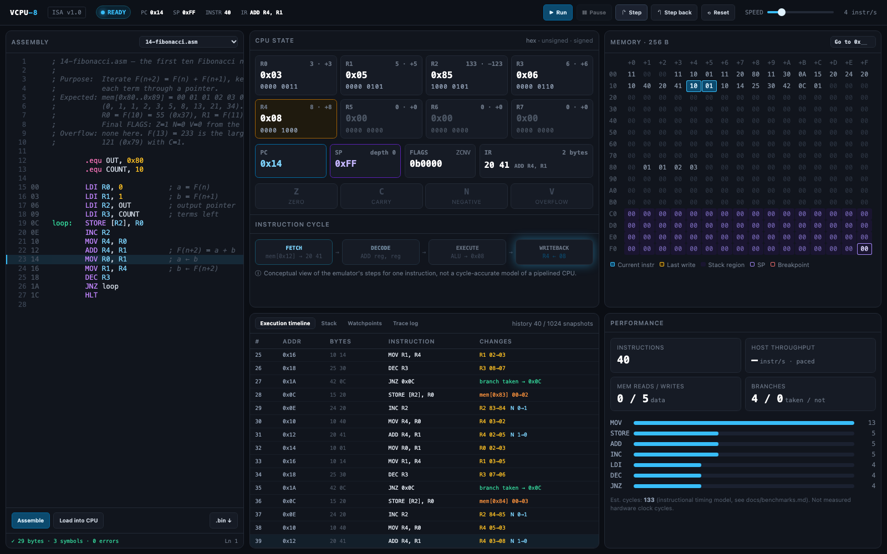
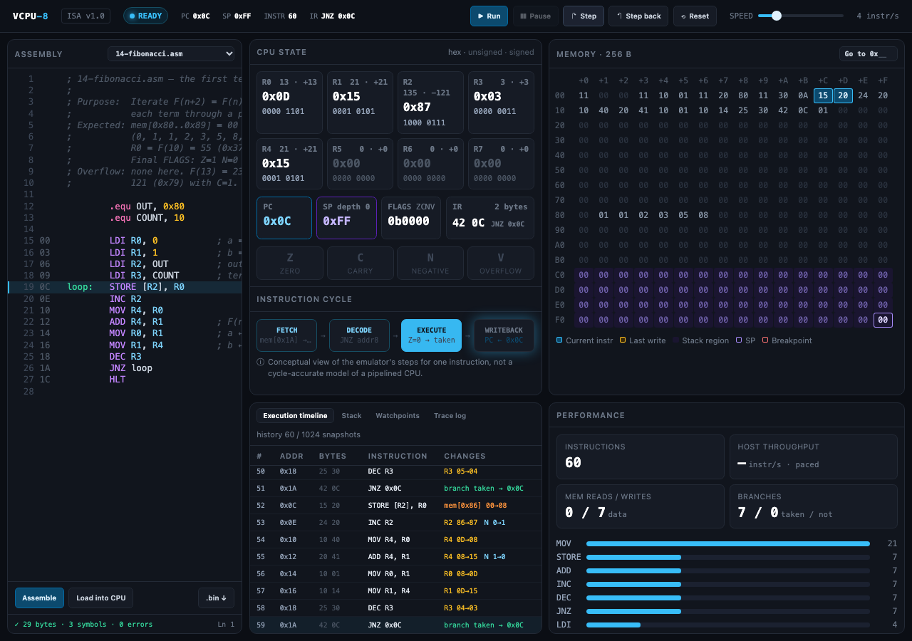

# Project 1 Report: VCPU-8

This is the completion report for Project 1 of the semiconductor initiative: VCPU-8, an educational 8-bit CPU emulator with an assembler, disassembler, debugger, web dashboard, CLI, benchmark suite and RTL-ready test fixtures. It covers the seven items of the project brief's §18 and gives the evidence for each item of the §17 Definition of Done.

Every number below was observed on 2026-10-16 in a fresh `git clone` of commit `dc5263f` (the tip of `master` when the audit ran). The runs used Node v24.15.0 and pnpm 10.34.7 on macOS 26 (Darwin 25.6.0), on an Apple M2 Pro. The two small fixes made during the audit are listed under [Audit fixes](#audit-fixes).

## Contents

1. [Definition of Done](#definition-of-done)
2. [Architecture summary](#architecture-summary)
3. [Implemented instruction set](#implemented-instruction-set)
4. [Test results](#test-results)
5. [Benchmark results](#benchmark-results)
6. [Commands to run everything](#commands-to-run-everything)
7. [Known limitations](#known-limitations)
8. [Readiness for Project 2](#readiness-for-project-2-systemverilog-cpu)
9. [Dashboard screenshots](#dashboard-screenshots)
10. [Audit fixes](#audit-fixes)

## Definition of Done

Each bullet of brief §17, with the evidence for it.

| §17 item                                  | Status | Evidence                                                                                                                                                                                                                                                                                                                                                                                                                                                                                                                                                                          |
| ----------------------------------------- | ------ | --------------------------------------------------------------------------------------------------------------------------------------------------------------------------------------------------------------------------------------------------------------------------------------------------------------------------------------------------------------------------------------------------------------------------------------------------------------------------------------------------------------------------------------------------------------------------------- |
| Executes encoded machine code             | Done   | `packages/cpu-core/src/cpu.ts` fetches and decodes the bytes in its 256-byte memory, using the opcode table in `@vcpu/shared`. `pnpm cpu disassemble` on a binary written by `pnpm cpu assemble` reproduces the source (see [Commands](#commands-to-run-everything)). The `vcpu8-fixture/1` fixtures store raw program bytes, and `fixtures.drift.test.ts` replays every one on the core.                                                                                                                                                                                         |
| All instructions                          | Done   | All 30 opcodes (28 mnemonics) are implemented, and each has its own `describe` block in `packages/cpu-core/src/__tests__/instructions/*.test.ts` ([table](#implemented-instruction-set)). The 20 examples execute every opcode, and the example suite asserts this. Every opcode also completes in at least one hardware fixture.                                                                                                                                                                                                                                                 |
| Deterministic arithmetic and flags        | Done   | `packages/cpu-core/src/alu.ts` has 100% branch coverage. `alu.test.ts` checks every binary ALU operation against an independent BigInt reference over all 256 × 256 operand pairs, then with fast-check on random operands and incoming FLAGS. It also asserts that every flag an instruction writes is seen both set and clear. The benchmark runner checks every timed run's instruction count against the reference run, and the audit's suite run finished without a mismatch. The exporter regenerated all 98 fixtures from a fresh clone, byte for byte (`git diff` empty). |
| Assembler and disassembler                | Done   | `packages/assembler`: a two-pass assembler with labels, `.org`, `.byte` and `.equ`, and errors that give line and column. It has 89 tests, including `roundtrip.test.ts` (1,000 random valid programs assembled, disassembled and assembled again, byte for byte). Branch coverage is 89.4%.                                                                                                                                                                                                                                                                                      |
| Debugger stepping and breakpoints         | Done   | `packages/debugger` has 63 tests and 95.0% branch coverage. Breakpoints pause before the target instruction runs, watchpoints report the instruction and the access that triggered them, and step-back uses a bounded history (`stepback.property.test.ts`). From the CLI, `pnpm cpu debug examples/01-addition.asm` with `break 0x06`, `run`, `step`, `back` stopped at `PC 0x06` before `ADD`, stepped to `R0 0x0A→0x1E`, then undid the step.                                                                                                                                  |
| Functional web dashboard                  | Done   | `pnpm --filter @vcpu/web build` exits 0 (423 kB JS, 128 kB gzipped). The [screenshots](#dashboard-screenshots) show `vite preview` running `14-fibonacci.asm`. They show the editor, controls, CPU state, the conceptual instruction-cycle strip, the memory viewer, the timeline and the performance panel. The browser console showed no errors.                                                                                                                                                                                                                                |
| CLI runs programs                         | Done   | `pnpm cpu run` on each of the 20 examples exited 0 with `Status: HALTED` (instruction counts below). The CLI has 76 tests in `apps/cli`.                                                                                                                                                                                                                                                                                                                                                                                                                                          |
| ≥ 20 example programs pass                | Done   | 20 of 20. `examples.integration.test.ts` assembles each `examples/*.asm` and checks the final state against its `.expect.json`, and `pnpm cpu run` halted on all 20.                                                                                                                                                                                                                                                                                                                                                                                                              |
| Tests pass                                | Done   | `pnpm check`: typecheck, lint and format check clean; 47 test files and 958 tests passed, 0 failed.                                                                                                                                                                                                                                                                                                                                                                                                                                                                               |
| Benchmark reports generated               | Done   | `pnpm bench` exited 0 and wrote `benchmarks/results/2026-10-16T203436Z-dc5263f.json`. `pnpm bench:compare` against the committed `benchmarks/baseline.json` reported `0 regressions (IPS drop over 5%)`.                                                                                                                                                                                                                                                                                                                                                                          |
| Architecture documented                   | Done   | Brief §15 asks for `docs/architecture.md`, `instruction-set.md`, `memory-model.md`, `cpu-execution.md`, `benchmarks.md` and `hardware-porting.md`; all exist. `docs/concepts.md` adds the transistors-to-fetch-decode-execute course. `docs-sync.test.ts` fails if the opcode map in `instruction-set.md` drifts from the code. A link check of every Markdown file in the repo found 0 broken relative links.                                                                                                                                                                    |
| Hardware fixtures exported                | Done   | `pnpm fixtures:export` printed `Wrote 98 fixtures (20 example, 17 fault, 61 instruction)` to `fixtures/v1`, and `git status --porcelain` was empty afterwards.                                                                                                                                                                                                                                                                                                                                                                                                                    |
| Installs and runs locally with pnpm       | Done   | In a fresh clone, `pnpm install` exited 0 and every command in this report ran from it. Nothing needs a network service at run time.                                                                                                                                                                                                                                                                                                                                                                                                                                              |
| cpu-core 95%+ branch coverage (brief §12) | Done   | 98.32% (234 of 238 branches) for `packages/cpu-core/src`. `alu.ts`, `cpu.ts`, `decoder.ts`, `memory.ts`, `metrics.ts`, `registers.ts` and `state.ts` are each at 100%.                                                                                                                                                                                                                                                                                                                                                                                                            |

## Architecture summary

VCPU-8 is a von Neumann 8-bit machine. It has eight general-purpose registers R0–R7, an 8-bit PC and SP, a stack-depth counter SD, a 4-bit FLAGS register (`Z C N V`) and an internal IR. Code and data share 256 bytes of memory. By convention, programs start at `0x00`, data lives at `0x80`–`0xBF`, and the 64-byte stack grows down from `0xFF` and ends at `0xC0`. SD makes stack overflow and underflow explicit faults rather than silent SP wraparound. Instructions are 1–3 bytes in six formats. Byte 0 is always the opcode, and the opcode alone determines the length. There are seven fault codes. Every fault is precise (it changes nothing) except one documented post-commit `PC_OVERFLOW`.

The monorepo keeps the CPU separate from everything that shows it:

```
@vcpu/shared       one frozen, typed ISA table: opcodes, formats, flags, faults, timing, fixture schema
   │
   ├── @vcpu/cpu-core     fetch → decode → execute → commit; trace, metrics, undo deltas
   │      │               (no React, Node or browser APIs; enforced by ESLint and tsconfig)
   ├── @vcpu/assembler    two-pass assembler, disassembler, address→source map
   │      │
   │   @vcpu/debugger     breakpoints, watchpoints, bounded step-back history
   │      │
   │   @vcpu/benchmarks   calibrated host timing + simulated metrics, Zod-validated JSON reports
   │
   ├── apps/cli  (@vcpu/cli)   pnpm cpu assemble | run | debug | disassemble | benchmark
   └── apps/web  (@vcpu/web)   Vite + React + Tailwind dashboard, a static site
```

No package outside `@vcpu/shared` declares an opcode number, length, flag rule or cycle count. The assembler and the emulator therefore cannot disagree about the ISA. The full specification is in [architecture.md](architecture.md), [instruction-set.md](instruction-set.md), [memory-model.md](memory-model.md) and [cpu-execution.md](cpu-execution.md).

## Implemented instruction set

ISA version 1.0.0: 30 opcodes and 28 mnemonics. `LOAD` and `STORE` each have an absolute and a register-indirect form. In the flag columns, `Δ` = computed from the result, `0` = cleared and `–` = unchanged. **Cycles** come from the instructional timing model. A control transfer adds 1. Each instruction's tests are in `packages/cpu-core/src/__tests__/instructions/`.

| Opcode | Syntax              | Bytes | Z   | C   | N   | V   | Cycles | Tests                |
| ------ | ------------------- | ----- | --- | --- | --- | --- | ------ | -------------------- |
| `0x00` | `NOP`               | 1     | –   | –   | –   | –   | 2      | `system.test.ts`     |
| `0x01` | `HLT`               | 1     | –   | –   | –   | –   | 2      | `system.test.ts`     |
| `0x10` | `MOV Rd, Rs`        | 2     | –   | –   | –   | –   | 3      | `data.test.ts`       |
| `0x11` | `LDI Rd, imm8`      | 3     | –   | –   | –   | –   | 4      | `data.test.ts`       |
| `0x12` | `LOAD Rd, [addr8]`  | 3     | –   | –   | –   | –   | 5      | `data.test.ts`       |
| `0x13` | `LOAD Rd, [Rp]`     | 2     | –   | –   | –   | –   | 4      | `data.test.ts`       |
| `0x14` | `STORE [addr8], Rs` | 3     | –   | –   | –   | –   | 5      | `data.test.ts`       |
| `0x15` | `STORE [Rp], Rs`    | 2     | –   | –   | –   | –   | 4      | `data.test.ts`       |
| `0x20` | `ADD Rd, Rs`        | 2     | Δ   | Δ   | Δ   | Δ   | 3      | `arithmetic.test.ts` |
| `0x21` | `SUB Rd, Rs`        | 2     | Δ   | Δ   | Δ   | Δ   | 3      | `arithmetic.test.ts` |
| `0x22` | `MUL Rd, Rs`        | 2     | Δ   | Δ   | Δ   | Δ   | 6      | `arithmetic.test.ts` |
| `0x23` | `DIV Rd, Rs`        | 2     | Δ   | 0   | Δ   | 0   | 10     | `arithmetic.test.ts` |
| `0x24` | `INC Rd`            | 2     | Δ   | –   | Δ   | Δ   | 3      | `arithmetic.test.ts` |
| `0x25` | `DEC Rd`            | 2     | Δ   | –   | Δ   | Δ   | 3      | `arithmetic.test.ts` |
| `0x30` | `AND Rd, Rs`        | 2     | Δ   | 0   | Δ   | 0   | 3      | `logic.test.ts`      |
| `0x31` | `OR Rd, Rs`         | 2     | Δ   | 0   | Δ   | 0   | 3      | `logic.test.ts`      |
| `0x32` | `XOR Rd, Rs`        | 2     | Δ   | 0   | Δ   | 0   | 3      | `logic.test.ts`      |
| `0x33` | `NOT Rd`            | 2     | Δ   | 0   | Δ   | 0   | 3      | `logic.test.ts`      |
| `0x34` | `SHL Rd`            | 2     | Δ   | Δ   | Δ   | 0   | 3      | `logic.test.ts`      |
| `0x35` | `SHR Rd`            | 2     | Δ   | Δ   | Δ   | 0   | 3      | `logic.test.ts`      |
| `0x36` | `CMP Ra, Rb`        | 2     | Δ   | Δ   | Δ   | Δ   | 3      | `logic.test.ts`      |
| `0x40` | `JMP addr8`         | 2     | –   | –   | –   | –   | 3 (+1) | `control.test.ts`    |
| `0x41` | `JZ addr8`          | 2     | –   | –   | –   | –   | 3 (+1) | `control.test.ts`    |
| `0x42` | `JNZ addr8`         | 2     | –   | –   | –   | –   | 3 (+1) | `control.test.ts`    |
| `0x43` | `JC addr8`          | 2     | –   | –   | –   | –   | 3 (+1) | `control.test.ts`    |
| `0x44` | `JNC addr8`         | 2     | –   | –   | –   | –   | 3 (+1) | `control.test.ts`    |
| `0x45` | `CALL addr8`        | 2     | –   | –   | –   | –   | 4 (+1) | `control.test.ts`    |
| `0x46` | `RET`               | 1     | –   | –   | –   | –   | 3 (+1) | `control.test.ts`    |
| `0x50` | `PUSH Rs`           | 2     | –   | –   | –   | –   | 4      | `stack.test.ts`      |
| `0x51` | `POP Rd`            | 2     | –   | –   | –   | –   | 4      | `stack.test.ts`      |

Faults, invalid opcodes, malformed register bytes, instruction overrun, both kinds of `PC_OVERFLOW`, divide by zero and stack overflow/underflow are tested in `faults.test.ts` and `decoder.test.ts`, and exported as 17 fault fixtures. [instruction-set.md](instruction-set.md) has the exact semantics of every instruction.

## Test results

`pnpm check` and `pnpm test:coverage` each exited 0 in the fresh clone.

```
 Test Files  47 passed (47)
      Tests  958 passed (958)
```

| Workspace             | Test files | Tests   | Statements | Branches   | Functions | Lines  |
| --------------------- | ---------- | ------- | ---------- | ---------- | --------- | ------ |
| `packages/cpu-core`   | 15         | 424     | 99.20%     | **98.32%** | 100%      | 99.39% |
| `packages/shared`     | 6          | 280     | 97.84%     | 96.67%     | 94.44%    | 98.51% |
| `packages/debugger`   | 7          | 63      | 98.10%     | 95.03%     | 100%      | 98.06% |
| `packages/assembler`  | 5          | 89      | 95.40%     | 89.41%     | 100%      | 95.73% |
| `packages/benchmarks` | 4          | 14      | 92.90%     | 77.48%     | 93.94%    | 91.91% |
| `apps/cli`            | 5          | 76      | 66.87%     | 50.67%     | 65.36%    | 68.37% |
| `apps/web`            | 5          | 12      | 73.18%     | 65.50%     | 70.68%    | 76.24% |
| **All**               | **47**     | **958** | 84.82%     | 75.12%     | 83.71%    | 86.40% |

The per-workspace figures are aggregated from `coverage/coverage-summary.json` (V8 provider). The brief's target is cpu-core branch coverage of 95% or more, and it measures 98.32%. Of its 4 uncovered branches, 3 are in `fixture.ts` (the fixture runner) and 1 is in `trace.ts`.

The suites include randomized tests as well as example-based ones:

- `alu.test.ts` checks the ALU exhaustively over all operand pairs, then with fast-check on random operands and incoming FLAGS.
- `roundtrip.test.ts` uses fast-check to assemble 1,000 random programs, disassemble them and assemble the result again.
- `stepback.property.test.ts` uses fast-check to check that stepping back after a random run restores the identical earlier state.

The other suites cover:

- `examples.integration.test.ts`: all 20 example programs, and that together they execute every opcode.
- `fixtures.drift.test.ts`: every committed fixture still matches the core.
- `docs-sync.test.ts`: the opcode map in `instruction-set.md` matches the code.

## Benchmark results

The figures below are copied from the committed baseline, `benchmarks/baseline.json` (schema 1, ISA 1.0.0). It was recorded on 2026-10-16 at `56f7023`, on an Apple M2 Pro (12 cores) running node v24.15.0 on darwin arm64. Settings: 3 warm-up and 10 timed samples per mode, at least 50 ms per sample, trace on and off. **Host** columns are wall-clock time on that machine. **Simulated** columns are deterministic. Estimated cycles come from the instructional timing model and are not measured clock cycles.

| Program                 | Instr | Est. cycles | Reads | Writes | Taken / not | Median per run | IPS      | ns / instr | Trace overhead |
| ----------------------- | ----- | ----------- | ----- | ------ | ----------- | -------------- | -------- | ---------- | -------------- |
| `01-addition`           | 4     | 13          | 0     | 0      | 0 / 0       | 2.63 µs        | 1.52 M/s | 657.9      | +75.1%         |
| `02-subtraction`        | 9     | 34          | 0     | 2      | 0 / 0       | 3.60 µs        | 2.50 M/s | 399.9      | +128.5%        |
| `03-multiplication`     | 9     | 40          | 0     | 2      | 0 / 0       | 3.61 µs        | 2.49 M/s | 400.8      | +129.3%        |
| `04-division`           | 10    | 45          | 0     | 2      | 0 / 0       | 3.88 µs        | 2.58 M/s | 387.9      | +132.8%        |
| `05-and`                | 14    | 53          | 0     | 3      | 0 / 0       | 4.61 µs        | 3.04 M/s | 329.4      | +154.5%        |
| `06-or`                 | 9     | 34          | 0     | 2      | 0 / 0       | 3.60 µs        | 2.50 M/s | 399.9      | +126.2%        |
| `07-xor`                | 13    | 48          | 0     | 3      | 0 / 0       | 4.54 µs        | 2.86 M/s | 349.3      | +148.0%        |
| `08-shift-left`         | 9     | 32          | 0     | 2      | 0 / 0       | 3.66 µs        | 2.46 M/s | 406.9      | +123.0%        |
| `09-shift-right`        | 45    | 152         | 0     | 2      | 10 / 6      | 10.75 µs       | 4.18 M/s | 239.0      | +210.9%        |
| `10-compare`            | 17    | 63          | 0     | 3      | 0 / 3       | 5.11 µs        | 3.33 M/s | 300.4      | +170.7%        |
| `11-conditional-branch` | 13    | 46          | 0     | 2      | 1 / 1       | 4.45 µs        | 2.92 M/s | 342.1      | +148.8%        |
| `12-countdown`          | 54    | 173         | 0     | 11     | 9 / 1       | 12.33 µs       | 4.38 M/s | 228.4      | +223.3%        |
| `13-sum-integers`       | 57    | 186         | 0     | 1      | 1 / 10      | 13.58 µs       | 4.20 M/s | 238.3      | +201.0%        |
| `14-fibonacci`          | 85    | 277         | 0     | 10     | 9 / 1       | 18.62 µs       | 4.57 M/s | 219.0      | +232.4%        |
| `15-factorial-overflow` | 48    | 183         | 0     | 7      | 10 / 2      | 11.71 µs       | 4.10 M/s | 243.9      | +214.7%        |
| `16-array-sum`          | 58    | 201         | 8     | 2      | 12 / 4      | 13.91 µs       | 4.17 M/s | 239.9      | +215.8%        |
| `17-array-max`          | 70    | 239         | 9     | 2      | 12 / 4      | 16.18 µs       | 4.33 M/s | 231.1      | +225.0%        |
| `18-memory-copy`        | 40    | 139         | 6     | 6      | 5 / 1       | 9.97 µs        | 4.01 M/s | 249.2      | +208.1%        |
| `19-subroutines`        | 16    | 66          | 3     | 4      | 0 / 0       | 4.81 µs        | 3.33 M/s | 300.3      | +176.1%        |
| `20-stack`              | 55    | 196         | 10    | 10     | 8 / 2       | 12.76 µs       | 4.31 M/s | 231.9      | +231.7%        |

Per-run time includes `reset()`, which dominates the shortest programs. So `01-addition` (4 instructions) shows about three times the ns per instruction of `14-fibonacci` (85 instructions). Longer programs settle at about 4.1–4.6 million simulated instructions per second with the trace off. Turning on the 1,024-entry execution trace adds 75–232% to per-run time.

**Reproducibility.** The audit re-ran `pnpm bench` on the same machine and compared it with `pnpm bench:compare`. Every program was `within noise`, with per-program IPS between −3.3% and +1.1% of the baseline. The tool reported `0 regressions (IPS drop over 5%)`. [benchmarks.md](benchmarks.md) explains the method, the statistics and the timing model.

## Commands to run everything

Requirements: Node.js 22.12 or newer and pnpm 10 (`corepack enable` picks up the pinned version).

```sh
pnpm install                       # install the workspace
pnpm check                         # typecheck + lint + format check + all tests
pnpm test:coverage                 # tests with V8 coverage → coverage/
pnpm --filter @vcpu/web dev        # dashboard dev server
pnpm --filter @vcpu/web build      # static dashboard → apps/web/dist
pnpm --filter @vcpu/web preview    # serve the built dashboard

pnpm cpu run examples/14-fibonacci.asm              # run to HLT; registers, memory, summary
pnpm cpu run examples/14-fibonacci.asm --trace      # plus one line per instruction
pnpm cpu assemble examples/01-addition.asm -o add.bin --listing
pnpm cpu disassemble add.bin
pnpm cpu debug examples/01-addition.asm             # interactive debugger
pnpm cpu benchmark examples/14-fibonacci.asm        # one program

pnpm bench                         # whole suite → benchmarks/results/<date>-<sha>.json
pnpm bench:compare                 # newest result vs benchmarks/baseline.json
pnpm fixtures:export               # regenerate fixtures/v1 (must leave no git diff)
```

To run every example from the shell: `for f in examples/*.asm; do pnpm -s cpu run "$f" >/dev/null || echo "FAIL $f"; done`. In the audit this printed nothing, and all 20 halted:

| Example             | Instructions | Halted at | Example                 | Instructions | Halted at |
| ------------------- | ------------ | --------- | ----------------------- | ------------ | --------- |
| `01-addition`       | 4            | `0x08`    | `11-conditional-branch` | 13           | `0x22`    |
| `02-subtraction`    | 9            | `0x16`    | `12-countdown`          | 54           | `0x11`    |
| `03-multiplication` | 9            | `0x16`    | `13-sum-integers`       | 57           | `0x16`    |
| `04-division`       | 10           | `0x16`    | `14-fibonacci`          | 85           | `0x1C`    |
| `05-and`            | 14           | `0x23`    | `15-factorial-overflow` | 48           | `0x1D`    |
| `06-or`             | 9            | `0x16`    | `16-array-sum`          | 58           | `0x20`    |
| `07-xor`            | 13           | `0x1F`    | `17-array-max`          | 70           | `0x27`    |
| `08-shift-left`     | 9            | `0x14`    | `18-memory-copy`        | 40           | `0x15`    |
| `09-shift-right`    | 45           | `0x1E`    | `19-subroutines`        | 16           | `0x0B`    |
| `10-compare`        | 17           | `0x2A`    | `20-stack`              | 55           | `0x20`    |

Assemble → disassemble round trip, as run in the audit:

```
$ pnpm cpu assemble examples/01-addition.asm -o add.bin --listing
Assembled examples/01-addition.asm: 9 bytes at 0x00–0x08; wrote 9 to add.bin
  0x00  11 00 0A     9  LDI R0, 10
  0x03  11 10 14    10  LDI R1, 20
  0x06  20 01       11  ADD R0, R1
  0x08  01          12  HLT
$ pnpm cpu disassemble add.bin
0x00  11 00 0A  LDI R0, 10
0x03  11 10 14  LDI R1, 20
0x06  20 01     ADD R0, R1
0x08  01        HLT
```

## Known limitations

**Architecture.** These are deliberate in ISA v1.0 and documented in [architecture.md](architecture.md#limitations-of-v10):

- There are no interrupts, I/O ports or privileged modes. Programs exchange results through data memory.
- There is no branch on N or V, so a signed comparison needs extra instructions. Programs cannot read PC, SP or FLAGS as values.
- There is no memory protection. The program, data and stack regions are conventions, so a program can overwrite its own code.
- `MUL` keeps only the low byte, and `DIV` discards the remainder. C and V report the lost high byte of a product.
- The stack holds 64 bytes, so nested calls and pushes are bounded at 64 bytes in total.

**Measurement.**

- Cycle counts come from an instructional timing model. They are not measurements of any circuit, and the dashboard labels its instruction-cycle strip as conceptual, not cycle-accurate. [hardware-porting.md](hardware-porting.md#instructional-timing-vs-real-cycles) lists where a real RTL design will differ.
- The baseline describes one machine (Apple M2 Pro, Node 24). Host figures on other hardware will differ. Compare runs on the same machine.

**Test coverage outside the core.** The core packages are well covered. The two apps are not:

- `apps/cli` has 50.7% branch coverage. The `benchmark` command and its formatter (`commands/benchmark.ts`, `format/benchmark.ts`) are mostly exercised by running them, not by unit tests.
- `apps/web` has 65.5% branch coverage. `StackView`, `TraceLog` and `WatchpointsTab` have almost no component tests.
- The dashboard has no automated browser end-to-end test. The screenshots in this report came from a one-off Playwright script against `vite preview`, which is not part of the repo.

**Platform and layout.**

- The audit ran only on macOS on Apple silicon with Node 24. Node 22.12 (the minimum in `engines`), Linux and Windows were not exercised here.
- The dashboard is built for desktop. It uses three columns at 1280 px and wider and stacks its panels below that. In the three-column layout, the editor column is narrower than the long header comments in the example sources. Those lines run past the edge, and the editor scrolls horizontally to show them.
- The JS bundle is a single 423 kB chunk (128 kB gzipped), with no code splitting.

## Readiness for Project 2 (SystemVerilog CPU)

**Assessment: ready to start.** Project 1 hands Project 2 a frozen, versioned ISA, a written mapping to hardware, and a reference model with test vectors that can be checked against RTL.

| Need for an RTL implementation                     | What Project 1 provides                                                                                                                                                                                                                                                                                                                                                            |
| -------------------------------------------------- | ---------------------------------------------------------------------------------------------------------------------------------------------------------------------------------------------------------------------------------------------------------------------------------------------------------------------------------------------------------------------------------- |
| A frozen spec                                      | ISA 1.0.0, with a freeze policy ([hardware-porting.md](hardware-porting.md#isa-version-freeze-policy)): any behavior change bumps `ISA_VERSION` and regenerates fixtures into `fixtures/v<N>/`. The opcode map is checked against the code by a test.                                                                                                                              |
| Bit-exact semantics with no host-language behavior | Every value passes through checked 8-bit helpers. Flags, wrapping, faults, fault priority, reset values and the post-commit `PC_OVERFLOW` are specified in [instruction-set.md](instruction-set.md) and [cpu-execution.md](cpu-execution.md).                                                                                                                                      |
| A module breakdown                                 | [hardware-porting.md](hardware-porting.md) maps the design to `regfile`, `alu`, `decoder`, `control_fsm` and `ram256x8`. It covers the datapath multiplexers, a per-instruction state sequence, reset and a suggested bring-up order.                                                                                                                                              |
| Test vectors                                       | 98 `vcpu8-fixture/1` fixtures in `fixtures/v1/`: 20 examples, 61 instruction vectors and 17 fault vectors. Each has the initial state, program and memory as hex, the expected final registers, flags, SP, SD and status, the expected memory, an instruction limit, and a `.trace.jsonl` for lock-step comparison. A JSON Schema is included (`fixtures/v1/fixture.schema.json`). |
| A golden model                                     | `@vcpu/cpu-core` runs in any JS runtime with no Node or browser dependency. It can generate new vectors (`pnpm fixtures:export`) or act as a lock-step reference in a cocotb/Verilator harness.                                                                                                                                                                                    |

What Project 2 still has to decide or build:

- Choose a micro-architecture: multi-cycle FSM or pipelined. Real cycle counts will then differ from the instructional timing model. That is expected, and the trace comparison is per instruction, not per cycle.
- Write a testbench that reads the `.mem.hex` and `.expected.hex` files and the JSON fixture. [hardware-porting.md](hardware-porting.md#using-the-fixtures-in-a-testbench) sketches one. Nothing in this repo has run against RTL yet, so the fixture format has not been tested by a simulator.
- Decide whether SD stays a separate 7-bit register in hardware. The ISA requires its behavior, not its storage.

## Dashboard screenshots

Both screenshots show `pnpm --filter @vcpu/web build` served by `vite preview`, with `14-fibonacci.asm` loaded into the CPU and stepped part-way.

**1600 × 1000, after 40 instructions.** `ADD R4, R1` is in IR, R4 is highlighted as just written, and the bytes of the next instruction, at PC `0x14`, are highlighted in memory. The timeline lists register, flag and memory changes per instruction, and the performance panel shows the opcode distribution and estimated cycles.



**1280 wide (1280 × 900), after 60 instructions.** This is the narrowest three-column layout. The first seven Fibonacci terms are already in memory at `0x80`–`0x86`, the stack region is shaded at `0xC0`–`0xFF`, and the branch counter shows 7 taken.



## Audit fixes

The audit found three small defects and fixed all of them:

1. **The dashboard's layout breakpoints fired at the wrong widths.** `apps/web/src/index.css` declared them as `80rem` and `96rem`. A container query resolves `rem` against the root font size, and the dashboard sets that to 13px. So the breakpoints fell at 1040 px and 1248 px instead of the 1280 px and 1536 px that `App.tsx` documents. At 1280 px the dashboard therefore used its widest column template. That left the middle column 311 px wide, which clipped the register cards' binary row, the IR card and the timeline's CHANGES column. The breakpoints are now `1280px` and `1536px`, and the middle column at 1280 px is 411 px wide, as the screenshot shows.
2. **Every page load logged a 404 for `/favicon.ico`.** `apps/web/index.html` now has an inline SVG icon, and the browser console is clean on load.
3. **CPU-heavy tests timed out under load.** Vitest allows 5 s per test by default. On an idle machine the whole suite took 5.7 s. With 47 test files in parallel on 12 cores and other applications running (load average 4–10), two tests ran past the limit and `pnpm check` exited 1:
   - the assembler's 1,000-program round trip (8.7 s);
   - cpu-core's `DEFAULT_MAX_INSTRUCTIONS` endless-loop test (6.8 s).

   A third, the debugger's step-back property test, took 3.0 s for one program. These three now have an explicit `30_000` ms timeout, the same one `apps/cli/src/bin.test.ts` already used for its 4.8 s process test. After the change, `pnpm check` passed 958 of 958 tests at a load average of 10.5.

Nothing else turned up that needed fixing. Everything in [Known limitations](#known-limitations) is documented there rather than changed in this ticket.
