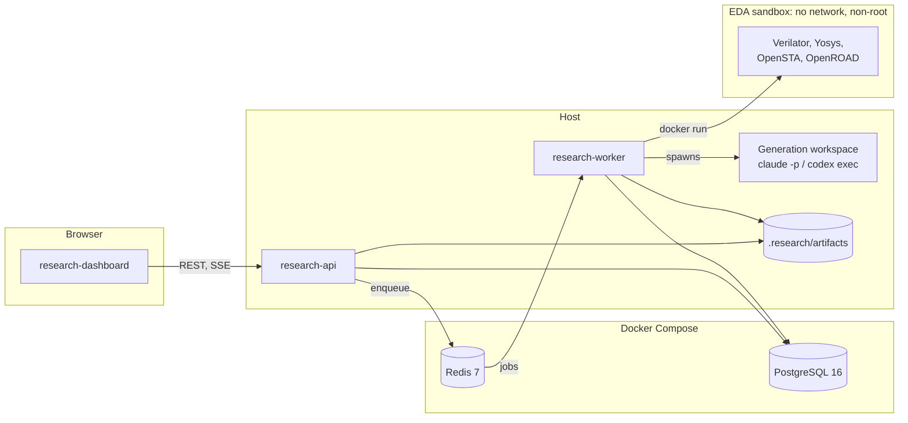
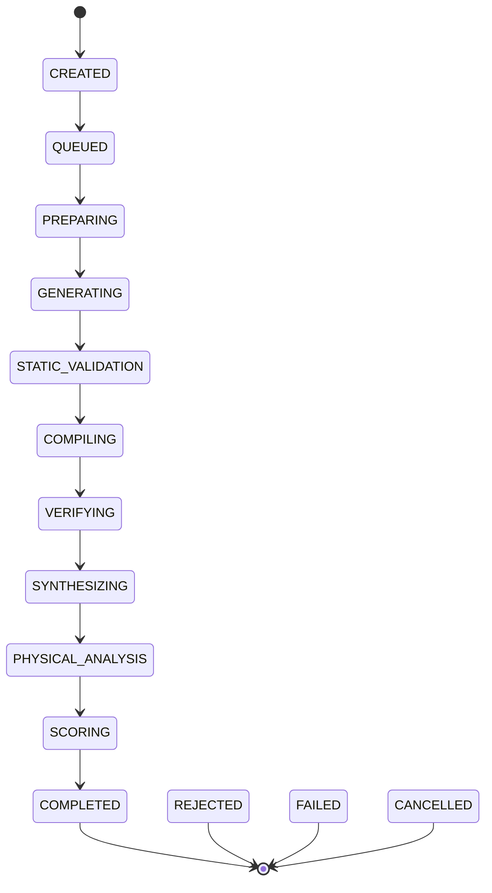

# Research engine architecture

The Silicon Lab Research Engine proposes RTL candidates, verifies them, measures them and archives every result, with no human in each step. Its first job is Campaign 001: minimise the area-delay product of the Project 3 processing element.

This document describes the planned system. Only the empty workspaces and Compose services exist so far; [the ticket map](README.md#build-order) shows what lands when. [research-workflow.md](research-workflow.md) describes how one experiment runs.

The two rules that shape the design:

- **Only the pipeline decides correctness.** Agents propose. They never mark a design verified.
- **Generated RTL is untrusted code.** It never runs on the host, and nothing that runs it has credentials.

## Components



| Workspace                  | Kind                 | Responsibility                                                                                            |
| -------------------------- | -------------------- | --------------------------------------------------------------------------------------------------------- |
| `@vcpu/research-core`      | Package, pure        | Domain types, Zod schemas, state machine, failure classes, metric model, ADP and Pareto math. No Node I/O |
| `@vcpu/eda-adapters`       | Package              | Verilator, Yosys, OpenSTA and OpenROAD adapters, report parsers, the sandbox command runner               |
| `@vcpu/artifact-storage`   | Package              | The content-addressed store interface and its local-disk implementation; S3-compatible storage can follow |
| `@vcpu/research-agents`    | Package              | Claude Code and Codex adapters over their headless CLIs, roles, versioned prompts                         |
| `@vcpu/experiment-runner`  | Package              | The staged pipeline, independent of the queue so it can run in a test                                     |
| `@vcpu/research-api`       | App, NestJS 11       | REST, OpenAPI, SSE, TypeORM entities and hand-written migrations                                          |
| `@vcpu/research-worker`    | App, BullMQ, on host | Orchestration, generation and evaluation workers                                                          |
| `@vcpu/research-dashboard` | App, Vite + React 19 | Campaigns, experiments, analytics and findings, using Tailwind 4, TanStack Query and Recharts             |

Workspace dependencies point one way: core, then adapters, storage and agents, then the runner, then the apps. `apps/web` and the Project 1 to 3 code do not change. Project 3's `make` targets and harness are called, never copied.

## Data flow

1. A client creates a campaign through the API, against one frozen baseline.
2. The API persists it and enqueues work in Redis. PostgreSQL is the source of truth, and Redis only schedules.
3. The orchestration worker moves each experiment through the state machine, persisting every transition.
4. The generation worker runs an agent in a generation workspace and collects the changed file.
5. The evaluation worker runs each EDA stage in a new sandbox container.
6. Stage outputs go to the artifact store by content hash, and parsed results go to PostgreSQL.
7. The dashboard reads the API and receives live updates over SSE.

## Data model

TypeORM entities with hand-written migrations under `apps/research-api/src/migrations/`; `synchronize` is always off. IDs are UUIDv7 strings generated in the app.

| Entity                                                                 | Holds                                                                         |
| ---------------------------------------------------------------------- | ----------------------------------------------------------------------------- |
| `ResearchProject`                                                      | A hardware target: name, architecture, baseline commit, interface version     |
| `ResearchCampaign`                                                     | A group of experiments: objective, baseline, constraints, budgets, status     |
| `Experiment`                                                           | One candidate's evaluation: parent, hypothesis, agent, seed, status, failure  |
| `DesignCandidate`                                                      | An immutable candidate: content hash, parent, changed files, patch artifact   |
| `VerificationResult`, `SynthesisResult`, `TimingResult`, `PowerResult` | What each tool reported, with its version and report artifact                 |
| `AgentRun`                                                             | One agent invocation: provider, model, prompt version, tokens, cost, duration |
| `ResearchFinding`                                                      | A finding, its supporting metrics and a confidence level                      |

Physical quantities are `numeric` with a separate unit column, or a JSONB metric object. A bare float without a unit is not allowed, and an unavailable metric is stored as unavailable, never as 0.

Two hashes prevent repeat work. `candidateHash` covers the sorted paths and normalised contents of the candidate's files. `evaluationConfigHash` covers the baseline id, tool versions, image digest, library, clock constraint and verification seeds and counts. An experiment whose pair of hashes already exists is not re-run.

## Experiment state machine



The diagram leaves out the other terminal edges for legibility. Every state from `CREATED` to `SCORING` can move to `CANCELLED`, and every state from `PREPARING` to `SCORING` can move to `REJECTED` or `FAILED`:

| Terminal    | Meaning                                                                                | Failure classes                                                        |
| ----------- | -------------------------------------------------------------------------------------- | ---------------------------------------------------------------------- |
| `COMPLETED` | Verified and scored                                                                    | None                                                                   |
| `REJECTED`  | The design failed a gate. Never retried                                                | `incorrect-design`, `unsupported-design`                               |
| `FAILED`    | The experiment could not finish. The first three classes get here once retries run out | `tool-failure`, `timeout`, `infrastructure-failure`, `budget-exceeded` |
| `CANCELLED` | A person or a campaign stop ended it                                                   | None                                                                   |

Stages are idempotent, so a restarted worker resumes from the last persisted state. Heartbeats let a recovery job find stale work.

An experiment with a supplied candidate, such as the deterministic fixture or a reproduction run, passes through `GENERATING` without invoking an agent and records that none ran.

## Metric tiers

Tiers are always labelled and never mixed in one comparison.

| Tier | Name                   | Tooling                                                 | Produces                                                               | Availability     |
| ---- | ---------------------- | ------------------------------------------------------- | ---------------------------------------------------------------------- | ---------------- |
| 0    | Technology-independent | Yosys generic synthesis using the steps of `generic.ys` | Cells, flip-flops, `$mul`, abstract gates, logic depth. Counts only    | Always           |
| 1    | Technology-mapped      | Yosys on `sky130_fd_sc_hd` typical corner, then OpenSTA | Cell area in µm², critical path in ns, WNS and TNS. The campaign's ADP | With the sandbox |
| 2    | Physical               | OpenROAD floorplan to route, STA and power              | Core area, routed WNS, congestion, estimated power                     | Optional         |

**ADP = area_µm² × critical_path_ns**, on Tier 1 only. The target clock period is measured once on the baseline, rounded up to a round number with about 10 % margin, and frozen in the baseline manifest. A candidate with negative slack at that period fails a hard constraint.

Every physical metric carries `{ value, unit, provenance, method, tool, toolVersion }`, where provenance is `measured`, `estimated`, `theoretical` or `unavailable`. Tier 2 numbers are never replaced by Tier 1 numbers. ADP and improvement % are computed only when baseline and candidate share an `evaluationConfigHash`; otherwise the comparison is `not-comparable`. Power is always an estimate here, because nothing measures a physical chip.

## Sandbox boundary

All EDA work on candidate code runs in the pinned `silicon-lab/eda-sandbox` image, built from `infrastructure/docker/eda-sandbox/Dockerfile`. Its digest goes in every reproducibility manifest. On Apple Silicon it may run as `linux/amd64` under emulation.

Each container runs with `--network none --read-only --cap-drop ALL --security-opt no-new-privileges`, a non-root user, and memory, CPU and PID limits. It has a tmpfs at `/tmp`, a read-only bind of the baseline, and read-write binds of the candidate workspace and output directory only. A wall-clock timeout ends in `docker kill`, and logs and artifacts have size caps. The golden model and harness are copied in read-only. The sandbox never gets `--privileged`, the Docker socket, a home directory or a credential file.

## Agent boundary

Claude Code and Codex run on the host, inside `research-worker`, using the person's own logged-in CLIs. Separating them from the sandbox keeps credentials away from untrusted code.

- **Workspace.** Each agent runs in a throwaway generation workspace holding only the baseline PE source and docs, the campaign brief, summarised prior findings and the one writable file.
- **Secrets.** The agent process never sees the API token, database URL or Redis URL.
- **After it exits.** The harness diffs the workspace. Any change outside the allowlist discards the candidate as `unsupported-design`, and the attempt is recorded.
- **Allowlist.** Campaign 001 allows exactly one file, `hardware/accelerators/matmul/rtl/processing_element.sv`.
- **Frozen contract.** The module name, parameters, every port's name, width and direction, the one-clock forwarding latency, `rst` and `clear` semantics, and the INT32 wrap-around accumulate may not change.
- **Protected paths.** Everything under `packages/`, `tb/`, `mk/`, `synth/`, `scripts/`, plus `Makefile`, `hardware/toolchain.env`, `hardware/asic/`, `research/baselines/`, `fixtures/` and all other RTL.

Because the worker needs both the Docker CLI and the agent CLIs, it runs on the host (`pnpm research:worker`). No container gets the Docker socket. Compose provides PostgreSQL and Redis, and may later provide the API and dashboard.

## Storage layout

```text
.research/                       local artifacts and databases, git-ignored
  artifacts/                     content-addressed store (RESEARCH_ARTIFACT_ROOT)
research/
  baselines/<name>/baseline.json frozen baseline manifests
  campaigns/<name>/campaign.json campaign configurations
  reports/                       generated reports
infrastructure/
  docker/compose.yml             PostgreSQL and Redis
  docker/eda-sandbox/            the sandbox image
  scripts/                       setup and helper scripts
```

## Conventions

- **API auth.** A bearer token from `RESEARCH_API_TOKEN` guards every mutating route and artifact download. The API binds to `127.0.0.1` by default.
- **Validation.** Zod schemas from `research-core` validate API input, campaign files and agent output.
- **Logging.** pino through `nestjs-pino`, as JSON lines.
- **Decorators.** `experimentalDecorators` and `emitDecoratorMetadata` are set in the API and worker tsconfigs only, because the worker loads the same entities. The base tsconfig stays as it is.

## Open points

The decisions file leaves these for the tickets that implement them:

- **Timing failures.** A candidate that misses the frozen clock is `REJECTED` for failing a hard constraint, but no failure class is named for it. VIRT-ZIH4RS settles this.
- **`policy-violation`.** The class exists, but the allowlist case is defined as `unsupported-design`, so no case uses it yet. VIRT-JAA90W and VIRT-W3M5PV settle this.
- **`budget-exceeded` in flight.** A limit pauses the campaign. This document records an experiment stopped by that limit as `FAILED`; VIRT-JAA90W confirms or changes it.
