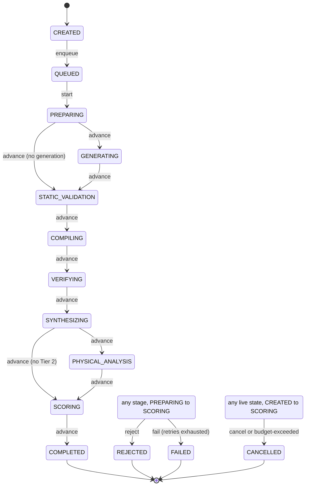

# Experiment state machine and orchestration

An experiment moves through a fixed set of states. The rules for which moves are legal live in one place, `@vcpu/research-core` (`src/state/`), and everything else asks it: the TypeORM repository, the worker, and later the API. The orchestration worker (`apps/research-worker`) runs each stage as a BullMQ job and survives crashes, restarts and lost jobs without running a completed stage twice.

## States



The eight states from `PREPARING` to `SCORING` are **stages**: a worker does work in them. `COMPLETED`, `REJECTED`, `FAILED` and `CANCELLED` are **terminal**: nothing leaves them.

## Events and the transition table

`transition(state, event)` returns the move or throws `InvalidTransition`. The table in `machine.ts` (`TRANSITIONS`) lists every legal move; anything not listed is refused. The unit tests offer every state every event (280 pairs) and check that exactly the 48 listed edges are accepted.

| Event             | Carries                                     | From                                   | To                                                         |
| ----------------- | ------------------------------------------- | -------------------------------------- | ---------------------------------------------------------- |
| `enqueue`         |                                             | `CREATED`                              | `QUEUED`                                                   |
| `start`           |                                             | `QUEUED`                               | `PREPARING`                                                |
| `advance`         | `to`                                        | A stage                                | The next stage of the plan, or `COMPLETED` after `SCORING` |
| `reject`          | a rejection class, a reason                 | A stage                                | `REJECTED`                                                 |
| `fail`            | a retryable class, `attemptsMade`, a reason | A stage                                | `FAILED`, only once the class's attempts are used up       |
| `cancel`          | a reason                                    | Any live state, `CREATED` to `SCORING` | `CANCELLED`, with no failure class                         |
| `budget-exceeded` | a reason                                    | Any live state, `CREATED` to `SCORING` | `CANCELLED`, with failure class `budget-exceeded`          |

The `advance` targets are explicit: `PREPARING` may go to `GENERATING` or skip it to `STATIC_VALIDATION`, and `SYNTHESIZING` may go to `PHYSICAL_ANALYSIS` or skip it to `SCORING`. No other stage can be skipped.

`fail` checks the retry policy itself, so the table cannot be used to fail an experiment that still has retries, and `reject` and `fail` refuse a class that does not belong to them.

### Stage plans

`stagesFor({ generation, physicalAnalysis })` gives the stages an experiment runs, in order. Both default to on:

| Plan                      | Stages                                                                                                                   |
| ------------------------- | ------------------------------------------------------------------------------------------------------------------------ |
| Default                   | `PREPARING`, `GENERATING`, `STATIC_VALIDATION`, `COMPILING`, `VERIFYING`, `SYNTHESIZING`, `PHYSICAL_ANALYSIS`, `SCORING` |
| `generation: false`       | Without `GENERATING`, for a run that never calls an agent                                                                |
| `physicalAnalysis: false` | Without `PHYSICAL_ANALYSIS`, when the sandbox has no Tier 2 flow                                                         |
| Both off                  | The six stages the kill-and-resume test uses                                                                             |

The worker takes its plan from `WORKER_SKIP_STAGES` (`GENERATING`, `PHYSICAL_ANALYSIS` or both), so every experiment one worker runs follows the same plan.

## Failure classes

| Class                    | Ends as     | Retried          | Typical cause                                                       |
| ------------------------ | ----------- | ---------------- | ------------------------------------------------------------------- |
| `incorrect-design`       | `REJECTED`  | Never            | Lint, unit, differential, randomized or structural gate failed      |
| `unsupported-design`     | `REJECTED`  | Never            | Interface or elaboration failure, a change outside the allowlist    |
| `policy-violation`       | `REJECTED`  | Never            | The candidate or the agent crossed a policy boundary                |
| `tool-failure`           | `FAILED`    | Up to 3 attempts | A tool crashed or wrote an unreadable report                        |
| `timeout`                | `FAILED`    | Up to 2 attempts | A stage ran past its wall-clock limit                               |
| `infrastructure-failure` | `FAILED`    | Up to 5 attempts | Docker, Postgres, Redis or the disk failed; a worker died mid-stage |
| `budget-exceeded`        | `CANCELLED` | Never            | A campaign limit was reached while the experiment was live          |

Two decisions here settle the open points the architecture left:

- **`budget-exceeded` ends as `CANCELLED`**, not `FAILED`. The experiment did not fail; the campaign stopped it. The class stays on the row and on the transition, so a report can still tell a budget stop from a person's cancel.
- **`policy-violation` ends as `REJECTED`**, like the other design results. The allowlist case remains `unsupported-design` (decisions §2); `policy-violation` is for what the campaign engine and agent adapters define as a policy breach.

A deterministic correctness failure is a result, not an outage. A stage reports it by **returning** `{ ok: false, failureClass }`, so it can never be confused with a crash, and `decideFailure` never retries it, whatever the attempt count.

## Retry policy

`DEFAULT_RETRY_POLICY` in `retry.ts` holds, per class, whether it retries, `maxAttempts` (every attempt of the stage, the first included) and an exponential backoff (`delayMs × 2^(attempt − 1)`, capped at `maxDelayMs`):

| Class                    | `maxAttempts` | First delay | Cap  |
| ------------------------ | ------------- | ----------- | ---- |
| `tool-failure`           | 3             | 2 s         | 30 s |
| `timeout`                | 2             | 5 s         | 30 s |
| `infrastructure-failure` | 5             | 5 s         | 60 s |
| all others               | 1             | none        | none |

`RetryPolicySchema` refuses a policy that makes any class other than the three transient ones retryable.

After a failed attempt `n`, `decideFailure(class, n)` answers one of: **retry** as attempt `n + 1` after the backoff, **reject**, **fail** (attempt `n` was the last), or **cancel** (`budget-exceeded`). Attempts count per stage, across classes: a stage that timed out once and then crashed has made two attempts.

## Persistence

`ExperimentRepository` (`src/ports/` in research-core) is the port; `TypeOrmExperimentRepository` in `apps/research-api/src/repositories/` implements it on PostgreSQL. The worker builds it with `createRepositories(dataSource)` from `@vcpu/research-api/repositories`, an entry point that loads no NestJS module.

`appendTransition(id, event)` makes each move atomic. In one database transaction it locks the experiment row (`SELECT … FOR UPDATE`), computes the move with `transition()`, updates `status`, `failure_class` and `failure_reason` (and `started_at` on `start`, `completed_at` on a terminal state), releases the lease, and inserts the `experiment_transition` row with the stage attempt that caused it. If the insert fails, the status change rolls back with it. Two options make it a compare-and-set: `expectedState` (the experiment must still be in that state) and `expectedLeaseOwner` (this worker must still hold the stage).

The migration `1793577600000-experiment-orchestration` adds the columns this needs:

| Column                          | Meaning                                                             |
| ------------------------------- | ------------------------------------------------------------------- |
| `experiment.stage_attempt`      | Attempts started of the current stage; 0 between stages             |
| `experiment.lease_owner`        | The worker holding the current stage, or null                       |
| `experiment.heartbeat_at`       | Refreshed while a stage runs; null once terminal                    |
| `experiment_transition.attempt` | The stage attempt that caused the move, or null when no attempt did |

## Orchestration

### Jobs

There is one queue, `experiments`, and one job per attempt of one stage. The job id is `<experimentId>:<stage>:<attempt>`. BullMQ will not add a job under an id it still holds, so enqueueing the same attempt twice is harmless, and a retry or a recovery gets a new id because its attempt is new. Finished jobs are removed (`removeOnComplete`, `removeOnFail`); the history lives in `experiment_transition` and the logs.

`enqueueExperiment(id)` moves a `CREATED` experiment to `QUEUED` and adds `<id>:PREPARING:1`. Each job then runs like this:

1. Load the experiment. A missing or terminal one ends the job.
2. Check the Redis cancel flag and the campaign. A flag, or a `CANCELLED` campaign, records `cancel` and ends the job.
3. If the experiment is `QUEUED` and this is the first stage, record `start`.
4. If the experiment is not in this job's stage, end the job: the stage was already done, or the job is a stale duplicate.
5. **Claim** the stage: `UPDATE … SET lease_owner, heartbeat_at, stage_attempt WHERE status = <stage> AND stage_attempt <= <attempt> AND (lease free, already ours, or heartbeat stale) RETURNING`. A worker that does not win ends the job.
6. Run the stage handler under its timeout, heartbeat and abort signal.
7. Persist the outcome. Success records `advance` and adds the next stage's job as attempt 1. A failure goes to `decideFailure`. A retry releases the lease and adds attempt `n + 1` with the backoff as the job's `delay`; any other decision records `reject`, `fail` or `budget-exceeded`.

Each step is safe to repeat, so BullMQ's own `attempts` (3, exponential from 1 s) only act as a safety net for the orchestration itself, such as Postgres being down while a result is written. Stage failures are never retried by BullMQ; they get a new job id from the retry policy.

### Stage handlers

A handler is `(context) => Promise<StageOutcome>`. The context carries `experimentId`, `stage`, `attempt`, an `idempotencyKey` (`<experimentId>:<stage>`), a pino logger and an `AbortSignal`. A handler must:

- **Be idempotent.** Before doing work, it checks for its own output under the idempotency key and reuses it.
- **Pass the signal to every command it starts**, for example with `spawn(…, { signal })`. A timeout, a cancel, a lost lease or a shutdown aborts it and kills the command. The EDA `CommandRunner` takes no signal yet; the pipeline ticket (VIRT-ZIH4RS) connects it.
- **Return a design failure, never throw it.** It may throw a `StageFailure(class, message)` for anything else. An unclassified exception counts as `infrastructure-failure`.

This ticket ships `createNoopHandlers` (every stage succeeds at once) and `createFixtureHandlers`, a deterministic set for tests. The fixture can script outcomes, run a real `sleep` command in one stage, and keep a JSON-lines journal shared across processes. `pnpm research:worker` runs the no-op set until the pipeline adds the real handlers, and logs a warning saying so.

### Timeouts

Each stage has a wall-clock limit: `STAGE_TIMEOUTS_JSON` per stage (for example `{"SYNTHESIZING": 600000}`), else `STAGE_TIMEOUT_MS`. When the limit is reached, the stage's signal is aborted and the attempt fails as `timeout`.

### Heartbeats and stale recovery

While a stage runs, the worker refreshes `heartbeat_at` every `HEARTBEAT_MS`. A refresh that finds the lease taken over aborts the stage and discards its result. BullMQ's job lock lasts `STALE_AFTER_MS` too, so the queue and the database agree on when a worker is dead.

A crashed worker is handled two ways:

- **The job is still in Redis.** BullMQ's stalled-job check moves the dead worker's active job back to the queue once its lock expires. Another worker (or the restarted one) runs it again. The heartbeat is stale by then, so the claim succeeds, and the idempotent stage redoes only its own work.
- **The job is gone**, for example when a worker died between committing a transition and adding the next job, or BullMQ gave up on a stalled job. The `stale-recovery` job scheduler runs every `RECOVERY_INTERVAL_MS` on its own queue, `experiments-recovery`. It finds live experiments (`QUEUED` and the plan's stages) whose heartbeat is older than `STALE_AFTER_MS` and whose current or next attempt is not waiting, delayed or active in the queue. It takes each one over with a conditional `UPDATE … WHERE heartbeat_at < threshold RETURNING`, so of two racing recoverers only one wins. A stage that never started is queued again as attempt 1. A stage that had started counts the dead attempt as an `infrastructure-failure`: it is queued as the next attempt, or `FAILED` once the infrastructure cap is reached. A stage that keeps killing its worker therefore cannot loop forever.

The scheduler also runs once as soon as a worker starts, so a restart recovers stale work at once.

### Cancellation

Cancellation has three parts:

- **A flag.** `cancelExperiment(id, reason)` sets `<prefix>:cancel:<id>` in Redis, with a one-week expiry. A job checks it before claiming a stage and again just after.
- **A message.** It publishes `{ experimentId, reason }` on `<prefix>:cancel`. Every worker subscribes, and the one running the experiment aborts the stage's signal, which kills the stage's command, then records `cancel`.
- **A direct write.** If no live worker holds the experiment (not started yet, between stages, or its worker is dead), `cancelExperiment` records `cancel` itself.

A cancel after a terminal state is ignored and logged.

### Concurrency

`WORKER_CONCURRENCY` sets how many stages one worker process runs at once (BullMQ `concurrency`). The integration test runs 6 experiments with a concurrency of 2 and checks that the in-flight counter never goes above 2. Choosing which experiments to run, and the campaign's `maxConcurrentExperiments`, belong to the campaign engine (VIRT-W3M5PV).

### Shutdown and failure of dependencies

| Situation                  | Behaviour                                                                                                                                                        |
| -------------------------- | ---------------------------------------------------------------------------------------------------------------------------------------------------------------- |
| `SIGTERM` or `SIGINT`      | Stop taking jobs and let running stages finish. After `SHUTDOWN_TIMEOUT_MS`, interrupt them: an interrupted stage is retried as `infrastructure-failure`. Exit 0 |
| Redis unreachable at start | Log `cannot reach Redis` and exit 1                                                                                                                              |
| Redis lost for over 30 s   | Log a fatal line and exit 1, so a supervisor restarts the worker                                                                                                 |
| Postgres down mid-stage    | The heartbeat logs and keeps trying. Writing the result fails, and BullMQ re-runs the idempotent job                                                             |
| Invalid configuration      | Log it and exit 2                                                                                                                                                |

### Logs

Logs are pino JSON lines on stdout. Every line about a stage carries `workerId`, `experimentId`, `stage` and `attempt`. Every transition is logged with `from`, `to`, `failureClass`, `reason` and the transition row id.

## Configuration

`pnpm research:worker` reads these from the environment or the repository's `.env`:

| Variable                | Default     | Meaning                                                          |
| ----------------------- | ----------- | ---------------------------------------------------------------- |
| `REDIS_URL`             | required    | Redis 7 (Compose)                                                |
| `DATABASE_URL`          | required    | PostgreSQL 16 (Compose), migrated with `pnpm research:migrate`   |
| `WORKER_CONCURRENCY`    | 2           | Stages one process runs at once                                  |
| `STAGE_TIMEOUTS_JSON`   | `{}`        | Per-stage limits in ms                                           |
| `STAGE_TIMEOUT_MS`      | 1,800,000   | Limit for a stage without its own                                |
| `HEARTBEAT_MS`          | 5,000       | Heartbeat interval                                               |
| `STALE_AFTER_MS`        | 60,000      | Heartbeat age that counts as dead; at least twice `HEARTBEAT_MS` |
| `RECOVERY_INTERVAL_MS`  | 30,000      | How often `stale-recovery` runs                                  |
| `SHUTDOWN_TIMEOUT_MS`   | 30,000      | How long shutdown waits before interrupting stages               |
| `WORKER_SKIP_STAGES`    | none        | `GENERATING` and/or `PHYSICAL_ANALYSIS`                          |
| `RESEARCH_QUEUE_PREFIX` | `research`  | Namespace of every Redis key                                     |
| `WORKER_ID`             | host:pid:id | Lease owner and log name                                         |
| `LOG_LEVEL`             | `info`      | pino level                                                       |

The worker runs on the host, not in Compose (see [architecture.md](architecture.md)). It runs from TypeScript source with `tsx`, using research-api's tsconfig, because the TypeORM entities need its legacy-decorator settings and `tsx` applies a tsconfig only to the files it includes.

## Tests

```sh
docker compose --env-file .env -f infrastructure/docker/compose.yml up -d postgres redis
pnpm --filter @vcpu/research-core test
DATABASE_URL=… REDIS_URL=… pnpm --filter @vcpu/research-worker test
```

The integration tests skip themselves unless both `DATABASE_URL` and `REDIS_URL` are set. Each test file migrates its own Postgres schema and uses its own Redis key prefix, and removes both afterwards. They cover:

- one transition row per status change, and a failed row insert rolling back its status change;
- an `incorrect-design` rejected after one attempt;
- a `tool-failure` attempted exactly `maxAttempts` times, then `FAILED`;
- a stage timeout retried as `timeout`;
- concurrency never above `WORKER_CONCURRENCY`;
- cancellation of a running stage killing its command and running no further stage;
- cancellation before the start, and a cancel ignored after the end;
- a stale heartbeat recovered within one scheduler tick;
- only one of several racing recoverers winning;
- a worker that keeps dying failing the stage at the infrastructure cap;
- a worker killed with `SIGKILL` in stage 3 of 6 and a second worker started. The experiment reaches `COMPLETED` with one transition row per boundary, the two completed stages are not run again, and only the interrupted stage is redone.
